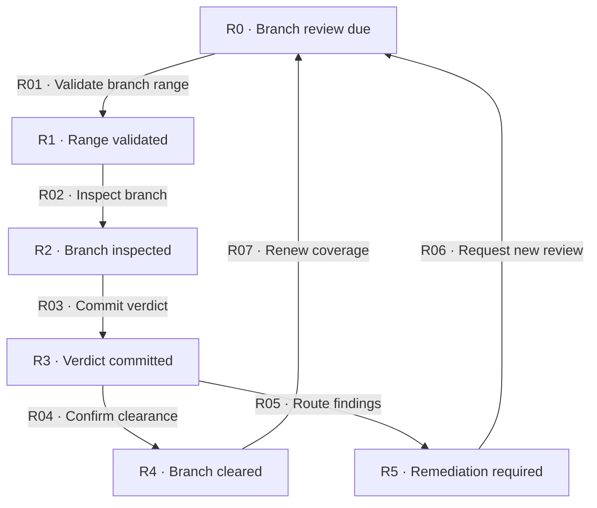

# Branch review

[Reference index](README.md) | Previous: [Task cycle](task-cycle.md) | Next: [Finish](finish.md)

## Step 5: review

The branch reviewer checks the complete change and its affected consumers. Task approval cannot prove that all tasks work correctly together.

### Responsibility and boundary

A full review starts from the complete branch diff. The reviewer also checks affected repository contracts, unchanged consumers, and required changes absent from the diff.

A remediation review checks cumulative corrections against a retained full-review baseline. It does not claim another full inspection.

The reviewer writes only `<change>/review.md`. The reviewer does not change code, tests, the plan, root task status, or task feedback.

### States

| State | Responsibility | Input evidence | Output or artifact | State contract |
| --- | --- | --- | --- | --- |
| R0 · Branch review due | Confirm task clearance and complete scope. | Plan, root ledger, and every task's current evidence. | Eligible branch-review request. | Every active task must be fully gated. |
| R1 · Range validated | Resolve the actual delivery target and merge base. | Explicit full target ref and complete branch package. | Verified Base, Head, and selected review scope. | An arbitrary ancestor is insufficient. |
| R2 · Branch inspected | Check integration, consumers, omissions, and requirements. | Full branch or valid cumulative remediation package. | Independently checked findings and proposed verdict. | A focused check resolves a concrete doubt only. |
| R3 · Verdict committed | Preserve the branch review result. | Complete pass and safe index state. | Root-review-only commit. | The physical last pass governs. |
| R4 · Branch cleared | Supply current clearance to finish. | Fresh durable approval and no unresolved blocker. | Verified finish handoff. | Finish still needs its own preconditions. |
| R5 · Remediation required | Retain every blocker and route each kind. | Requested-change finding set. | Numbered plan amendment, evidence adjudication, or intent revision request. | Never send branch code defects directly to a worker. |

### Transitions

| ID | From → to | Actor and operation | Input → output and artifacts | Gates and contract |
| --- | --- | --- | --- | --- |
| R01 | R0 → R1 | Reviewer validates the branch range. | Fully gated tasks and explicit target → actual merge-base range and scope. | [G17](gates.md#g17-task-clearance), [G19](gates.md#g19-branch-range), [G33](gates.md#g33-remediation-eligibility) for remediation. Reject task-scoped input without a review write. |
| R02 | R1 → R2 | Reviewer inspects the branch. | Verified package and approved intent → located findings and checked coverage. | [G19](gates.md#g19-branch-range), [G28](gates.md#g28-semantic-inspection). Inspect relevant omissions and affected consumers. |
| R03 | R2 → R3 | Reviewer commits the verdict. | Full or remediation pass → appended `review.md` and artifact-only commit. | [G16](gates.md#g16-verdict-durability). Preserve earlier passes and pre-existing staged work. |
| R04 | R3 → R4 | Coordinator confirms branch clearance. | Physical last approval and current material range → finish handoff. | [G20](gates.md#g20-branch-clearance). Neither `applied` metadata nor an earlier approval grants clearance. |
| R05 | R3 → R5 | Coordinator routes findings. | Complete typed finding set → responsible owners and preserved obligations. | [G18](gates.md#g18-finding-routes). Classify blockers even when coverage is stale. |
| R06 | R5 → R0 | Coordinator requests new review. | Gated remediation tasks or independently checked new evidence → full or eligible remediation request. | [G18](gates.md#g18-finding-routes), [G19](gates.md#g19-branch-range), [G24](gates.md#g24-recovery-and-retry). Changed intent requires full review. |
| R07 | R4 → R0 | Coordinator renews coverage. | New material change or changed required target range → new review request. | [G24](gates.md#g24-recovery-and-retry). Obtain new coverage when the actual required range changes. |

The common [hold contract](concepts.md#6-common-hold-and-recovery-contract) covers invalid, absent, skipped, unreachable, or undurable review evidence.

## Full and remediation contracts

| Item | Full review | Remediation review |
| --- | --- | --- |
| Purpose | Establish complete branch coverage. | Resolve retained blockers and bound correction impact. |
| Input range | Actual target merge base through reviewed Head. | Same whole range plus the cumulative delta from the retained full Head. |
| Required prior evidence | None for the first review. | Immutable modern full `changes-requested` pass and its artifact-only commit. |
| Inspection | Complete branch, affected repository consumers, integration, and omissions. | Every retained blocker, cumulative correction, affected consumer, and invariant. |
| Approval value | `approved` | `approved-remediation` |
| Output fields | Base, Head, Verdict, Scope, and Target. | Full fields plus Parent pass, Parent commit, Delta base, and Resolutions. |
| Failure route | Preserve findings and route by kind. | Preserve findings. Use full review when retained coverage cannot be verified. |

A remediation approval covers the exact union of blocker IDs from the full baseline and every scoped suffix.

Each resolution names the finding, located evidence, and an independent verification result. Resolution text cannot erase a historical blocker.

Every scoped Head must remain within the cumulative range. Missing or rewritten scoped history prevents bounded clearance.

## Material changes and verification

Material paths include code, tests, plans, intent, canonical specs, maps, skills, templates, scripts, and documentation.

The narrow exclusions are the change's root progress, task progress, task feedback, root review, and finish history.

The exclusion prevents a verdict commit from invalidating its own range. It does not permit arbitrary edits to execution records.

The reviewer runs a focused check only when a concrete behavioral doubt requires it. Routine full-suite tests and builds belong to finish admission.

A context label of `range-fresh; clearance-unverified` proves range coverage only. The coordinator must still verify target, scope, durability, and outstanding findings.
