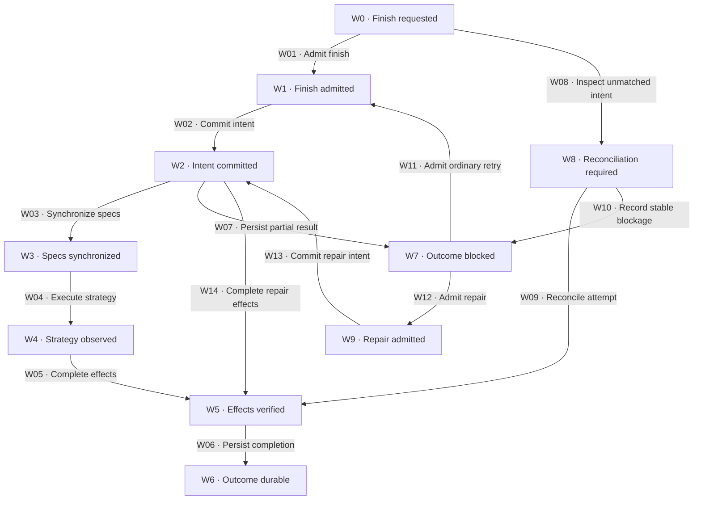

# Finish

[Reference index](README.md) | Previous: [Branch review](branch-review.md) | Next: [Gates](gates.md)

## Step 6: finish-work

The finish owner synchronizes canonical specs and performs one authorized finish strategy. The owner records intent before effects and observed results after effects.

A finish gate failure before admission creates no finish attempt. A failed effect after intent requires partial-state inspection and safe outcome persistence.

### States

| State | Responsibility | Input evidence | Output or artifact | State contract |
| --- | --- | --- | --- | --- |
| W0 · Finish requested | Inspect history and choose the applicable admission path. | Cleared change, strategy, and any existing `finish.md`. | New-attempt, recovery, or repair route. | Reconcile an unmatched attempt before new allocation. |
| W1 · Finish admitted | Bind current verified repository state. | Open precondition gate and read-only intent checks. | Verified HEAD, identities, planned spec targets, and compatible strategy. | No finish-owned write precedes admission. |
| W2 · Intent committed | Preserve the exact planned effects. | Complete admitted identities and approved input blobs. | Artifact-only `Attempt N` commit. | Verify this commit before the first effect. |
| W3 · Specs synchronized | Apply approved requirement deltas. | Approved artifacts and the same durable attempt. | Lint-valid canonical spec commit or verified no change. | Never repair requirement deltas during finish. |
| W4 · Strategy observed | Verify the selected Git, provider, or retention result. | Authorized strategy and current mutation boundary. | Observed delivery identity or no-op identity. | Command success alone does not prove the result. |
| W5 · Effects verified | Complete exact route, workspace, and history prerequisites. | Observed strategy result and recorded route intent. | Verified effect state on the surviving branch or base. | Do not claim rollback after partial failure. |
| W6 · Outcome durable | Preserve completion proof. | Every intended effect verified. | Separately committed `Outcome N` with `completed`. | Required remote history must also be present remotely. |
| W7 · Outcome blocked | Preserve the verified partial result. | Safe partial-state inspection after failure. | Paired `Outcome N` with `blocked` and remaining effects. | Do not report completion or repeat observed delivery. |
| W8 · Reconciliation required | Inspect an unmatched attempt. | Durable Attempt without a durable matching Outcome. | Observed completed, partial, absent, or ambiguous effects. | Continue only the same attempt when safe. |
| W9 · Repair admitted | Complete remaining effects after verified delivery. | `gate: repair-open` and exact original provenance. | Bound remaining-effects list and repair identity. | Repair cannot authorize delivery or cleanup again. |

W07 also applies after W3, W4, or a failed W5 operation. An unsafe or unpersistable partial result remains W8.

Repair uses W2 and W5 through W14 below. It cannot use W04 to perform another delivery.

### Transitions

| ID | From → to | Actor and operation | Input → output and artifacts | Gates and contract |
| --- | --- | --- | --- | --- |
| W01 | W0 → W1 | Finish owner admits finish. | Current task, review, intent, strategy, and workspace → verified gate-entry identity. | [G21](gates.md#g21-finish-admission), [G22](gates.md#g22-finish-intent), [G25](gates.md#g25-route-binding). Failure permits no finish write. |
| W02 | W1 → W2 | Finish owner commits intent. | Exact admitted identity and planned effects → verified artifact-only Attempt commit. | [G22](gates.md#g22-finish-intent), [G16](gates.md#g16-verdict-durability). The history commit precedes specs and external effects. |
| W03 | W2 → W3 | Finish owner synchronizes specs. | Approved deltas and exact target paths → canonical commit or no-change observation. | [G26](gates.md#g26-post-admission-boundary), [G29](gates.md#g29-spec-synchronization). Lint each changed spec before commit. |
| W04 | W3 → W4 | Finish owner executes the strategy. | Authorized compatible strategy → independently observed merge, request, or retained workspace. | [G26](gates.md#g26-post-admission-boundary), [G30](gates.md#g30-strategy-and-shipment). Do not infer effects from exit status. |
| W05 | W4 → W5 | Finish owner completes the effects. | Observed qualification → exact route/map update and verified workspace state. | [G25](gates.md#g25-route-binding), [G30](gates.md#g30-strategy-and-shipment). Preserve sibling units and shared workspaces. |
| W06 | W5 → W6 | Finish owner persists completion. | Verified effects → lint-valid, separately committed Outcome. | [G31](gates.md#g31-finish-outcome). Verify required remote persistence. |
| W07 | W2 through W5 → W7 | Finish owner persists the partial result. | Actual failed and completed effects → blocked Outcome and remaining effects. | [G31](gates.md#g31-finish-outcome). Stop forward effects before inspection. |
| W08 | W0 or interrupted W2 through W5 → W8 | Finish owner inspects unmatched intent. | Committed attempt and current Git/provider/filesystem evidence → reconciliation diagnosis. | [G24](gates.md#g24-recovery-and-retry), [G31](gates.md#g31-finish-outcome). Do not allocate a duplicate attempt. |
| W09 | W8 → W5 | Finish owner reconciles the same attempt. | Proof of existing effects or safe continuation → every effect verified. | [G26](gates.md#g26-post-admission-boundary), [G31](gates.md#g31-finish-outcome). Continue only the first unverified step. |
| W10 | W8 → W7 | Finish owner records stable blockage. | Verified failed or partial state → paired blocked Outcome. | [G31](gates.md#g31-finish-outcome). Ambiguous unsafe state stays held without invented history. |
| W11 | W7 → W1 | Finish owner admits an ordinary retry. | Changed condition before any verified delivery → fresh full admission. | [G21](gates.md#g21-finish-admission), [G24](gates.md#g24-recovery-and-retry). Allocate a new number after the existing pair. |
| W12 | W7 → W9 | Finish owner admits finalization repair. | Verified delivery and original provenance → `repair-open` and exact remaining effects. | [G32](gates.md#g32-finalization-repair). A removed source is not another merge input. |
| W13 | W9 → W2 | Finish owner commits repair intent. | Repair admission → new `reconcile-delivery` Attempt linked to original delivery. | [G32](gates.md#g32-finalization-repair), [G16](gates.md#g16-verdict-durability). Copy original identities and required retry evidence. |
| W14 | W2 → W5 | Finish owner completes repair effects. | Linked repair Attempt → only named canonical, route, map, or history effects. | [G32](gates.md#g32-finalization-repair), [G31](gates.md#g31-finish-outcome). Observe existing effects before idempotent reuse. |

### Strategy contracts

| Strategy | Responsibility and input | Required observation | Output and workspace contract |
| --- | --- | --- | --- |
| `local-merge` | Merge the admitted source into the resolved base under project rules. | The base contains the attempt and expected merge result. | Record route/map and Outcome on the surviving base. Remove only authorized, exclusive, clean, preserved workspaces. |
| `pull-request` | Push the admitted source and create the authorized pull or merge request. | Canonical URL, provider, repository, state, source, target, and request head. | Retain branch and worktree. Push route/map and Outcome commits. Verify the remote and request head. |
| `no-op` | Keep the workspace without external delivery. | The intended branch and worktree remain. | Do not merge, push, create a request, or delete a workspace. Commit local history. |

An open request satisfies shipment only when the route permits `request-open`. A merge condition requires an observed merge.

A no-op can advance a route unit only when its Shipping rules explicitly permit no-op qualification.

The map becomes shipped only after every route unit satisfies its shipment contract. Map status alone proves neither ownership nor shipment.

### Recovery limits

A blocked outcome before delivery can lead to a new ordinary attempt after fresh preconditions.

A blocked outcome after verified delivery can lead only to a provenance-bound repair. It cannot authorize another merge, request creation, or cleanup.

A failed repair needs changed, verifiable retry evidence. Dirty surviving files close automated repair, including exact owned route/map changes.

The owner must authorize preservation, restoration, or a scoped commit before repair admission can continue. The finish owner cannot manufacture cleanliness.

Legacy records remain unchanged. Missing original provenance prevents automated repair and requires owner adjudication.
