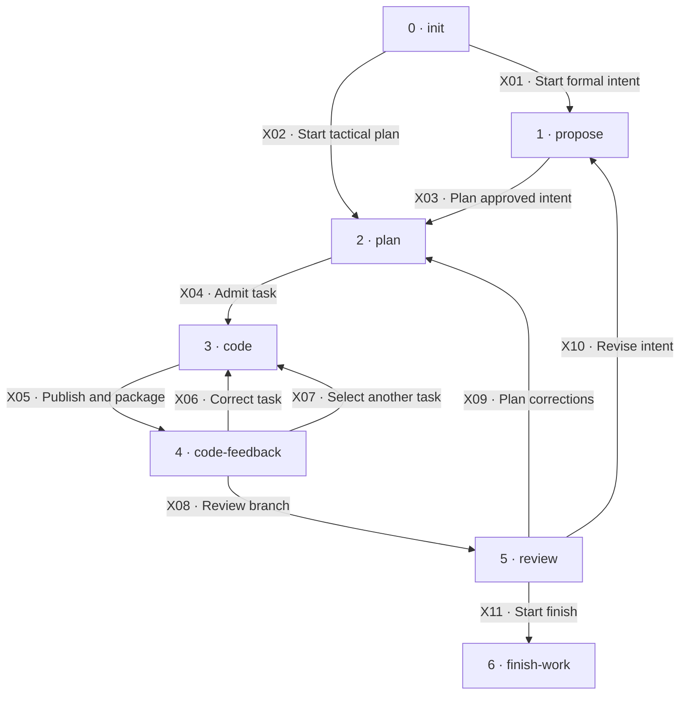

# Workflow map

[Reference index](README.md) | Previous: [Concepts](concepts.md) | Next: [Preparation](preparation.md)

## Core steps

The diagram shows step boundaries. The step documents show internal states. Edge labels name operations, not gate conditions.

A project reuses the result of step 0 for later changes. A tactical change starts at step 2 after project readiness.

Step 1 produces three artifact groups. Proposal, requirements, and design are internal work, not additional numbered core steps.

Steps 3 and 4 form a task cycle. Independent tasks can use compatible isolated lanes. The coordinator serializes integration and publication.

Step 5 judges the whole change. Step 6 requires a separate finish gate before any finish effect.

## Step contracts

| Step and owner | Responsibility | Inputs | Outputs and artifacts | Contract |
| --- | --- | --- | --- | --- |
| 0 · Init owner | Establish project standards and language. | Existing repository and requester facts. | `AGENTS.md`, workspace directories, and canonical glossary. | Preserve existing data. Resolve required facts before readiness. See [Preparation](preparation.md#step-0-init). |
| 1 · Intent owner | Define why, what, and how. | Request, canonical specs, glossary, standards, and optional route unit. | Approved proposal, requirement deltas, design, and exact approval references. | The requester approves exact revisions. See [Preparation](preparation.md#step-1-propose). |
| 2 · Planner | Define small tasks and their dependency graph. | Tactical request or approved formal intent. | Plan, root ledger, initialized task logs, and input records. | Preserve stable identities and completed definitions. See [Preparation](preparation.md#step-2-plan). |
| 3 · Worker and coordinator | Implement, verify, integrate, and publish one task. | Exact task contract and guarded admission. | Original worker commit, task attempt, and root publication. | Worker evidence does not grant root publication authority. See [Task cycle](task-cycle.md#step-3-code). |
| 4 · Task reviewer | Judge one stable task range. | Published task package and cited constraints. | Artifact-only feedback commit. | Approval requires independent, fresh, complete evidence. See [Task cycle](task-cycle.md#step-4-code-feedback). |
| 5 · Branch reviewer | Judge composition, consumers, and omissions. | Fully gated tasks and complete branch package. | Artifact-only root review commit. | A task review cannot replace branch review. See [Branch review](branch-review.md). |
| 6 · Finish owner | Complete the authorized strategy and preserve proof. | Exact task, review, intent, strategy, and repository evidence. | Canonical specs, paired finish history, and observed delivery or retention result. | Commit intent before effects. Verify effects before completion. See [Finish](finish.md). |

## Boundary transitions

The internal transition tables define the detailed operation contracts. This table defines the handoff between step owners.

| ID | From → to | Actor and operation | Input → output | Gates |
| --- | --- | --- | --- | --- |
| X01 | 0 → 1 | Requester starts formal intent. | Ready project and request → propose input. | [G02](gates.md#g02-project-readiness) |
| X02 | 0 → 2 | Requester starts a tactical plan. | Ready project and contract-preserving request → planning input. | [G02](gates.md#g02-project-readiness), [G04](gates.md#g04-change-path) |
| X03 | 1 → 2 | Intent owner supplies approved revisions. | Exact formal input commits and references → planning context. | [G05](gates.md#g05-formal-approval), [G06](gates.md#g06-critique-disposition) |
| X04 | 2 → 3 | Coordinator admits the selected worker. | Committed scaffold and current task inputs → bound task attempt. | [G07](gates.md#g07-plan-and-scaffold), [G08](gates.md#g08-input-standing), [G09](gates.md#g09-admission) |
| X05 | 3 → 4 | Coordinator publishes and packages the task. | Worker commit and integrated verification → task package with publication identity. | [G13](gates.md#g13-publication), [G14](gates.md#g14-task-range) |
| X06 | 4 → 3 | Coordinator requests a same-task correction. | Classified code defect → retry admission with the original Task Base. | [G18](gates.md#g18-finding-routes), [G24](gates.md#g24-recovery-and-retry) |
| X07 | 4 → 3 | Coordinator selects another ready task. | Current task clearance and graph → a separate task admission. | [G09](gates.md#g09-admission), [G17](gates.md#g17-task-clearance) |
| X08 | 4 → 5 | Coordinator requests branch review. | All active tasks fully gated → complete branch package. | [G17](gates.md#g17-task-clearance), [G19](gates.md#g19-branch-range) |
| X09 | 5 → 2 | Coordinator requests numbered remediation tasks. | Complete classified code-defect set → committed plan amendment. | [G18](gates.md#g18-finding-routes), [G23](gates.md#g23-plan-amendment) |
| X10 | 5 → 1 | Coordinator returns an intent defect. | Defective requirement or design → explicit revision request. | [G18](gates.md#g18-finding-routes), [G05](gates.md#g05-formal-approval) |
| X11 | 5 → 6 | Coordinator supplies current branch clearance. | Durable review and clean workspace → finish precondition input. | [G20](gates.md#g20-branch-clearance), [G21](gates.md#g21-finish-admission) |

A task intent defect can also return to step 1. A changed requirement can require a plan amendment before another task attempt.

Evidence-only findings return to the applicable reviewer after independent adjudication. They do not require invented tasks or code changes.

The [finding route table](gates.md#g18-finding-routes) defines these exception paths. The [common hold contract](concepts.md#6-common-hold-and-recovery-contract) applies at every boundary.

## Support boundaries

[Wayfinder](support.md#wayfinder) supplies an optional route before formal intent or planning. [Critique](support.md#critique) checks formal artifacts without granting approval.

[Orchestration](support.md#orchestration) coordinates the task cycle and branch review. It does not implement tasks or perform finish effects.

A controller hands current branch clearance to `kepler-finish-work`. Only that step owns finish side effects.
