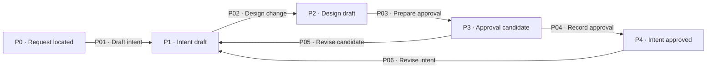
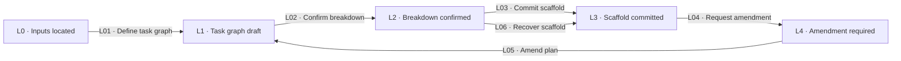

# Preparation

[Reference index](README.md) | Previous: [Workflow map](lifecycle.md) | Next: [Task cycle](task-cycle.md)

These steps establish the project, intent, and task contract. The common [hold and recovery contract](concepts.md#6-common-hold-and-recovery-contract) applies throughout.

## Step 0: init

The init owner prepares an existing repository. `kepler setup` installs global resources. It does not replace project initialization.

### States

| State | Responsibility | Input evidence | Output or artifact | State contract |
| --- | --- | --- | --- | --- |
| I0 · Unprepared | Identify project facts. | Existing repository and requester information. | Read-only observations. | Do not infer missing standards. |
| I1 · Facts known | Record commands, layout, style, Git rules, and boundaries. | Repository files and confirmed facts. | Draft `AGENTS.md`. | Preserve existing user content. |
| I2 · Workspace prepared | Preserve prior data and establish project language. | Standards and any legacy data. | `.kepler/specs/`, `.kepler/changes/`, and glossary. | Do not merge or delete migration sources. |
| I3 · Project ready | Supply standing context to later steps. | Valid glossary and resolved required facts. | Project readiness and disclosed non-blocking assumptions. | Unresolved material language prevents readiness. |

### Transitions

| ID | From → to | Actor and operation | Input → output and artifacts | Gates and contract |
| --- | --- | --- | --- | --- |
| I01 | I0 → I1 | Init owner inspects the project. | Repository and requester facts → sourced standards. | [G02](gates.md#g02-project-readiness). Separate observed facts from assumptions. |
| I02 | I1 → I2 | Init owner prepares the workspace. | Standards and legacy-path check → directories and created or preserved glossary. | [G03](gates.md#g03-preservation-and-attribution). Copy legacy data only when the canonical destination is absent. |
| I03 | I2 → I3 | Init owner confirms readiness. | Glossary lint and confirmed required facts → readiness handoff. | [G01](gates.md#g01-common-evidence), [G02](gates.md#g02-project-readiness). A glossary format check cannot confirm its meanings. |

## Step 1: propose

The intent owner defines the change through requester dialogue. Formal intent needs explicit approval over exact committed revisions.

### States

| State | Responsibility | Input evidence | Output or artifact | State contract |
| --- | --- | --- | --- | --- |
| P0 · Request located | Establish the change and workspace owner. | Request, standards, specs, and optional route unit. | Change identity and source/target roles. | Preserve an existing route binding. |
| P1 · Intent draft | Explain the problem and required behavior. | Sourced language and resolved scope. | Draft `proposal.md` and `requirements/`. | Separate current behavior from proposed behavior. |
| P2 · Design draft | Define the model, boundaries, and implementation approach. | Draft intent and compared approaches. | Draft `design.md`. | Assign affected responsibilities and contracts. |
| P3 · Approval candidate | Present the final artifact bytes. | Consistent artifacts and self-review. | Exact candidate revisions with approval metadata. | Candidate metadata does not create approval. |
| P4 · Intent approved | Supply immutable approval references. | Explicit requester decision over candidate bytes. | Committed formal inputs and approval references. | Later content changes need new approval. |

### Transitions

| ID | From → to | Actor and operation | Input → output and artifacts | Gates and contract |
| --- | --- | --- | --- | --- |
| P01 | P0 → P1 | Intent owner drafts intent. | Request and canonical context → proposal and capability deltas. | [G04](gates.md#g04-change-path), [G25](gates.md#g25-route-binding), [G03](gates.md#g03-preservation-and-attribution). Verify ownership before writes. |
| P02 | P1 → P2 | Intent owner designs the change. | Requirements and approach comparison → design. | [G28](gates.md#g28-semantic-inspection). Resolve material language and ownership. |
| P03 | P2 → P3 | Intent owner prepares approval. | Self-reviewed formal artifacts → exact final candidate bytes. | [G01](gates.md#g01-common-evidence), [G28](gates.md#g28-semantic-inspection). Correct contradictions before presentation. |
| P04 | P3 → P4 | Requester approves. Intent owner commits. | Exact candidate and explicit decision → approved commits and requester-held references. | [G05](gates.md#g05-formal-approval). Verify current bytes against each approved revision. |
| P05 | P3 → P1 | Intent owner revises the candidate. | Requester feedback or critique → corrected drafts. | [G28](gates.md#g28-semantic-inspection). Resolve critique findings without treating their verdict as requester approval. |
| P06 | P4 → P1 | Intent owner revises approved intent. | Located intent defect or authorized change → new drafts and revision scope. | [G24](gates.md#g24-recovery-and-retry). Preserve history and assess input impact before downstream work resumes. |

The intent owner hands the approved artifacts to the requester or controller. The propose skill does not start planning automatically.

## Step 2: plan

The planner defines independently verifiable tasks. The planner writes planning artifacts, not production code.

### States

| State | Responsibility | Input evidence | Output or artifact | State contract |
| --- | --- | --- | --- | --- |
| L0 · Inputs located | Select the formal or tactical path. | Request or approved artifacts and canonical specs. | Spec-impact decision and verified context. | A changed domain contract needs formal intent. |
| L1 · Task graph draft | Define goals, acceptance, dependencies, and checks. | Source inspection and binding intent. | Task definitions and input records. | Add dependencies for required results, not numeric order. |
| L2 · Breakdown confirmed | Obtain authority for the task breakdown. | Draft graph and quality review. | Requester confirmation or authorized unattended self-review. | Breakdown authority cannot approve formal intent. |
| L3 · Scaffold committed | Supply complete execution inputs. | Confirmed breakdown and initialization proof. | `plan.md`, root `progress.md`, and each initialized task log. | All new tasks start pending without attempts. |
| L4 · Amendment required | Preserve existing work while the planner revises scope. | Plan defect, changed input, or branch-review finding. | Amendment scope and preservation evidence. | Completed task definitions and history remain frozen. |

### Transitions

| ID | From → to | Actor and operation | Input → output and artifacts | Gates and contract |
| --- | --- | --- | --- | --- |
| L01 | L0 → L1 | Planner defines the task graph. | Current inputs and source inspection → task contracts and selected input blobs. | [G04](gates.md#g04-change-path), [G05](gates.md#g05-formal-approval), [G07](gates.md#g07-plan-and-scaffold). Each task states Goal, Acceptance, Depends on, Steps, Verify, and Commit. |
| L02 | L1 → L2 | Requester confirms the breakdown. An authorized unattended planner can self-review. | Complete task graph → breakdown authority and quality notes. | [G07](gates.md#g07-plan-and-scaffold). Unresolved structural defects require correction or an explicit design exception. |
| L03 | L2 → L3 | Planner commits the scaffold. | Final tasks and pre-write proof → plan, root rows, and pending logs. | [G07](gates.md#g07-plan-and-scaffold), [G08](gates.md#g08-input-standing), [G25](gates.md#g25-route-binding). Commit complete, lint-valid artifacts before dispatch. |
| L04 | L3 → L4 | Controller requests an amendment. | Located plan defect, input change, or classified finding → bounded revision request. | [G18](gates.md#g18-finding-routes), [G23](gates.md#g23-plan-amendment). Preserve active workers and partial work. |
| L05 | L4 → L1 | Planner amends the plan. | Approved revision scope → new task graph and reconciled input records. | [G23](gates.md#g23-plan-amendment), [G08](gates.md#g08-input-standing). Never renumber tasks or reuse an abandoned ID. |
| L06 | L2 → L3 | Planner recovers an interrupted initial scaffold. | Proven initialization and present files → only the missing initial files. | [G27](gates.md#g27-initial-scaffold-recovery). Context must report `scaffold-recovery: eligible`. |

Files is optional guidance in a version 2 task. Goal, Acceptance, approved intent, design, and project standards define the implementation boundary.

A plan amendment is not an implementation attempt. Only the planner can change the plan after task work starts.

Historical serial plans remain read-only to the current plan and orchestrate skills. See [Compatibility](maintenance.md#compatibility).
