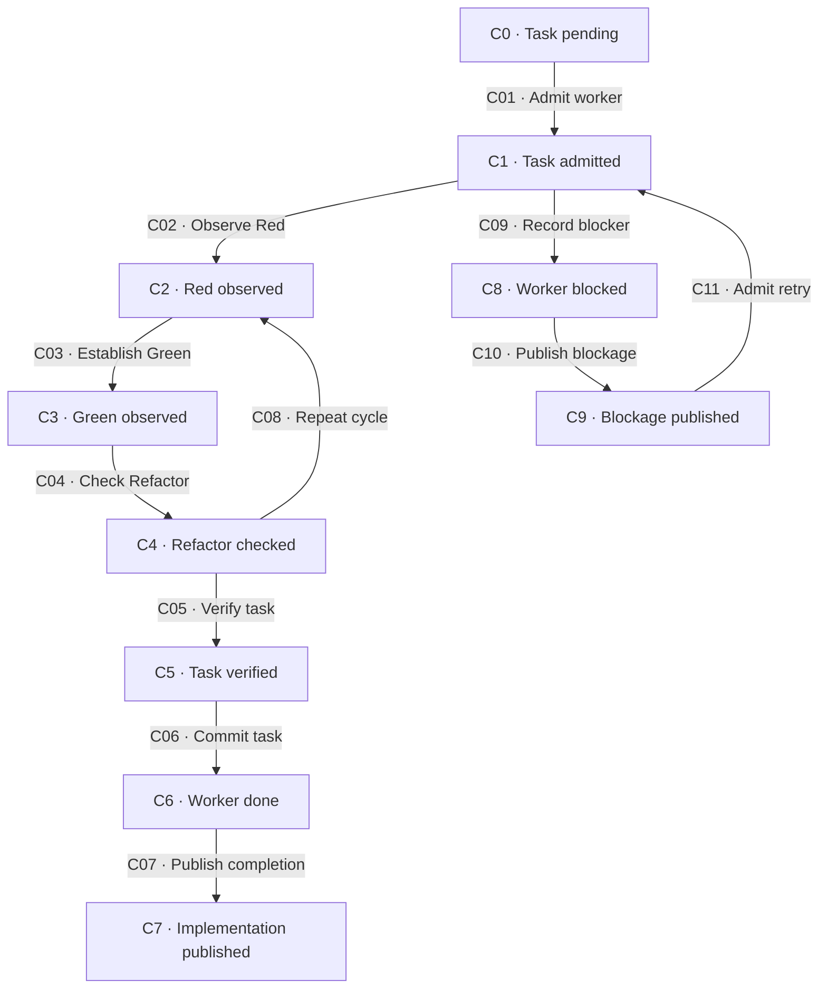
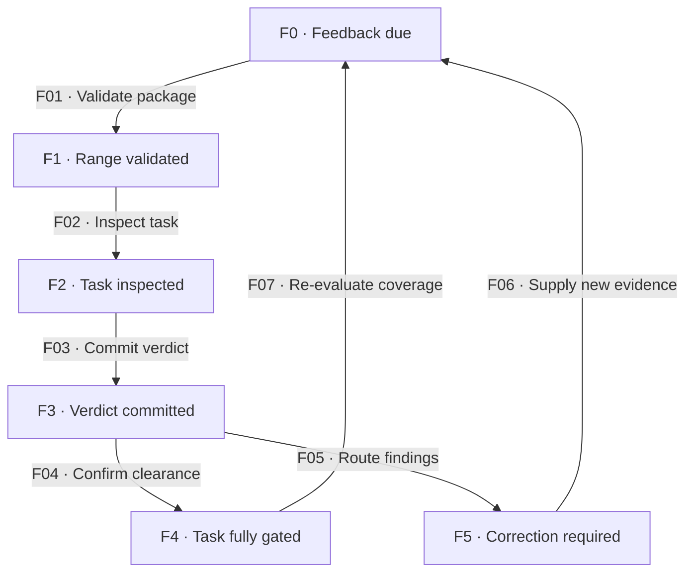

# Task cycle

[Reference index](README.md) | Previous: [Preparation](preparation.md) | Next: [Branch review](branch-review.md)

This chapter describes one task in a version 2 dependency plan. Its task identity remains unchanged through attempts and feedback passes.

The worker owns implementation and task-local evidence. The coordinator owns shared admission, integration, and root publication.

## Step 3: code

### States

| State | Responsibility | Input evidence | Output or artifact | State contract |
| --- | --- | --- | --- | --- |
| C0 · Task pending | Evaluate readiness without code writes. | Committed task, inputs, and prerequisite evidence. | Ready or held projection from context. | Readiness is not admission. |
| C1 · Task admitted | Confirm the exact worker and lane. | Guarded admission and independent identity readback. | Root `in-progress` and immutable Task Base. | The worker cannot publish root state. |
| C2 · Red observed | Demonstrate the pre-change defect. | Task contract and behavioral check. | Exact command and intended failure observation. | A broken test harness does not establish Red. |
| C3 · Green observed | Make the smallest passing implementation. | Red evidence and same behavioral check. | Passing result and goal-bounded code. | Green is not completion. |
| C4 · Refactor checked | Preserve behavior while the worker improves structure. | Green result and quality constraints. | Cleanup or explicit no-cleanup decision with regression results. | A behavior change returns to Red. |
| C5 · Task verified | Check all acceptance criteria and required verification. | Refactor result and exact task Verify. | Observed checks and self-review evidence. | Failed or unavailable required checks prevent completion. |
| C6 · Worker done | Preserve truthful terminal implementation evidence. | Verified implementation and exact attempt-start revision. | Original worker commit and appended task attempt with `Outcome: done`. | Root state remains coordinator-owned. |
| C7 · Implementation published | Supply the integrated range for feedback. | Original worker commit and successful integrated Verify. | Root `done` publication and review coverage. | Published completion does not release dependents. |
| C8 · Worker blocked | Record a terminal obstacle without losing partial edits. | Observed blocker during an active attempt. | Task-local `Outcome: blocked` and artifact-only worker commit. | Keep partial production edits uncommitted. |
| C9 · Blockage published | Preserve a truthful blocked root outcome. | Worker blocked evidence and guarded publication. | Root `blocked` publication. | Retry needs changed input and renewed admission. |

C09 also applies after Red, Green, Refactor, or verification. Common hold edges apply to every state.

### Transitions

| ID | From → to | Actor and operation | Input → output and artifacts | Gates and contract |
| --- | --- | --- | --- | --- |
| C01 | C0 → C1 | Coordinator admits the worker. | Ready task, observed worker, and lane → committed admission and root `in-progress`. | [G09](gates.md#g09-admission), [G11](gates.md#g11-dispatch-identity). Preserve the original Task Base. |
| C02 | C1 → C2 | Worker observes Red. | Planned check → intended failure before production edits. | [G10](gates.md#g10-scope-reservation), [G12](gates.md#g12-implementation-cycle). Record the actual result. |
| C03 | C2 → C3 | Worker establishes Green. | Red result → smallest implementation and passing same check. | [G10](gates.md#g10-scope-reservation), [G12](gates.md#g12-implementation-cycle). Do not broaden approved intent. |
| C04 | C3 → C4 | Worker checks Refactor. | Passing behavior → behavior-preserving cleanup and regression checks. | [G12](gates.md#g12-implementation-cycle). An explicit no-cleanup decision still needs checks. |
| C05 | C4 → C5 | Worker verifies the task. | Final code → exact Verify, other required checks, and acceptance evidence. | [G12](gates.md#g12-implementation-cycle). Required check failures prevent a done outcome. |
| C06 | C5 → C6 | Worker commits the task. | Verified code and phase evidence → original commit and one appended terminal attempt. | [G01](gates.md#g01-common-evidence), [G03](gates.md#g03-preservation-and-attribution). Record the admitted `Start HEAD`. |
| C07 | C6 → C7 | Coordinator publishes completion. | Original task commit → integrated code, exact Verify result, and root publication commit. | [G13](gates.md#g13-publication). Integrate original ancestry without rewriting worker history. |
| C08 | C4 or an active failed phase → C2 | Worker repeats the cycle. | Located correction → new Red, Green, Refactor, and verification evidence. | [G12](gates.md#g12-implementation-cycle), [G24](gates.md#g24-recovery-and-retry). Keep related cycles within the task. |
| C09 | C1 through C5 → C8 | Worker records a blocker. | Truthful obstacle → one terminal blocked attempt and partial-path report. | [G03](gates.md#g03-preservation-and-attribution). Do not commit partial production edits. |
| C10 | C8 → C9 | Coordinator publishes blockage. | Committed task-local blocked evidence → guarded root `blocked`. | [G13](gates.md#g13-publication). A missing response cannot substitute for worker evidence. |
| C11 | C9 → C1 | Coordinator admits a retry. | Resolved obstacle and preserved lane → new admission against the original Base. | [G09](gates.md#g09-admission), [G24](gates.md#g24-recovery-and-retry). Preserve all prior attempts and reservation use. |
| C12 | Active C1 through C5 → same phase | Coordinator reserves a necessary prerequisite. | Necessity, evidence, exact paths, and check → committed before-edit reservation. | [G10](gates.md#g10-scope-reservation). Reservation does not change approved intent. |

C12 is a bounded operation within an active attempt. The main-path diagram omits its self-edge.

### Checkpoint and interruption contracts

Task Base, coordinator source HEAD, admission commit, attempt start HEAD, and next coordinator HEAD are different identities.

A retry retains Task Base. The worker records the exact admitted attempt start as `Start HEAD`.

The ignored `.base` file is a cache. Verified admission history owns the checkpoint. Cache loss does not permit a new Base.

An interrupted, unavailable, or missing worker response creates no terminal attempt. The coordinator inspects the lane, commits, checkpoint, and actual task evidence.

The coordinator preserves the unresolved admission and partial work. A recovery can resume the original work or hold it for owner diagnosis.

## Step 4: code-feedback

The task reviewer supplies independent refactor-phase review. The reviewer does not repair code or change task status.

### States

| State | Responsibility | Input evidence | Output or artifact | State contract |
| --- | --- | --- | --- | --- |
| F0 · Feedback due | Assemble one task's review input. | Published implementation and task contract. | Stable package and feedback destination. | Use the numeric task ID. |
| F1 · Range validated | Confirm the immutable checkpoint and publication scope. | Task Base, integrated Head, Coverage, and commit manifest. | Verified review boundary. | Preserve earlier integration effects across corrections. |
| F2 · Task inspected | Judge criteria, code, tests, and phase evidence. | Complete attributed range and cited constraints. | Located findings and proposed verdict. | Inspect only a named outside risk when needed. |
| F3 · Verdict committed | Preserve the independent result. | Complete pass and safe index state. | Artifact-only `feedback.md` commit. | The physical last pass governs. |
| F4 · Task fully gated | Release eligible dependents. | Published completion, current approval, and cleared prerequisites. | Verified `fullyGated` projection. | Root `done` alone cannot establish this state. |
| F5 · Correction required | Preserve and route unresolved findings. | Current or stale requested-change findings. | Typed obligations and the responsible owner. | Staleness does not erase blockers. |

### Transitions

| ID | From → to | Actor and operation | Input → output and artifacts | Gates and contract |
| --- | --- | --- | --- | --- |
| F01 | F0 → F1 | Reviewer validates the package. | One task and publication package → verified Base, Head, and Coverage. | [G14](gates.md#g14-task-range). Reject whole-branch or mixed task input without a verdict write. |
| F02 | F1 → F2 | Reviewer inspects the task. | Range, constraints, and task attempt → independently checked criteria and findings. | [G15](gates.md#g15-task-inspection). Peer approval never hides new task changes in shared files. |
| F03 | F2 → F3 | Reviewer commits the verdict. | Located findings → appended pass and feedback-only commit. | [G16](gates.md#g16-verdict-durability). Preserve unrelated staged work. |
| F04 | F3 → F4 | Coordinator confirms task clearance. | Physical last pass and all task evidence → fully gated task. | [G17](gates.md#g17-task-clearance). Recompute dependency readiness. |
| F05 | F3 → F5 | Coordinator routes findings. | Complete blocker set → code, evidence, or intent owner. | [G18](gates.md#g18-finding-routes). Classify before freshness routing. |
| F06 | F5 → F0 | Coordinator supplies changed review input. | Verified correction publication or independently located evidence → new review request. | [G18](gates.md#g18-finding-routes), [G24](gates.md#g24-recovery-and-retry). Evidence-only feedback keeps the same Base, Head, and Coverage. |
| F07 | F4 → F0 | Coordinator re-evaluates lost clearance. | Changed required coverage → new feedback request or owner diagnosis. | [G14](gates.md#g14-task-range), [G24](gates.md#g24-recovery-and-retry). Do not rewrite the previous approval. |

A code defect returns through renewed admission and the same task's implementation cycle. A new publication precedes its new feedback pass.

An evidence gap can return to feedback without a code change. An intent defect returns to the intent owner before implementation continues.

A `skipped`, absent, undurable, or invalid pass cannot establish F4. Apply the common hold contract and obtain valid, changed review input.
