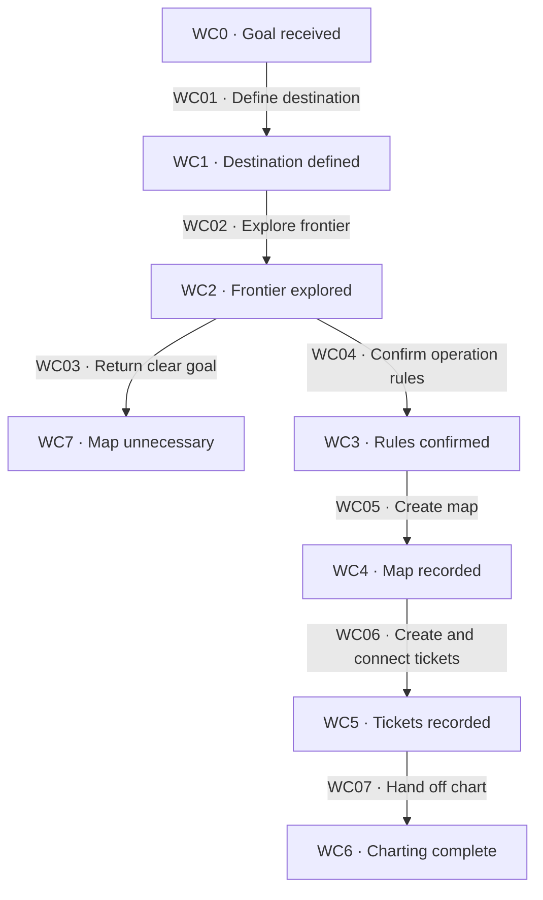

# Charting

[Reference index](README.md) | Previous: [Workflow map](lifecycle.md) | Next: [Ticket cycle](ticket-cycle.md)

Charting names the destination and explores the decision space. It creates a map only when some in-scope questions remain too uncertain to specify.

The Wayfinder owner loads grilling and domain modeling before the first question. Grilling receives the goal as content and a clear destination/frontier as its exit condition.

## States

| State | Responsibility | Input evidence | Output or artifact | State contract |
| --- | --- | --- | --- | --- |
| WC0 · Goal received | Locate the subject, project facts, and existing language. | Request, repository, and canonical glossary. | Dialogue context. | Look up available facts before asking the requester. |
| WC1 · Destination defined | Confirm what reaching the goal means. | One-question-at-a-time dialogue. | Destination and scope boundaries. | The requester resolves decisions. |
| WC2 · Frontier explored | Explore decisions breadth-first. | Destination and known dependencies. | Precise candidate questions and unspecified fog. | Charting does not answer or resolve tickets. |
| WC3 · Rules confirmed | Ask for per-effort operation rules. | Map need and requester preferences. | Confirmed rules or an explicit decision to leave them empty. | Notes remain descriptive context. |
| WC4 · Map recorded | Create the effort index on the observed branch. | Destination, fog, rules, and branch evidence. | Lint-valid `map.md` and any working glossary. | Initial map status is `open`; Decisions so far is empty. |
| WC5 · Tickets recorded | Create questions, then wire dependencies. | Questions that can be specified now. | Lint-valid ticket set in `tickets/`. | Each ticket starts `open`. Its type must fit the question. |
| WC6 · Charting complete | Supply orientation and available ticket choices. | Current map and ticket set. | Frontier and authorized research dispatch references, if any. | Charting grants no automatic permission for ticket work. |
| WC7 · Map unnecessary | Return a clear goal without a map. | Breadth-first exploration with no fog. | Explanation to the requester. | Do not manufacture uncertainty or ticket work. |

## Transitions

| ID | From → to | Actor and operation | Input → output and artifacts | Gates and contract |
| --- | --- | --- | --- | --- |
| WC01 | WC0 → WC1 | Wayfinder owner conducts destination dialogue. | Goal and known facts → requester-confirmed outcome. | [WG02](gates.md#wg02-charting), [WG10](gates.md#wg10-dialogue-and-decision-work). Load both required skills before questions. |
| WC02 | WC1 → WC2 | Wayfinder owner explores the whole frontier. | Outcome and boundaries → questions, blockers, fog, and exclusions. | [WG02](gates.md#wg02-charting). A precise question belongs in a ticket even when its answer depends on another question. |
| WC03 | WC2 → WC7 | Wayfinder owner explains that no map is needed. | No remaining fog → returned goal. | [WG02](gates.md#wg02-charting). Stop charting without inventing tickets or construction work. |
| WC04 | WC2 → WC3 | Requester supplies operation rules. | Explicit invitation → rules or empty section. | [WG02](gates.md#wg02-charting). Do not infer a commit or delegation rule from a preference in Notes. |
| WC05 | WC3 → WC4 | Wayfinder owner writes the map. | Confirmed context and observed branch → `<effort>/map.md`. | [WG03](gates.md#wg03-map-and-ticket-creation), [WG01](gates.md#wg01-evidence-and-preservation). Use the installed template and lint the map. |
| WC06 | WC4 → WC5 | Wayfinder owner creates tickets and connects blockers. | Precise questions → numbered ticket files, then dependency edits. | [WG03](gates.md#wg03-map-and-ticket-creation). Lint each creation and dependency mutation. |
| WC07 | WC5 → WC6 | Wayfinder owner supplies the chart and any authorized research handoff. | Valid artifacts and explicit research authority → frontier, dispatch references, and stopping point. | [WG04](gates.md#wg04-fixed-authorization), [WG08](gates.md#wg08-research). Creating a research ticket alone does not authorize dispatch. |

## Map body contract

| Section | Input | Output and responsibility |
| --- | --- | --- |
| Destination | Requester-confirmed outcome. | Brief destination; add the route link when closure completes. |
| Notes | Standing domain context and preferences. | Orientation only. Vocabulary belongs in the glossary. |
| Operation rules | Explicit requester instructions for sessions. | Binding rules for covered actions, or an empty section. |
| Decisions so far | Resolved tickets. | Initially empty. Later, one summary line links to each answer. |
| Not yet specified | In-scope uncertainty without a precise question. | Fog that can later become a ticket. |
| Out of scope | Explicit destination exclusions. | Boundaries that do not graduate into ordinary tickets. |

Record `branch` from the charting branch. On detached HEAD, record the repository's default branch and tell the requester.

The effort path is `.kepler/maps/<effort>/`. The slug is undated and identifies the effort across sessions.

## Ticket creation contract

Choose `research`, `prototype`, `grilling`, or `task` for each ticket. Size the question for one bounded session or investigation.

Create ticket files from `01`, using `NN-slug.md`. Create the set first, then connect its `blocked_by` references in a second pass.

A task ticket must name the decision that cannot proceed without its work. Work that can wait for delivery belongs in a route unit.

Charting can dispatch explicitly authorized research in parallel. The returned findings follow the [research return contract](investigations.md#research), not automatic human decision substitution.

The source's unconditional charting-dispatch wording needs qualification. [Maintenance](maintenance.md#known-source-gaps) records that tension with the explicit authorization rule.

## Failure and recovery

If dialogue stops before destination agreement, retain the known facts and open questions. Do not claim a completed chart.

If only part of the file set exists, inspect it before continuing. Preserve identities and correct missing links or dependencies without regenerating answered tickets.

Apply the [common hold contract](concepts.md#6-common-hold-and-recovery-contract). An empty frontier does not establish a cleared map.
