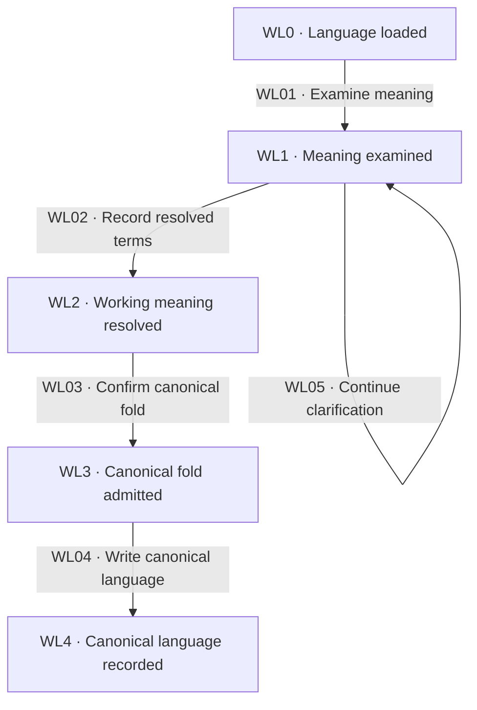

# Domain modeling

[Reference index](README.md) | Previous: [Investigations](investigations.md) | Next: [Route compilation](route.md)

Domain modeling maintains the language used by the destination, tickets, and route. It runs during charting and decision dialogue, not as another numbered SDD step.

A bounded context defines where a term has one meaning. The same word can have different meanings in different contexts.

## States

| State | Responsibility | Input evidence | Output or artifact | State contract |
| --- | --- | --- | --- | --- |
| WL0 · Language loaded | Read committed and current-effort language. | `.kepler/specs/glossary.md` and this effort's working glossary, when present. | Scoped context for discussion. | Do not read another effort's working glossary as current authority. |
| WL1 · Meaning examined | Challenge ambiguity and compare concrete cases. | Proposed term, relationship, source behavior, and context. | Clear alternatives or an explicit conflict. | Look up facts and surface contradictions. |
| WL2 · Working meaning resolved | Record a requester-resolved term and decision. | Explicit resolution and source. | Working glossary entry and ticket Answer. | Proposed language does not silently replace canonical language. |
| WL3 · Canonical fold admitted | Confirm any change to committed meaning. | Resolved entries, canonical comparison, and requester decision. | Exact confirmed fold scope. | Distinct context meanings and source links remain intact. |
| WL4 · Canonical language recorded | Create or edit the canonical glossary and lint it. | Confirmed fold scope and attribution evidence. | Valid canonical vocabulary. | Preserve existing content, format, and author. |

## Transitions

| ID | From → to | Actor and operation | Input → output and artifacts | Gates and contract |
| --- | --- | --- | --- | --- |
| WL01 | WL0 → WL1 | Language owner compares scoped meanings and scenarios. | Loaded terms and source facts → precise alternatives or conflict. | [WG10](gates.md#wg10-dialogue-and-decision-work), [WG11](gates.md#wg11-canonical-language). Translate between contexts before declaring a conflict. |
| WL02 | WL1 → WL2 | Language owner records requester-resolved working terms. | Confirmed meaning → current effort's glossary entry and ticket decision. | [WG11](gates.md#wg11-canonical-language). Create working files lazily; record sources and aliases. |
| WL03 | WL2 → WL3 | Requester confirms canonical meaning changes at closure. | Working entries and existing canonical terms → approved fold scope. | [WG11](gates.md#wg11-canonical-language), [WG12](gates.md#wg12-route-consistency). A newer term is not automatic replacement authority. |
| WL04 | WL3 → WL4 | Language owner folds confirmed vocabulary and validates it. | Confirmed scope → `.kepler/specs/glossary.md` and successful file-scoped lint. | [WG11](gates.md#wg11-canonical-language), [WG01](gates.md#wg01-evidence-and-preservation). Complete this before writing the route. |
| WL05 | WL1 → WL1 | Requester and language owner clarify an unresolved term. | Conflict or ambiguous scenario → further evidence and discussion. | [WG10](gates.md#wg10-dialogue-and-decision-work). Keep unresolved proposals outside canonical entries. |

## Working glossary contract

Use the domain-modeling skill's [glossary format](../../../skills/kepler-wayfinder-domain-modeling/references/GLOSSARY-FORMAT.md).

Record the term, bounded context, meaning, aliases, and source. Preserve separate definitions when contexts require different meanings.

Within a map, write resolved terms immediately into `<effort>/glossary.md`. The working glossary is not a recognized Kepler artifact and needs no Kepler lint.

The resolving ticket holds the decision and its reason. The working glossary holds vocabulary, not architecture or application behavior.

## Canonical glossary contract

The canonical glossary is an author-bearing requirements-spec. Its metadata envelope does not make it a place for production code or implementation decisions.

If the file is missing, use the installed glossary template. Read `git config user.name` and `git config user.email` before creation.

Record `author: Name <email>` from those values. Missing identity prevents creation; do not invent attribution.

When editing an existing glossary, preserve its recorded author, content, and format. Run `kepler workbench lint --file <spec-path>` immediately after mutation.

A successful lint result proves format. It cannot resolve a naming conflict or establish requester agreement.

## Standalone modeling and decision records

Outside a map, record requester-confirmed naming decisions directly in the canonical glossary's Decisions section. Link the affected term's Source to that record.

Do not create a map or ticket merely to record a term. Architecture decisions belong in the project's existing decision location.

If that location or its owner is unknown, ask before writing. Do not place architecture decisions in the glossary.

Record full reason, context, and alternatives for costly, surprising, or trade-off decisions. Otherwise, record at least one line explaining the chosen alternative.

A verdict without alternatives is sufficient only when no real alternative exists.

## Recovery

If the glossary fold succeeds but route creation fails, retain the valid canonical edit. Recheck the candidate and actual files before resuming closure.

A partial fold does not clear the map. Preserve unresolved terms and report the exact missing confirmation or lint failure.
