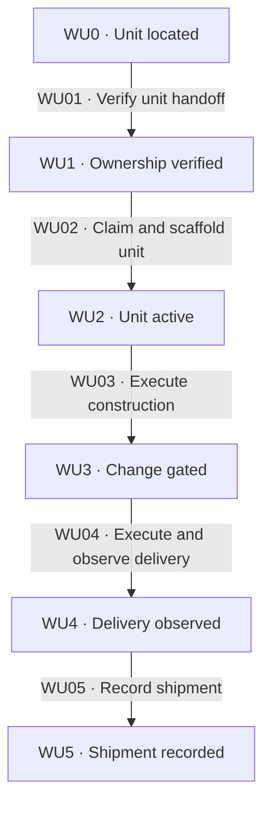

# Construction handoff

[Reference index](README.md) | Previous: [Route compilation](route.md) | Next: [Gates](gates.md)

A route unit is not a construction task. It defines one delivery outcome that can need proposal, design, planning, and several implementation tasks.

The route supplies direction and constraints. It does not replace formal approval, task admission, independent review, or finish authority.

## States

| State | Responsibility | Input evidence | Output or artifact | State contract |
| --- | --- | --- | --- | --- |
| WU0 · Unit located | Resolve exact route and unit identity. | Cleared map, route revision, and requester-selected outcome. | Named candidate unit. | Map summary alone does not prove availability. |
| WU1 · Ownership verified | Check dependencies, claims, source, and actual target. | Unit state, known changes, branch/worktree scan, and target history. | Eligible owner-bound handoff. | A claim is not a distributed lock. |
| WU2 · Unit active | Commit the unit claim with matching change scaffolding. | Authorized owner, source branch, and construction inputs. | Unit `in-progress`; first active unit changes map to `shipping`. | One owner per unit and one writer per change/worktree. |
| WU3 · Change gated | Complete construction's independent gates. | Approved intent or valid tactical path, tasks, feedback, and branch review. | Admitted finish candidate and exact planned effects. | Inception status cannot waive construction gates. |
| WU4 · Delivery observed | Execute the selected authorized strategy and read it back. | Finish intent and compatible Shipping rules. | Verified Git/provider effect or explicit no-op result. | Read back qualification before shipment updates. |
| WU5 · Shipment recorded | Advance the named unit and preserve proof. | Actual qualifying effect and unchanged binding. | Unit `shipped`, final map update when applicable, and finish outcome. | Preserve siblings, route body, and partial effects. |

## Transitions

| ID | From → to | Actor and operation | Input → output and artifacts | Gates and contract |
| --- | --- | --- | --- | --- |
| WU01 | WU0 → WU1 | Change owner verifies identity and eligibility. | Exact route/unit, dependencies, claims, source revision, and target → owner-bound candidate. | [WG15](gates.md#wg15-unit-admission). Inspect before new change-artifact or code writes. |
| WU02 | WU1 → WU2 | Change owner claims and scaffolds the unit. | Authorized eligible candidate → committed in-progress unit with matching change artifacts. | [WG15](gates.md#wg15-unit-admission), [WG16](gates.md#wg16-construction-boundary). Use a named source distinct from the actual target. |
| WU03 | WU2 → WU3 | Construction owners execute the SDD framework. | Bound unit and approved inputs → verified tasks, independent feedback, branch clearance, and admitted finish intent. | [WG16](gates.md#wg16-construction-boundary). Follow [construction preparation](../phase_construction/preparation.md), [task cycle](../phase_construction/task-cycle.md), and [branch review](../phase_construction/branch-review.md). |
| WU04 | WU3 → WU4 | Finish owner executes and observes the selected strategy. | Committed intent and actual target/provider → qualifying delivery readback. | [WG17](gates.md#wg17-shipment). Apply [construction finish](../phase_construction/finish.md); no route update before qualification. |
| WU05 | WU4 → WU5 | Finish owner records permitted shipment effects. | Verified delivery and exact identity → named unit advancement, scoped lint, commits, and outcome readback. | [WG17](gates.md#wg17-shipment), [WG18](gates.md#wg18-recovery). Complete final map shipment only after every unit qualifies. |

## Unit selection

For new, unbound work, select the first pending unit in frontmatter order. If it is blocked, report the exact prerequisite and stop.

Do not skip to a later unit without owner authority. An existing plan binding controls resume; a non-null proposal binding must agree.

Resume the same unit and change. An in-progress marker does not permit a different claim.

Each dependency must be shipped and reachable from the actual delivery base. Otherwise, wait for merge or obtain an explicit decision to branch from that work.

## Handoff payload

| Input | Producer | Consumer obligation |
| --- | --- | --- |
| Canonical map and route paths, effort, and unit ID | Wayfinder owner. | Resolve the exact unit. Do not infer identity from a title or a workspace suffix. |
| Route-source revision and input/base revision | Observed repository evidence. | Recheck actual bytes and history on admission and resume. |
| Destination contribution and Done when outcomes | Compiled route body. | Preserve outcome and unit-specific constraints in intent and planning. |
| Unit dependencies and backing tickets | Route metadata and current answers. | Verify prerequisite completion and reachability at the actual target, not only a `shipped` label. |
| Merge-back branch, repository, and qualification | Map branch and route Shipping rules. | Resolve full target identity and compatible finish strategy. Carry additional owner rules independently. |
| Owner, change identity, named source, and worktree | Requester/controller and current environment. | Prefer existing owner resume. Inspect competing or ambiguous claims before any write. |
| Canonical glossary and relevant decision evidence | Language and ticket owners. | Apply scoped meanings; keep unresolved product choices out of local implementation latitude. |

A project can start directly in construction when no map is needed. A route-backed change still selects the formal or tactical path under construction rules.

Formal artifacts need explicit requester approval over exact revisions. Route agreement cannot replace that formal approval.

## Unit and map lifecycle

| Operation | Unit field | Map field | Write boundary |
| --- | --- | --- | --- |
| Compile route | All units `pending`. | `open` → `cleared`. | Wayfinder owner closes planning. |
| Start first unit | Named unit `pending` → `in-progress`. | `cleared` → `shipping`. | Owner-bound source, with matching change scaffold. |
| Start another unit | Named unit `pending` → `in-progress`. | Remains `shipping`. | Preserve sibling units and verified dependency results. |
| Qualify a unit | Named unit `in-progress` → `shipped`. | Remains `shipping` until all units qualify. | Finish owner, after observed compatible effect. |
| Qualify final unit | Named unit `in-progress` → `shipped`. | `shipping` → `shipped`. | Verify every unit, then lint and persist each affected artifact. |

Route-level `status` accepts `open`, `shipping`, and `shipped`, but the source does not define its aggregate update procedure.

Do not infer an automatic route-level status transition from the map lifecycle. [Maintenance](maintenance.md#known-source-gaps) records this gap.

## Shipping qualification

| Qualification token | Required observation | Non-qualifying evidence |
| --- | --- | --- |
| `merge` | Actual compatible merge and target reachability. For a provider request, observe the merged result. | An open request or a local success claim alone. |
| `request-open` | Shipping rules permit this qualification; provider readback proves the canonical open request, head, source, and target. | An unverified URL, wrong target, or local outcome missing from the remote request. |
| `no-op` | The authorized no-op strategy preserves the workspace and meets the route's explicit condition. | Treating skipped work as delivered without the required condition and readback. |

Automated finish recovery requires exactly one canonical `- Qualification: <token>` line in Shipping rules. The token must match the admitted route condition.

Additional shipping rules remain binding. A token does not authorize push, merge, request creation, or cleanup without requester and project authority.

Updates travel on the owner-bound branch and surviving delivery location. With request-open qualification, shipment does not assert that production code has merged.

## Ownership and recovery

A designated requester/controller serializes claims and delivery. Inspect known proposals/plans, local and visible remote branches, and worktrees for the same unit.

A local scan cannot prove cross-clone exclusivity. Concurrent cross-clone claims and shipping are unsupported; do not add a lock service or second status database.

A competing claim requires owner-directed resume, authorized transfer, or a stop. Transfer or release requires partial-work and Git/provider inspection, history preservation, and fresh dependency checks.

Never reset verified shipment. Do not infer rollback from failed lint, a failed push, or an incomplete map update.

Between merges, the target's route copy can lag behind the owner branch. Verify actual source and unit revision rather than using that lag to create another claim.

Dirty, shared, or uncertain workspaces remain retained. Construction's [finish repair contract](../phase_construction/finish.md) governs partial delivery and finalization recovery.
