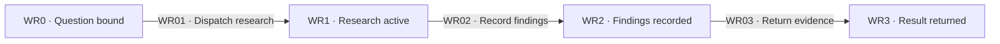
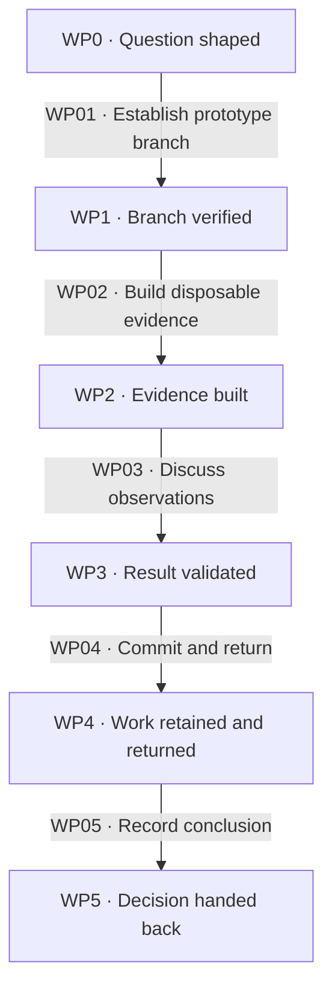
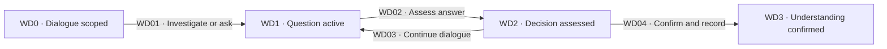
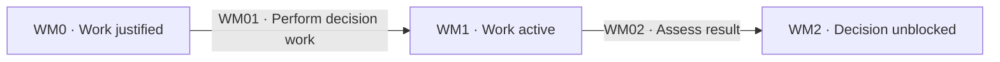

# Investigations

[Reference index](README.md) | Previous: [Ticket cycle](ticket-cycle.md) | Next: [Domain modeling](domain-modeling.md)

Each investigation answers one authorized question. The [ticket cycle](ticket-cycle.md) owns claims, answer writeback, consistency, and the fixed authorization set.

Load the matching skill before work begins. An evidence result does not authorize another ticket or construction work.

## Research

Research uses a background agent and primary sources. Official documentation, specifications, source code, and first-party APIs support the findings.

### States

| State | Responsibility | Input evidence | Output or artifact | State contract |
| --- | --- | --- | --- | --- |
| WR0 · Question bound | Identify the exact investigation and output path. | Authorized research ticket and destination. | Bounded research brief. | Preserve the question and prior authorization. |
| WR1 · Research active | Investigate in the background. | Loaded research skill and source access. | Source observations and run identity. | Dispatch does not resolve the ticket. |
| WR2 · Findings recorded | Trace each claim to its owning source. | Source passages and assessed evidence. | Markdown under `<effort>/research/`. | Disclose unsupported or conflicting conclusions. |
| WR3 · Result returned | Supply the findings for integration. | Saved findings and optional ticket pointer. | Answer candidate for the Wayfinder owner. | Notes stay outside Kepler lint; a ticket edit requires scoped lint. |

### Transitions

| ID | From → to | Actor and operation | Input → output and artifacts | Gates and contract |
| --- | --- | --- | --- | --- |
| WR01 | WR0 → WR1 | Wayfinder owner dispatches a background researcher. | Exact question and authorized output scope → observed run identity. | [WG06](gates.md#wg06-type-dispatch), [WG08](gates.md#wg08-research). Keep ticket ownership and researcher write scope explicit. |
| WR02 | WR1 → WR2 | Researcher records cited findings. | Primary-source evidence → one Markdown findings file. | [WG08](gates.md#wg08-research). Cite the source for each claim. Research notes are not recognized Kepler artifacts. |
| WR03 | WR2 → WR3 | Researcher returns evidence; Wayfinder owner assesses it. | Findings and any ticket pointer → supported answer candidate. | [WG08](gates.md#wg08-research), [WG07](gates.md#wg07-answer-and-consistency). Lint the ticket immediately after a pointer edit. |

A completed background result continues its prior authorization when absorbed. It cannot authorize product choices that still need a live requester exchange.

On failure or interruption, preserve the run reference and partial findings. Incomplete evidence leaves the ticket claimed; do not manufacture an Answer.

## Prototype

A prototype is a disposable artifact for one design question. Choose its shape from the question, project domain, and stack.

Use a logic probe for a state model. Use distinct alternatives for appearance or structure. Keep the artifact easy to run and show relevant state after actions.

### States

| State | Responsibility | Input evidence | Output or artifact | State contract |
| --- | --- | --- | --- | --- |
| WP0 · Question shaped | Select the smallest useful disposable form. | Authorized question and project context. | Logic probe, mockup, script, notebook, or equivalent. | Resolve ambiguity with the requester when available. |
| WP1 · Branch verified | Create or resume the prototype branch. | Starting branch and exact map/ticket identity. | Verified `prototype/...` branch. | No prototype code exists before this gate. |
| WP2 · Evidence built | Exercise the model or compare alternatives. | Disposable form and representative cases. | Runnable prototype with visible state. | No persistence by default; scratch storage only when needed for the question. |
| WP3 · Result validated | Discuss observations with the requester. | Actual artifact behavior and user exchange. | Verdict and question settled, or an explicit unresolved result. | Do not treat a prototype as production approval. |
| WP4 · Work retained and returned | Preserve the throwaway and return to the starting branch. | Outstanding prototype changes and known start branch. | Committed prototype branch and restored working branch. | Do not merge disposable code into the delivery branch. |
| WP5 · Decision handed back | Record the validated conclusion and branch pointer. | Observations and requester decision. | Ticket Answer and prototype reference. | Fold the decision on the returned branch; lint recognized edits. |

### Transitions

| ID | From → to | Actor and operation | Input → output and artifacts | Gates and contract |
| --- | --- | --- | --- | --- |
| WP01 | WP0 → WP1 | Prototype owner creates or resumes the branch and verifies it. | Starting branch and ticket slug → guarded prototype workspace. | [WG09](gates.md#wg09-prototype). A resumed result means continue existing work. |
| WP02 | WP1 → WP2 | Prototype owner builds the question-specific artifact. | Verified branch and bounded shape → disposable evidence. | [WG09](gates.md#wg09-prototype). Follow existing throwaway conventions; avoid production abstractions and polish. |
| WP03 | WP2 → WP3 | Requester and prototype owner discuss behavior. | Observed cases or alternatives → validated conclusion. | [WG09](gates.md#wg09-prototype), [WG10](gates.md#wg10-dialogue-and-decision-work). A failed experiment can answer the question without approving a design. |
| WP04 | WP3 → WP4 | Prototype owner commits outstanding work and returns. | Prototype changes → reachable prototype branch and starting branch readback. | [WG09](gates.md#wg09-prototype), [WG18](gates.md#wg18-recovery). Preserve unrelated changes and branch identity. |
| WP05 | WP4 → WP5 | Wayfinder owner records the validated conclusion. | Verdict, settled question, and branch pointer → ticket evidence. | [WG07](gates.md#wg07-answer-and-consistency). Write real decision records on the returned branch, not the prototype branch. |

### Branch operations

| Context | Command | Required readback |
| --- | --- | --- |
| Map ticket | `kepler workbench prototype <map-name> <NN-slug>` | Last line identifies `prototype/<map-name>/<NN-slug>`. Verify that exact branch. |
| Standalone question | `kepler workbench prototype --standalone <question-slug>` | Last line identifies `prototype/<question-slug>`. No map is required. |
| Before writes | `kepler workbench prototype --verify <branch>` | Successful verification of the expected prototype branch. |

When the CLI is unavailable, the skill permits equivalent Git creation or resume with the same naming and order. Confirm branch identity before writes.

Prototype files are unrelated outputs, outside Kepler lint. The prototype skill intentionally omits production tests and hardening for disposable code.

That exception applies only to the throwaway. Construction code retains the construction verification contract.

## Grilling

Grilling resolves requester-owned decisions through live dialogue. It takes content and an exit condition from the caller.

### States

| State | Responsibility | Input evidence | Output or artifact | State contract |
| --- | --- | --- | --- | --- |
| WD0 · Dialogue scoped | Establish content and completion condition. | Goal, question, findings, or approaches. | Explicit dialogue subject. | Ask for the subject when invoked without inputs. |
| WD1 · Question active | Separate available facts from requester decisions. | Current uncertainty and environmental evidence. | One question with a recommendation, or a looked-up fact. | Wait for the answer before the next question. |
| WD2 · Decision assessed | Check a concrete weakness once. | Requester answer, glossary, and known constraints. | Reaffirmed or revised decision and any reservation. | Accept a final reaffirmation; do not repeat the objection. |
| WD3 · Understanding confirmed | Record answers and return to the caller. | Met exit condition and requester confirmation. | Current decision in the directed artifact. | Do not act beyond the caller's authority. |

### Transitions

| ID | From → to | Actor and operation | Input → output and artifacts | Gates and contract |
| --- | --- | --- | --- | --- |
| WD01 | WD0 → WD1 | Dialogue owner looks up facts or asks the requester. | Content and exit condition → evidence or one recommended question. | [WG10](gates.md#wg10-dialogue-and-decision-work). Load domain modeling too for charting or a grilling ticket. |
| WD02 | WD1 → WD2 | Dialogue owner evaluates the answer. | User answer → specific objection once, or accepted decision. | [WG10](gates.md#wg10-dialogue-and-decision-work). Let the requester reaffirm or revise; do not invent their response. |
| WD03 | WD2 → WD1 | Dialogue owner addresses remaining uncertainty. | Accepted answer and unmet exit condition → next dependent question. | [WG10](gates.md#wg10-dialogue-and-decision-work). Do not reopen a final objection without new authority. |
| WD04 | WD2 → WD3 | Requester confirms understanding; owner records it. | Met exit condition → Answer or caller-directed record and return. | [WG07](gates.md#wg07-answer-and-consistency), [WG10](gates.md#wg10-dialogue-and-decision-work). Lint recognized edits immediately. |

A reversed decision must replace stale current truth in its artifact. Preserve its supersession history through the ticket consistency operation.

## Decision-enabling task

A task ticket performs manual work that a named decision needs now. Production work that can wait belongs downstream.

### States

| State | Responsibility | Input evidence | Output or artifact | State contract |
| --- | --- | --- | --- | --- |
| WM0 · Work justified | Name the decision and necessary work. | Authorized task ticket and dependency reason. | Bounded manual-work scope. | Do not substitute a delivery backlog item. |
| WM1 · Work active | Perform reachable work or give the human a precise checklist. | Scope, tools, and required human actions. | Observed results or pending human evidence. | A checklist alone does not prove completion. |
| WM2 · Decision unblocked | Assess the result with the requester. | Completed work and evidence. | Answer candidate and supported decision. | AFK work cannot replace a required human planning exchange. |

### Transitions

| ID | From → to | Actor and operation | Input → output and artifacts | Gates and contract |
| --- | --- | --- | --- | --- |
| WM01 | WM0 → WM1 | Ticket owner performs bounded work or hands off a checklist. | Decision need and authority → concrete results or precise human actions. | [WG06](gates.md#wg06-type-dispatch), [WG10](gates.md#wg10-dialogue-and-decision-work). This type requires no separate resolving skill. |
| WM02 | WM1 → WM2 | Ticket owner and requester assess the evidence. | Actual work result → supported Answer. | [WG07](gates.md#wg07-answer-and-consistency), [WG10](gates.md#wg10-dialogue-and-decision-work). Preserve unresolved items instead of inventing success. |

Every type returns through ticket writeback. A specialist's completed run does not by itself set the ticket to `resolved`.
