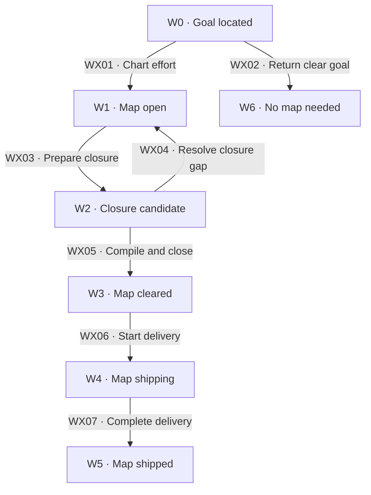

# Workflow map

[Reference index](README.md) | Previous: [Concepts](concepts.md) | Next: [Charting](charting.md)

## Phase states

| State | Responsibility | Input evidence | Output or artifact | State contract |
| --- | --- | --- | --- | --- |
| W0 · Goal located | Establish the destination and uncertainty. | Request and project context. | Charting scope. | Do not assume that a map is necessary. |
| W1 · Map open | Chart questions and resolve authorized tickets. | Destination, rules, ticket set, and current decisions. | Answers, working language, and revised frontier. | `map.status: open` includes both charting and ticket work. |
| W2 · Closure candidate | Check the synthesized destination and delivery boundaries. | Resolved tickets and remaining fog review. | Route candidate and glossary fold scope. | Keep the map open until closure completes. |
| W3 · Map cleared | Supply the static route. | Consistent route, confirmed language, and successful scoped lint. | Map `cleared`, route `open`, units `pending`. | Closure grants no construction permission. |
| W4 · Map shipping | Track owner-bound downstream changes. | Authorized unit claims and construction evidence. | Map `shipping` and active unit metadata. | Construction gates govern each change. |
| W5 · Map shipped | Preserve qualifying results for every unit. | Verified unit completion under Shipping rules. | Map and units `shipped`. | Aggregate status cannot replace delivery proof. |
| W6 · No map needed | Return a small, sufficiently clear goal to the requester. | Breadth-first dialogue finds no fog. | Explanation and possible construction input. | Charting does not invent tickets to justify a map. |

## Boundary transitions

| ID | From → to | Actor and operation | Input → output and artifacts | Gates and contract |
| --- | --- | --- | --- | --- |
| WX01 | W0 → W1 | Wayfinder owner charts the effort with the requester. | Goal and live dialogue → map, rules, working terms, and specified tickets. | [WG02](gates.md#wg02-charting), [WG03](gates.md#wg03-map-and-ticket-creation). See [Charting](charting.md). |
| WX02 | W0 → W6 | Wayfinder owner returns the clear goal. | Breadth-first exploration → no-map explanation. | [WG02](gates.md#wg02-charting). This ends charting without ticket resolution. |
| WX03 | W1 → W2 | Wayfinder owner prepares route closure. | Completed ticket writeback → current decision synthesis. | [WG07](gates.md#wg07-answer-and-consistency), [WG12](gates.md#wg12-route-consistency). See [Route compilation](route.md). |
| WX04 | W2 → W1 | Wayfinder owner returns an unresolved gap. | Contradiction or essential ambiguity → explicit question or new ticket. | [WG12](gates.md#wg12-route-consistency). New tickets need separate work authorization. |
| WX05 | W2 → W3 | Wayfinder owner folds terms and writes the route. | Consistent candidate and requester language decisions → canonical glossary, route, cleared map. | [WG11](gates.md#wg11-canonical-language), [WG13](gates.md#wg13-route-structure), [WG14](gates.md#wg14-closure-publication). |
| WX06 | W3 → W4 | Authorized change owner starts a route unit. | Exact eligible unit and delivery target → committed claim with matching change scaffold. | [WG15](gates.md#wg15-unit-admission). See [Construction handoff](handoff.md). |
| WX07 | W4 → W5 | Finish owner completes the last unit. | All qualifying unit results → verified aggregate shipment state. | [WG16](gates.md#wg16-construction-boundary), [WG17](gates.md#wg17-shipment). |

## Internal operation contracts

| Operation and owner | Responsibility | Inputs | Outputs and artifacts | Contract |
| --- | --- | --- | --- | --- |
| Charting · Wayfinder owner | Name the destination and explore the whole decision space. | Goal, repository facts, canonical language, and requester dialogue. | Map, initial tickets, and working terms. | Charting resolves no tickets. Research dispatch needs explicit authority. |
| Ticket cycle · Wayfinder owner | Apply one fixed authorization set. | Current map, exact request, and ticket dependencies. | Claimed tickets, answers, summaries, and consistency updates. | Recheck eligibility at each member's turn. |
| Investigation · Matching specialist | Produce evidence for one question. | Authorized ticket and type-specific inputs. | Cited research, prototype, dialogue decision, or manual-work result. | Result production and ticket resolution are separate boundaries. |
| Domain modeling · Language owner | Clarify scoped vocabulary. | Canonical and current-effort terms, facts, and requester decisions. | Working glossary and confirmed canonical entries at closure. | Preserve distinct context meanings and sources. |
| Route compilation · Wayfinder owner | Translate current answers into a self-contained delivery contract. | Destination, answers, language, rules, and boundaries. | Static route body and ordered unit metadata. | Structural lint cannot replace semantic review. |
| Construction handoff · Change and finish owners | Deliver one unit and verify its qualification. | Bound route revision, dependencies, owner, and downstream authority. | Construction artifacts, delivery evidence, and lifecycle metadata. | A cleared map cannot replace formal intent or finish gates. |

Inception is optional before construction. Delivery can span several changes and sessions after inception closes.

Map and route shipment tracking remains visible here because it completes the artifact lifecycle. Its execution belongs to construction owners.
