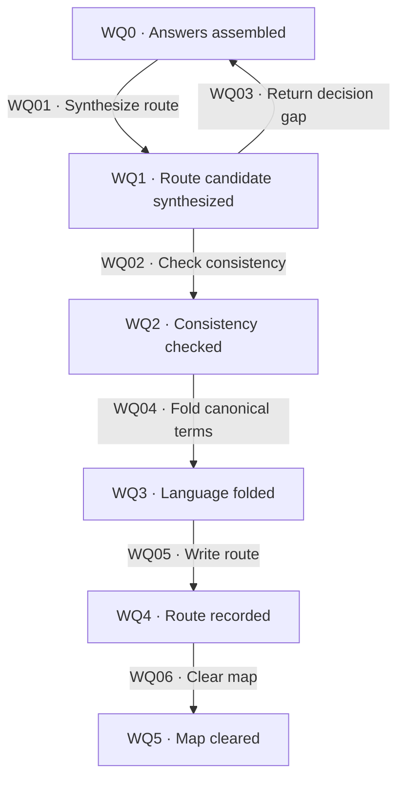

# Route compilation

[Reference index](README.md) | Previous: [Domain modeling](domain-modeling.md) | Next: [Construction handoff](handoff.md)

Route compilation closes decision work. It produces one static handoff for downstream delivery, not a task plan.

Compile the current truth from answers and their consequences. Do not copy ticket chronology or move detailed investigation history into the route.

## States

| State | Responsibility | Input evidence | Output or artifact | State contract |
| --- | --- | --- | --- | --- |
| WQ0 · Answers assembled | Read current decisions and remaining uncertainty. | Resolved tickets, map destination, glossary, rules, and exclusions. | Complete closure inputs. | Resolved statuses alone do not prove consistency. |
| WQ1 · Route candidate synthesized | Explain the causal path and self-contained destination. | Current answers and binding consequences. | Candidate route with coarse units. | Builder latitude contains only choices that cannot change the destination. |
| WQ2 · Consistency checked | Verify coverage, dependencies, and boundaries. | Candidate and complete decision evidence. | Semantically consistent candidate. | A contradiction or essential ambiguity keeps the map open. |
| WQ3 · Language folded | Promote confirmed working terms. | Scoped canonical comparison and requester confirmation. | Lint-valid canonical glossary. | Complete the glossary fold before writing the route. |
| WQ4 · Route recorded | Write and structurally validate the route. | Consistent candidate, confirmed language, and installed template. | Lint-valid `<effort>/route.md`. | Unit metadata and body identities agree. |
| WQ5 · Map cleared | Link the route and publish the planning handoff. | Completed route and final map writeback. | Lint-valid map with `status: cleared`. | This closing act does not start construction. |

## Transitions

| ID | From → to | Actor and operation | Input → output and artifacts | Gates and contract |
| --- | --- | --- | --- | --- |
| WQ01 | WQ0 → WQ1 | Wayfinder owner synthesizes current decisions. | Destination, current answers, glossary, rules, and exclusions → route candidate. | [WG12](gates.md#wg12-route-consistency). The point of departure explains causes, not session chronology. |
| WQ02 | WQ1 → WQ2 | Wayfinder owner reviews consistency. | Candidate and evidence → decision coverage, destination coverage, dependency order, and boundary confirmation. | [WG12](gates.md#wg12-route-consistency). This is a semantic check without a score or report section. |
| WQ03 | WQ1 → WQ0 | Wayfinder owner returns a decision gap. | Contradiction or essential ambiguity → new ticket or requester exchange. | [WG12](gates.md#wg12-route-consistency), [WG04](gates.md#wg04-fixed-authorization). Keep the map open; do not start a new ticket outside existing authority. |
| WQ04 | WQ2 → WQ3 | Language owner folds resolved terms with the requester. | Confirmed working language → canonical glossary and successful lint. | [WG11](gates.md#wg11-canonical-language). Preserve existing author and distinct scoped meanings. |
| WQ05 | WQ3 → WQ4 | Wayfinder owner writes the route. | Valid language and consistent candidate → `route.md` and exact unit metadata. | [WG13](gates.md#wg13-route-structure), [WG14](gates.md#wg14-closure-publication). Lint immediately after the write. |
| WQ06 | WQ4 → WQ5 | Wayfinder owner clears and links the map. | Valid route and resolved ticket set → map Destination link and cleared status. | [WG14](gates.md#wg14-closure-publication), [WG01](gates.md#wg01-evidence-and-preservation). Lint the map and apply any operation-rule commit requirement. |

## Route body contract

| Section | Responsibility | Required inputs → outputs | Boundary |
| --- | --- | --- | --- |
| Point of departure | Explain the starting situation and causal problem. | Goal and ticket questions → why this destination is necessary. | Exclude meeting chronology and unrelated uncertainty. |
| Destination | Make the required result self-contained. | Map outcome, current decisions, language, and scope → Outcome, useful Concrete shape, Guardrails and boundaries, Builder latitude. | Product and architecture uncertainty cannot hide in builder latitude. |
| Path chosen | Explain each binding choice. | Current ticket answers → choice, concise reason, consequence, and evidence link. | Keep detailed rejected alternatives and superseded reasoning in tickets. |
| Shipping rules | Carry delivery authority requirements forward. | Map branch and shipping-relevant Operation rules → actual target and delivery conventions. | Downstream readers must not need to reopen the map to find a shipping rule. |
| Units | Define coarse, causally ordered delivery outcomes. | Destination facets and constraints → contribution, observable Done when criteria, and unit-specific boundaries. | Units do not prescribe implementation steps. |

Use the five core sections from the installed template. Do not reject a lint-valid existing route merely because it has additional sections.

A unit's body states its outcome and constraints. Its frontmatter entry holds `id`, `name`, `status`, `depends_on`, and `backed_by`.

A new route has pending units. Route `status: open` is separate from map `status: cleared`; these fields have different value sets.

## Semantic and structural checks

| Check | Required evidence | Failure effect |
| --- | --- | --- |
| Decision coverage | Every decision that constrains the destination appears with its current consequence and ticket link. | Keep the candidate unclosed. Correct omissions or contradictions. |
| Destination coverage | The units together establish the destination and preserve its exclusions. | Revise coarse boundaries or resolve the missing decision. |
| Causal ordering | Required results precede dependent units; dependencies explain those needs. | Correct ordering and dependencies without inventing implementation tasks. |
| Scope | Units retain guardrails and stay within the destination. | Return scope changes to the requester. |
| Structural identity | Unique unit IDs, names, and order match numbered Units headings exactly. | Correct the route and rerun file-scoped lint. |
| Dependency graph | Unique, existing, non-self dependency IDs form an acyclic graph. | Correct the graph and rerun lint. |

Structural lint cannot prove semantic coverage or shipped, reachable prerequisites. Delivery admission checks prerequisites again at the actual target.

## Closure and recovery

Writing the route is the closing act after the last ticket resolves. It does not authorize the next map ticket or a delivery unit.

A failing gate leaves the map open. If a file write partly succeeds, preserve actual results and complete only the missing verified work.

The route body is static for downstream execution. A later decision correction belongs to the Wayfinder owner and needs explicit authority and impact review.

The source's unspecified “decision line” update is not permission for a delivery owner to rewrite the route. See [known source gaps](maintenance.md#known-source-gaps).
