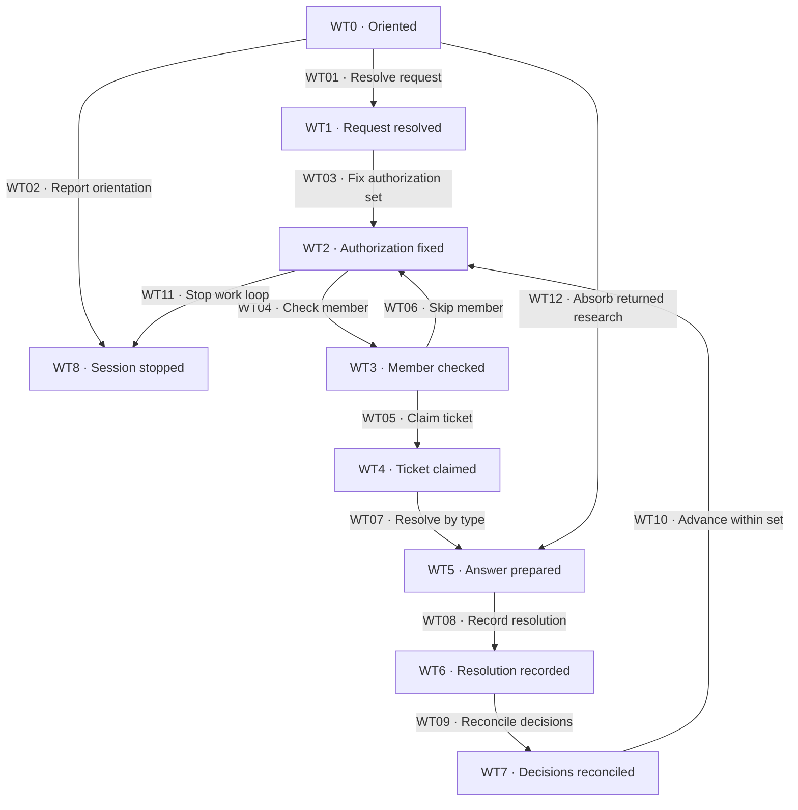

# Ticket cycle

[Reference index](README.md) | Previous: [Charting](charting.md) | Next: [Investigations](investigations.md)

The Wayfinder owner loads the map, its `branch`, and Operation rules before each work session. Orientation alone does not authorize ticket work.

Returned research can continue prior authorization. It does not authorize another ticket or enlarge the current work set.

## States

| State | Responsibility | Input evidence | Output or artifact | State contract |
| --- | --- | --- | --- | --- |
| WT0 · Oriented | Read current destination, decisions, rules, and fog. | Map and prior dispatch results. | Frontier and returned-research assessment. | No new claim from orientation alone. |
| WT1 · Request resolved | Resolve named ticket identifiers or the requested next frontier member. | Explicit requester instruction. | Exact selected identifiers and unknown-ID report. | Do not substitute another ticket for an unknown ID. |
| WT2 · Authorization fixed | Freeze membership and processing order. | Resolved identifiers. | Fixed authorization set in ticket file order. | Eligibility can change; membership cannot. |
| WT3 · Member checked | Reread the next member and its blockers. | Current ticket and every `blocked_by` ticket. | Eligibility result. | Check at its turn, not only at session start. |
| WT4 · Ticket claimed | Start the matching operation. | Eligible authorized ticket. | `status: claimed` and scoped lint result. | Claim before resolution work begins. |
| WT5 · Answer prepared | Obtain the type-specific result. | Research, prototype, dialogue, or decision-enabling work. | Evidence and current answer. | Background dispatch alone is not resolution. |
| WT6 · Resolution recorded | Record the answer and map summary. | Supported answer and source links. | Ticket `resolved`, Answer, and linked decision summary. | Complete and lint each recognized mutation. |
| WT7 · Decisions reconciled | Check previous answers and remaining uncertainty. | New result and map summaries. | Supersession records, revised summaries, new questions, and scope notes. | Newly created or unblocked tickets do not enlarge the fixed authorization set. |
| WT8 · Session stopped | Return the outcome of the fixed set. | Completed or skipped members and outstanding research. | Handoff or closure input. | No automatic next-ticket selection. |

## Transitions

| ID | From → to | Actor and operation | Input → output and artifacts | Gates and contract |
| --- | --- | --- | --- | --- |
| WT01 | WT0 → WT1 | Wayfinder owner resolves the request. | Named ID, batch, or next-frontier request → resolved tickets and excluded unknown IDs. | [WG04](gates.md#wg04-fixed-authorization). Next-frontier selection chooses the first eligible file. |
| WT02 | WT0 → WT8 | Wayfinder owner reports orientation. | No explicit work request → current frontier and stop. | [WG04](gates.md#wg04-fixed-authorization). No ticket claim or status change. Prior authorized research can still follow WT12. |
| WT03 | WT1 → WT2 | Wayfinder owner fixes the set. | Resolved IDs → immutable membership ordered by ticket file order. | [WG04](gates.md#wg04-fixed-authorization). A blocked named member stays in the set for its later turn. |
| WT04 | WT2 → WT3 | Wayfinder owner checks the next member. | Ticket and current blocker statuses → present eligibility. | [WG05](gates.md#wg05-ticket-claim). Reread every blocker immediately before the turn. |
| WT05 | WT3 → WT4 | Wayfinder owner claims the ticket. | Eligible authorized member → claimed ticket. | [WG05](gates.md#wg05-ticket-claim), [WG01](gates.md#wg01-evidence-and-preservation). Lint before further mutation or handoff. |
| WT06 | WT3 → WT2 | Wayfinder owner skips an ineligible member. | Resolved, claimed, or blocked member → report and skip without substitution. | [WG05](gates.md#wg05-ticket-claim). Membership stays fixed; advance the processing position. |
| WT07 | WT4 → WT5 | Matching owner performs the investigation. | Claimed question and loaded skill → supported answer. | [WG06](gates.md#wg06-type-dispatch) and the type-specific gate. A researcher returns later through WT12. |
| WT08 | WT5 → WT6 | Wayfinder owner records the resolution. | Valid result → ticket Answer, evidence pointer, resolved status, and map summary. | [WG07](gates.md#wg07-answer-and-consistency). Apply covered Operation rules, including any commit rule. |
| WT09 | WT6 → WT7 | Wayfinder owner reconciles decisions. | Current answer and prior summaries → corrected answers, history, summaries, and affected route decision line. | [WG07](gates.md#wg07-answer-and-consistency). Preserve old answers under Outdated decisions with a superseding-ticket link. |
| WT10 | WT7 → WT2 | Wayfinder owner advances within the fixed set. | Remaining authorized members → next processing position. | [WG04](gates.md#wg04-fixed-authorization). New eligibility does not authorize an outside ticket. |
| WT11 | WT2 → WT8 | Wayfinder owner ends the work loop. | Exhausted set or no next-frontier member → report and wait. | [WG04](gates.md#wg04-fixed-authorization). Completed map work can proceed to [route closure](route.md) as its closing act. |
| WT12 | WT0 → WT5 | Wayfinder owner absorbs returned research. | Completed prior authorized dispatch → findings assessment and answer candidate. | [WG08](gates.md#wg08-research). Verify dispatch identity and question. Preserve claims when results are incomplete. |

## Selection examples

| Request and current state | Fixed set | Required behavior |
| --- | --- | --- |
| Load the map. | None. | Report orientation. Start no ticket. |
| Work ticket `03`. It is blocked. | `03`. | Recheck blockers at its turn, then report and skip if still blocked. |
| Work `02` and `01`. `02` depends only on `01`. | `01`, `02` in file order. | Resolve eligible `01`, then reread `02`. It can start when `01` resolves. |
| Work `01`. Its answer creates `04`. | `01`. | Record `04`, but do not start it. |
| Work the next frontier ticket. No member is eligible. | None. | Report that no frontier ticket is available. Do not choose a blocked ticket. |
| Research for `05` returns after an authorized dispatch. | Prior dispatch authority for `05`. | Absorb that result without claiming another ticket. |

The set stays fixed even when members are skipped. The processing position advances; skipping does not substitute a new member.

## Consistency and uncertainty

After each resolution, inspect the map's decision summaries for contradictions. Open each affected ticket and preserve its old Answer under Outdated decisions.

Write the current answer and update its map summary. If a route already exists, update the affected unit's decision line without redesigning unrelated delivery scope.

Create newly precise questions as tickets and remove their fog entries. Keep questions outside the destination in Out of scope.

The source says to close a newly out-of-scope ticket but defines no `closed` status. Preserve its record and obtain owner direction; see [known source gaps](maintenance.md#known-source-gaps).

## Interruption and partial writeback

A claimed ticket has no automatic expiry. An interruption does not make it open, resolved, or available for a new owner.

Inspect its current answer, background run, branch, and map summary before resuming. The owner must direct any reassignment or release.

If the Answer exists but the map update failed, complete the missing writeback from observed evidence. Do not repeat the investigation or invent a second answer.

Take a claimed ticket as far as its type allows before ending the session. A dispatched research ticket can remain claimed while its bounded investigation runs.
