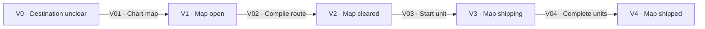

# Support operations

[Reference index](README.md) | Previous: [Artifacts](artifacts.md) | Next: [Reference maintenance](maintenance.md)

Support operations prepare decisions or coordinate core work. They do not add core step numbers or bypass core gates.

## Wayfinder

Wayfinder resolves uncertainty before a change needs formal intent or a task plan. It produces a map, decision tickets, and a compiled route.

### State contracts

| State | Responsibility | Inputs | Outputs and artifacts | Contract |
| --- | --- | --- | --- | --- |
| V0 · Destination unclear | Identify the required result and unresolved questions. | Request and project context. | Destination and candidate ticket frontier. | If no material uncertainty exists, no map is required. |
| V1 · Map open | Resolve authorized tickets. | Map, operation rules, and explicit ticket authorization. | Answers, research links, and decision summaries. | An orientation request alone authorizes no ticket work. |
| V2 · Map cleared | Compile current decisions into one route. | All resolved tickets and consistent destination. | Lint-valid route and confirmed canonical terms. | The route contains no unresolved product decision. |
| V3 · Map shipping | Track units through bound changes. | Route and owner-bound in-progress units. | Aggregate map and route state. | Downstream change owners retain their core gates. |
| V4 · Map shipped | Preserve verified destination completion. | Every route unit's qualifying result. | Aggregate shipped map and route. | Map status alone cannot prove shipment. |

### Transition contracts

| ID | From → to | Actor and operation | Input → output | Conditions and contract |
| --- | --- | --- | --- | --- |
| V01 | V0 → V1 | Wayfinder owner charts the map. | Destination dialogue → map, operation rules, and tickets. | Preserve requester rules. Apply [G01](gates.md#g01-common-evidence) and [G03](gates.md#g03-preservation-and-attribution). |
| V02 | V1 → V2 | Wayfinder owner compiles the route. | Resolved ticket set → glossary updates, route body, and unit metadata. | Apply the route compilation gate below. Lint every recognized artifact after mutation. |
| V03 | V2 → V3 | Bound change owner starts a unit. | Selected eligible route unit → committed in-progress claim with change scaffold. | Apply [G25](gates.md#g25-route-binding). Do not bypass a competing claim. |
| V04 | V3 → V4 | Finish owner completes the last unit. | Qualifying effects for every unit → shipped aggregate state. | Apply [G30](gates.md#g30-strategy-and-shipment). Preserve all unit identities and sibling evidence. |

The route body contains Point of departure, Destination, Path chosen, Shipping rules, and Units.

The frontmatter owns mutable unit identity, dependencies, backing tickets, and lifecycle state. Downstream owners do not rewrite the compiled destination.

### Ticket contracts

| State | Responsibility and evidence | Contract |
| --- | --- | --- |
| `open` | The question and `blocked_by` list define unresolved work. | Only open, unclaimed tickets with resolved prerequisites enter the frontier. |
| `claimed` | The authorized owner starts the matching support operation. | Claim before work. Research can remain claimed while its dispatched investigation runs. |
| `resolved` | An Answer and map summary preserve the result. | Retain source evidence and explicit supersession history. |

| ID | From → to | Actor and operation | Input → output | Conditions and contract |
| --- | --- | --- | --- | --- |
| V05 | open → claimed | Authorized ticket owner claims the ticket. | Explicit fixed authorization set and current eligibility → claimed ticket. | Recheck status and blockers at its turn. Do not substitute another ticket. |
| V06 | claimed → resolved | Ticket owner records the answer. | Matching operation result → Answer, source links, resolved status, and map summary. | Apply operation rules and artifact lint. Check conflicts with prior decisions. |
| V07 | resolved → resolved | Wayfinder owner records supersession. | New authorized decision → current Answer and explicit Outdated decisions. | Preserve the superseded evidence and update affected summaries. |

Newly created or unblocked tickets do not enlarge the fixed authorization set. A later session needs explicit authority for additional ticket work.

A claimed ticket has no automatic expiry or reopen transition. An interrupted claim requires owner diagnosis and explicit authority before reassignment.

### Support gate table

| Gate | Check owner | Required condition | Failure action |
| --- | --- | --- | --- |
| Route compilation | Wayfinder owner | All tickets are resolved. Decisions, destination coverage, causal dependencies, and boundaries agree. | Keep the map open. Resolve uncertainty before route creation. |
| Route structure | Wayfinder owner | Unit IDs and names match body order. Dependencies are unique, valid, non-self, and acyclic. | Correct structure and rerun lint. |
| Canonical language | Wayfinder owner and requester | Changed committed meanings have requester confirmation. Scoped terms retain sources and existing author metadata. | Preserve unresolved language outside canonical entries. |
| Ticket start | Ticket owner | The ticket belongs to the explicit fixed authorization set and is currently open, unblocked, and unclaimed. | Report and skip that member without substitution. |
| Ticket resolution | Ticket owner | The matching skill supplies the result. Prototype branch checks precede prototype code. | Do not claim unsupported resolution. |

These support conditions remain in tables, not diagram labels.

## Critique

Critique checks proposal, requirements, and design against each other and the repository. The reviewer writes findings, not fixes to the input artifacts.

| State | Responsibility | Inputs → outputs | Contract |
| --- | --- | --- | --- |
| Q0 · Critique requested | Establish the artifact scope. | Present formal artifacts, specs, glossary, and source → review scope. | Absent optional artifacts do not justify invented content. |
| Q1 · Findings prepared | Verify claims and classify located findings. | Read-only inspection → numbered findings and quality assessment. | Proposed code needs clear ownership. Existing-code claims need actual source proof. |
| Q2 · Disposition unresolved | Record the critique without inventing a user decision. | Report → `critique.md` with verdict and decision. | A skipped decision supplies no clearance. |
| Q3 · Disposition settled | Apply the supported owner decision. | Explicit decision and any applied corrections → settled critique. | Formal intent approval remains separate. |

| ID | From → to | Actor and operation | Input → output | Conditions and contract |
| --- | --- | --- | --- | --- |
| Q01 | Q0 → Q1 | Critique reviewer inspects artifacts. | Scoped inputs → located findings. | Verify logic, language, boundaries, source references, and structural quality. |
| Q02 | Q1 → Q2 | Critique reviewer records the report. | Validated findings or disclosed unattended findings → lint-valid critique. | Preserve the review-only boundary. Do not invent acceptance. |
| Q03 | Q2 → Q3 | Requester settles disposition. | Explicit decision and application evidence → settlement. | Apply [G06](gates.md#g06-critique-disposition). Return revisions to the intent owner. |

A settled critique can return to plan, code, or orchestration as applicable. It cannot waive exact requester approval of formal inputs.

## Orchestration

The coordinator operates across steps 3, 4, and 5. It hands current branch clearance to step 6.

Its input is the committed plan, ledger, task history, feedback, review, standards, and current Git evidence.

Its output is fully gated active tasks and durable current branch clearance. A blocker instead returns control to the responsible owner.

| State | Responsibility and evidence | Contract |
| --- | --- | --- |
| O0 · State loaded | Validate artifacts and derive current task readiness. | Conversation memory and todo status are not durable authority. |
| O1 · Lanes active | Admit compatible workers and inspect returned evidence. | Workers remain isolated. Only the coordinator mutates shared runtime state. |
| O2 · Task gates checked | Integrate, Verify, publish, and obtain independent feedback. | Root done cannot replace task clearance. |
| O3 · Branch gate checked | Obtain and validate the root review commit. | Every active task is fully gated first. |
| O4 · Finish handoff ready | Supply clean, current clearance to the finish owner. | The coordinator does not merge or create requests. |

| ID | From → to | Actor and operation | Input → output | Conditions and contract |
| --- | --- | --- | --- | --- |
| O01 | O0 → O1 | Coordinator selects and admits ready tasks. | Current graph and identities → isolated admitted lanes. | Apply [G08](gates.md#g08-input-standing), [G09](gates.md#g09-admission), and [G11](gates.md#g11-dispatch-identity). |
| O02 | O1 → O2 | Coordinator publishes and checks feedback. | Original worker outcomes → current task clearance or held findings. | Apply [G13](gates.md#g13-publication) through [G18](gates.md#g18-finding-routes). |
| O03 | O2 → O0 | Coordinator recalculates remaining work. | Changed task or feedback evidence → updated readiness. | Do not infer execution order from task numbers. |
| O04 | O2 → O3 | Coordinator obtains branch review. | All tasks fully gated → root review commit. | Apply [G19](gates.md#g19-branch-range) and [G20](gates.md#g20-branch-clearance). |
| O05 | O3 → O4 | Coordinator supplies the finish handoff. | Current approval and clean workspace → finish inputs. | The finish owner independently applies [G21](gates.md#g21-finish-admission). |
| O06 | O3 → O0 | Coordinator routes branch findings. | Complete classified blocker set → updated owner work. | Apply [G18](gates.md#g18-finding-routes). Never implement corrections in the controller. |

The todo list mirrors durable state. It does not approve a task, reserve a prerequisite, or publish a result.

## Other support skills

| Operation | Responsibility | Inputs → outputs and artifacts | Contract |
| --- | --- | --- | --- |
| Research | Answer a bounded external question from high-trust sources. | Question and destination path → sourced Markdown findings, often under `<effort>/research/`. | Distinguish findings from assumptions. Research cannot approve intent or resolve unrelated tickets. |
| Prototype | Test a design question with disposable code. | Specific question and branch context → throwaway artifact and observed conclusion. | Run the prototype branch gate before code. Do not treat the result as production implementation. |
| Grilling | Resolve user-owned ambiguity through dialogue. | Question, plan, or finding set → explicit decisions and unresolved questions. | The exit condition determines completion. Dialogue cannot fabricate requester approval. |
| Domain modeling | Maintain scoped language and explicit model decisions. | Project evidence and requester decisions → glossary or model updates. | Confirm material changes to canonical meanings. Keep unresolved meanings explicit. |
| Compose-spec | Author canonical capability documents outside the change pipeline. | Direct specification authority and source behavior → canonical `.kepler/specs/` files. | Do not infer authority to change a contract from source code alone. |

These operations have no additional core lifecycle states. Their durable handoffs use the map, ticket, glossary, or spec contracts above.
