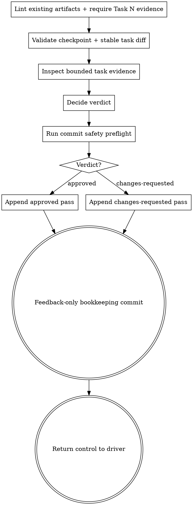

# Reviewing one implemented task

Review exactly one implemented plan task within its stable diff. Record a tactical verdict in its task-owned feedback history.

The **seven-stage core pipeline** is Kepler's fixed spec-driven sequence: init → propose → plan → code → code-feedback → review → finish-work. This skill is **step 4**, the tactical gate between task implementation and whole-branch review. Wayfinder and `kepler-critique` are optional, outside the seven-step core count.

**Judge, do not fix.** Inspect and report. Never modify implementation, tests, plan artifacts, or task status while performing code feedback.

## Refactor gate

This refactor-phase review is the refactor gate. Judge the behavior-preserving refactor against the assigned task, project standards, and the code-quality rubric. A passing test alone does not approve the refactor. When exception evidence replaces refactor evidence, judge whether the exceptional verification is justified and sufficient; do not approve it automatically.

## Inputs

Every invocation supplies exactly one existing active `Task N` from the change's `plan.md` and:

- The task block, including its acceptance criteria, task-local quality constraints and source, verified decision context or non-applicability, and cited requirements/design constraints. For a legacy task lacking quality fields, receive the same verified dispatch-supplied quality and decision context used by code, plus its latest attempt's criterion/check evidence. Verify it against the unchanged task, current approved intent, cited repository standards and local rubric; never require rewriting the frozen block or adding Acceptance/Files. New tasks carry the context in their own block, and legacy compatibility never waives the quality review.
- The code attempt's implementation context, including quality/decision evidence, red/green/refactor or exception evidence, and task-local verification results.
- A stable task diff package with the immutable Task Base, reviewed integrated HEAD, exact Coverage publication commit, and a manifest of each attempt's admission commit, Start HEAD, terminal HEAD, original task-owned commits, parent/path identities, and verified integration-delta history across corrections, including earlier publication effects. For a verified v1 publication, retain the broad Task Base-to-HEAD package and do not invent attempt coverage. This includes historical attempts and interrupted integrations whose exact narrow boundary cannot be recovered.
- The latest implementation evidence from `<change-dir>/tasks/task-N/progress.md`. This is the detailed claim source; no separate implementer report is required.
- The current task input standing from `kepler workbench context`. For `legacy-current-confirmed`, receive the scoped current confirmation and its exact current input blobs; `historicalInputs: "unknown"` means those blobs are not historical evidence. Judge the implementation against the current approved contract and located code, not reference strings or hashes alone.
- For a cumulative range containing prerequisites or peer work, bounded peer-approved commit/path context: peer task ID, full reviewed Base/Head, exact feedback commit/path and approval boundary, and each covered production commit with its changed paths. `none` means no peer context, never permission to omit unattributed changes. This evidence does not authorize new task obligations.
- The binding requirements and design constraints cited by the task.
- The change directory path.
- Project standards from `AGENTS.md` or its repository equivalent.

The numeric identity controls every task path. Never infer it from a title, accept multiple tasks, or crawl a sibling task's evidence. The only peer-evidence exception is independent readback of the exact committed approval artifact and commit/path context supplied for this cumulative range.

## References

Read this skill's `references/code-quality.md` from its directory and apply it proportionately to the task diff. This skill needs no other structural-quality rubric.

## Generation preflight

Run this no-write gate before task-scope inspection, diff validation, or verdict mutation. A change directory without `plan.md` is `pre-plan`, not legacy. Stop because no planned task can be reviewed; do not classify or scaffold it as an unsupported generation.

Once `plan.md` exists, run `kepler workbench lint --change-dir <change-dir>` before interpreting the existing artifacts. Its exit status is the single source of truth for their format and schema: a successful lint must not be overturned by a task-only-table rule, a comparison to a template, or a skill-specific `legacy-unsupported` classification. Root `<change-dir>/progress.md` may contain both frontmatter and a task ledger, as well as other lint-accepted content. On nonzero lint, report its findings without writing feedback.

Require the assigned active task's root status and existing `<change-dir>/tasks/task-N/progress.md` as evidence. If an input is absent, stop and name it; lint does not require absent files to exist. Check that the supplied task identity agrees with the plan, task evidence, and feedback destination. These are review scope checks, not an independent artifact-format validator. An absent assigned `feedback.md` is valid before creation; the first successful pass creates it. Run the task-specific scope and evidence checks below only after these checks.

## Wrong scope

Before inspection, require one exact positive numeric `Task N` that occurs once as an active plan task and matches the diff package, checkpoint, task progress heading, and destination path. A missing id, multiple ids, an abandoned task, a task-only identity mismatch, or whole-branch input is wrong scope. Stop without recording a verdict or changing an artifact. Direct whole-branch work to `kepler-review`.

## Bounded inspection

The stable task diff package is the inspection boundary. Judge changed lines against the task's acceptance criteria, cited requirements and design constraints, latest task-local implementation claims, project standards, and this skill's quality rubric.

Retain the original Base and full cumulative range on resume, including prerequisite/peer commits. Use commit-attributed review: enumerate `git log --reverse --format=%H <Base>..<Head>`, read each commit's changed paths and diff, and independently verify supplied peer approval by reading `git show <feedback-commit>:<feedback-path>` and that artifact-only commit's path list. Its recorded reviewed Base/Head must cover the claimed peer commits and be valid at the named approval boundary. Missing, stale-at-boundary, forged, or incomplete peer context supplies no exemption. Do not demand that old peer certification cover later Task N work: inspect those new commits yourself. Never exclude whole filenames, crop the range, or rebase onto the prerequisite. In overlapping files, distinguish certified peer changes from unapproved Task N changes by their actual commits; inspect both their diffs and the resulting code against Task N's unchanged contract. Unknown or out-of-scope changes require a located blocking finding or bounded adjudication, never assumed approval. A peer approval cannot clear a new Task N defect or replace this task's feedback.

Do not crawl the broader repository. If changed code raises one concrete, named risk in an unchanged consumer or contract, inspect only that named location. Identify the causal changed location and the exact outside location inspected. If that single check does not resolve the impact, report `cannot verify from diff`; do not widen the search.

## Process

1. Run the generation preflight and stop without inspection or writes unless it succeeds.
2. Validate the exact task identity; reject wrong-scope input before inspection or writes.
3. Validate the diff package and checkpoint. Require full commit identifiers and require the package Base to equal the CLI-verified historical task checkpoint, not only the ignored `.base` cache. The CLI checks all valid feedback Bases against the first parent of the earliest committed task attempt, then validates Base-to-Head and Head-to-current-`HEAD` ancestry. Stop on a missing, malformed, inverted, unreachable, or mismatched range.
4. Read only the assigned task block, its cited binding constraints, project standards, the latest physical attempt in that task's progress file, the supplied diff package, this skill's local rubric, and explicitly supplied peer commit/path context. Independently verify each peer feedback artifact-only commit, covered range and changed paths at its approval boundary. The assigned artifact identities must equal `Task N`; explicitly labelled peer IDs identify contextual evidence only, never a second task to review or mutate.
5. Inspect the complete task diff for correctness, meaningful tests, security, project idioms, structural quality, scope, hygiene, and boundary compliance. Verify the attempt's quality/decision evidence against the task-local constraint (or verified legacy dispatch-supplied record), its cited source, current approved intent, and located implementation/tests; hashes or a reported decision do not substitute for semantic review. Follow the bounded-inspection rule for any concrete outside risk.
6. Check every acceptance criterion and latest implementation claim against located diff or permitted-risk evidence. Claims never substitute for the diff.
7. Decide `approved` or `changes-requested` under the verdict rules.
8. Run the commit safety preflight and inspect the index before mutating the feedback artifact.
9. Append one complete pass to the assigned task's feedback history.
10. Make the path-limited artifact-only bookkeeping commit. Verify the committed path list and preservation of the pre-existing staged state before handoff.

An approved pass completes the refactor gate and returns control to the driver. Requested changes remain append-only and follow kind-specific routing before freshness checks. Confirmed code defects return the same task to a new correction cycle with relevant verification before a new verdict; evidence gaps require located-evidence adjudication, and intent defects return upstream. The reviewer never edits implementation or progress artifacts.

## Review dimensions

- **Correctness:** Every acceptance criterion and cited constraint is satisfied, including failure paths and edge cases represented by the task.
- **Tests:** Tests exercise observable behavior and would fail if the implementation regressed; none were deleted or weakened to force a pass.
- **Security:** The diff adds no secret, unsafe input handling, injection path, or sensitive output.
- **Idioms and standards:** Naming, structure, error handling, and style follow project standards.
- **Structural quality:** The changed code satisfies the local task-diff quality rubric without speculative redesign.
- **Scope and hygiene:** Attribute changes by commit and located evidence. A cumulative range may contain independently certified prerequisite/peer changes, including in the assigned task's files; do not hide overlapping new task changes or accept unrelated edits through a filename exemption. There are no stubs, dead code, debug output, TODOs, or commented-out blocks.
- **Boundaries:** The implementation does not cross a boundary forbidden by the plan or design.

Every Blocking finding names the exact file and location, explains the defect and required correction, cites the violated criterion or standard, and records `id: pass-N-blocking-M` plus one kind: `code-defect`, `evidence-gap`, or `intent-defect`. Preserve the first-occurrence identity and kind when carrying a finding forward; the kind guides routing but does not alter the verdict. For a legacy untyped finding, synthesize identity from its first physical pass without rewriting history. Keep `cannot verify from diff` as the legacy evidence-gap fallback, and adjudicate ambiguous kinds rather than inventing a code defect. Suggestions are optional improvements, not disguises for unresolved requirements.

## Verdicts

Use only these verdicts for a new feedback pass. A historical `skipped` pass may be lint-valid; it is not an approval and never advances the task.

- `approved` when all acceptance criteria and binding constraints are verified, the reviewed range is valid, and Blocking contains no findings.
- `changes-requested` when any correctness, test, security, standards, scope, boundary, or structural defect blocks acceptance.

Every unresolved `cannot verify from diff` item is a blocking finding under `changes-requested` until located evidence or code resolves it. Never issue `approved` while such an item remains unresolved, and never demote it to Suggestions. The driver may either return a confirmed code gap to the same task's code step or provide located evidence and dispatch a new feedback pass against the same head. Only a new complete pass without the unresolved item may approve.

## Commit safety preflight

Immediately before any create, append, change, write, or other mutation of the feedback artifact, inspect the repository index with `git diff --cached --name-only --` and preserve the exact staged diff from `git diff --cached --binary --` as read-only comparison evidence. A pre-staged production path does not belong to this verdict commit. A pre-staged change-artifact path unrelated to this task receives the same protection. If the feedback destination itself was already staged before this pass, stop without mutating it because its staged content cannot be attributed safely to the current verdict.

Never unstage, reset, restore, overwrite, or otherwise alter pre-existing staged work. Keep its index state intact through artifact authoring and the path-limited commit below. If the initial staged state cannot be identified exactly, stop before feedback mutation rather than risk absorbing or destroying unrelated work.

## Feedback artifact

Write only `<change-dir>/tasks/task-N/feedback.md`; the task directory segment is lowercase `task-N`. Load the exact installed `${XDG_CONFIG_HOME:-$HOME/.config}/vialactea-works/kepler/templates/feedback.md` template on every pass. When the file does not exist, instantiate a complete copy with the exact task id, title, current date, next pass number, full reviewed identifiers, verdict, decision, and findings. Populate the artifact frontmatter only with artifact identity and lifecycle fields: `artifact`, `change`, `task`, `created`, `status`, and `decision`. Remove the opening instruction block and every inline hint while substituting placeholders; neither authoring instructions nor hints may survive in the live artifact.

When the file exists, use the successful preflight lint result as its format validation, then use the cleaned record portion of that same installed template to append the next-numbered pass at the physical end. Preserve the task identity heading and every prior pass. Each pass contains exactly one full `Base:`, `Head:`, and `Verdict:` field, in that order, followed by optional `Coverage:` and then exactly its two child sections, `### Blocking` and `### Suggestions`. A v2 publication requires `Coverage:` to equal the exact publication commit in the diff package; omit it only for a verified v1 broad-review publication. Preserve each earlier pass's publication identity unchanged when appending. A retained leading template instruction block or inline hint is not a reason to reject a lint-valid history. Do not change, delete, reorder, or insert within any prior pass. Never rewrite a prior pass. No `### Reviewed range` heading or any other child heading is allowed; Base and Head are the per-pass revision range, while Coverage identifies the publication epoch. Populate every template-defined value. An approval has no blocking findings and may briefly record useful verified coverage as a suggestion; both findings groups remain present. Every pass records the supplied full Base and Head values, never abbreviated commit ids. Append to the one `feedback.md` history only; never create `feedback-<k>.md`.

When creating a feedback file, use identity and lifecycle-only frontmatter with complete pass-local Base, Head, and Verdict fields; existing lint-valid extra metadata is not a blocker. The first append to a legacy-global history has one deterministic transition: validate the legacy-global history, preserve every existing pass body byte-for-byte, remove exactly the global `base`, `head`, and `verdict` fields, and append the next complete pass-local record at the physical end in the same mutation. Never copy global provenance into historical passes. Never retain global provenance beside an explicit suffix. A fieldless prefix followed by an explicit suffix is already transitioned, including the already-migrated root-review shape, so append normally to that suffix; modern all-explicit history also appends normally. Fail closed for partial globals, mixed global-plus-explicit evidence, missing legacy globals without an explicit suffix, or any fieldless pass after the explicit suffix. Never create `feedback-<k>.md`.

The physically last pass governs. Use lint to determine whether its artifact format, numbering, fields, and findings are valid; do not apply a second shape check after successful lint. Verify its reviewed range against actual Git history and its verdict against task evidence. Never scan backward or fall back to an earlier approval. Do not rewrite, delete, reorder, or insert before an existing pass except for the documented legacy-global transition.

## Record and commit

After appending the complete pass, run `kepler workbench lint --file <change-dir>/tasks/task-N/feedback.md` before staging or committing. A nonzero lint result is a failed gate: resolve the finding and rerun lint, or report its exact blocker without staging, committing, or handing off. Then stage only `tasks/task-N/feedback.md`. Create an artifact-only bookkeeping commit with the exact path-limited invocation `git commit --only -- <change-dir>/tasks/task-N/feedback.md`. Do not use an unrestricted commit. Commit no code or sibling task artifact. After the commit, verify that its path list contains only `tasks/task-N/feedback.md`; if it includes any other path, stop and report the invalid commit rather than advancing. Also compare the index with the safety-preflight evidence and require every pre-existing staged path to remain staged and unchanged. Never use destructive unstaging to make either check pass.

Never write root `<change-dir>/progress.md`. Never write `<change-dir>/tasks/task-N/progress.md`. Never change the root task status. Feedback history belongs only in the feedback artifact, even when the verdict is `changes-requested`.

## Output and handoff

Return the task identity, full reviewed Base and Head, verdict, blocking and suggestion counts, and feedback commit identifier. Do not create a separate detailed report.

For `approved`, return control to the driver so it can select the next task for `kepler-code` or, after every task is approved, enter whole-branch `kepler-review`. For `changes-requested`, preserve and classify every blocker before freshness routing. A confirmed `code-defect` returns the same task to code with relevant verification; an `evidence-gap` needs independent located-evidence adjudication on the unchanged Base and Head; an `intent-defect` returns to the owning proposal/design stage for revision and approval. Adjudicate ambiguous legacy kinds rather than inventing defects. Retain `cannot verify from diff` as the legacy evidence-gap fallback and inspect only its named risk. New located evidence may justify another same-range feedback pass without a code change; unchanged useful inputs do not justify an identical retry. Never invoke another pipeline skill yourself.

## Process flow

## Dependency-mode feedback

In dependency mode, review the actual integrated task range and retain artifact-only append-only feedback. For v2 publications, copy `Coverage:` from the package's verified publication commit and pair it with that publication's reviewed integrated HEAD; every pass must bind its own epoch. A v1 broad-review package retains the full cumulative commit history and has no Coverage value. Files are not an allowlist: judge Goal, Acceptance, binding constraints, TDD evidence, and any scope expansion. Only fresh independent `approved` feedback grants clearance; `done`, missing, skipped, interrupted, or unavailable responses do not. Do not change root status or coordinator admission/publication evidence.
