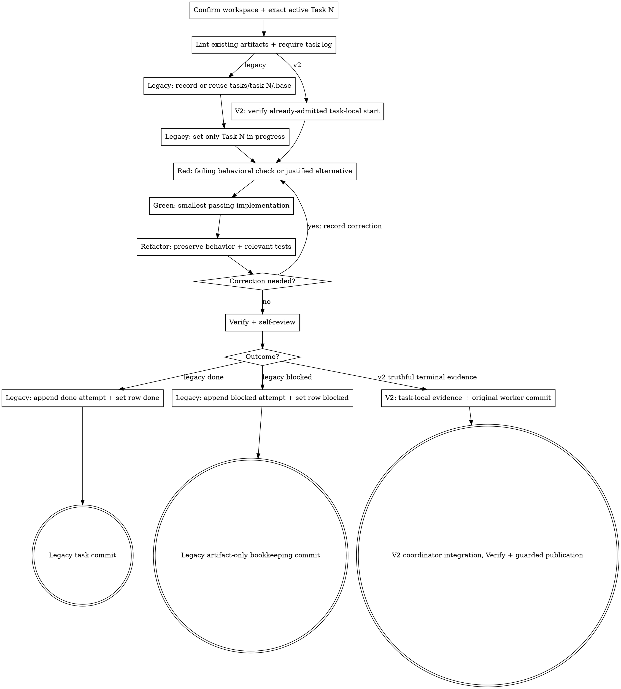

# Implementing one task

Implement exactly one active plan task. Follow its Steps in historical serial mode; exercise bounded judgment within Goal and Acceptance in v2 dependency mode. Verify the result, review implementation quality, and commit with synchronized task-local evidence.

The **seven-stage core pipeline** is Kepler's fixed spec-driven sequence: init → propose → plan → code → code-feedback → review → finish-work. Each step has a skill that a person or agent can run. This skill is **step 3**, the code step. Wayfinder and `kepler-critique` are optional and remain outside the seven-step core count.

**Scope: one task.** In historical serial mode, execute the planned Steps exactly. In dependency-mode v2, apply bounded judgment within the task's Goal, Acceptance, approved intent, cited design, and standards. Do not redesign, reorder, add work outside approved intent, or inspect sibling task evidence; preserve the required TDD phase order.

## Inputs

Identify exactly one existing active `Task N` from the change's `plan.md` by one of these forms:

- **By reference:** the change's `plan.md` plus the exact numeric task id, such as `Task 3`.
- **Inline:** one task block with its exact numeric `Task N` id. In historical serial mode it also includes Files, Acceptance, Steps, Verify, and Commit. In v2 it includes Goal, Acceptance, Depends on, Steps, Verify, and Commit and may omit Files. If an inline task omits the numeric task id, includes more than one id, or fails to match one existing active plan task, stop before implementation and ask for the exact id. Do not infer identity from the title.

A task is abandoned only when its heading ends with the complete canonical `### Task N: <title> (abandoned — <reason>)` form and supplies a nonempty reason. Headings that use `(abandoned - reason)`, `(abandoned — )`, or `(abandoned — reason) trailing` do not match; treat them as active if lint accepts the plan, without inventing a skill-only format error. Never resolve or execute an exactly abandoned task as active, and never reuse its numeric id.

Each invocation also receives:

- The change directory path (`.kepler/changes/<change>/`), always present.
- If the task cites `design.md` or `requirements/`, those cited sections supply its acceptance criteria. Reference them; do not re-derive them.
- Task-local Quality constraints and Decision context, verified by `kepler-plan`, plus current project standards from `AGENTS.md`.
- The selected task's input standing from `kepler workbench context`: `current`, `impact-reviewed-unaffected`, or `legacy-current-confirmed`. For a legacy confirmation, receive the exact task-scoped record and its current input blobs with `historicalInputs: "unknown"`; treat that as current scope only, not as a reconstructed historical snapshot or authorization. Missing, stale, or `legacy-confirmation-stale` evidence returns to the owner.
- For an explicit execution sequence, the dispatch's validated sequence, selected slot, prior-slot gate result and full committed plan revision. Direct invocations require the same selection evidence; task identity alone does not authorize an out-of-sequence task.
- The admitted dispatch identity: full `HEAD`, full named source branch ref, fully resolved delivery-target ref, canonical repository root, canonical absolute Git directory for this worktree, and exact assigned worker/run/session identity. Route-backed tasks also receive the owner/change, canonical route/unit, route-source revision, and base/input revision. Obtain the observed worker identity independently from the execution harness, not by copying the expected dispatch value. Direct invocations require the same owner-admitted binding.
- Optional feedback for this same task from a prior pass. Never read a sibling task's feedback or progress file.

## Legacy task quality context

For legacy tasks without task-local quality fields, accept dispatch-supplied task-scoped quality and decision context verified against the unchanged task, current approved intent, project standards, and this skill's self-review rubric. Name its sources and explain unavailable or rejected memory. Preserve the task definition, Notes, and history; record the criterion and observed implementation check in the new attempt. This context adds no acceptance criteria and does not change the task's Files. Return conflicts or new obligations to planning/intent ownership instead of editing a frozen task. New tasks must carry these constraints in the task block; this compatibility path never excuses missing quality context or invents historical review or approval.

## Dispatch identity readback

Immediately before checkpoint recording or any task/root/production mutation, and again on resume, execute this read-only shell gate from the admitted worktree. Pass seven separately quoted arguments: expected full HEAD, full named source branch ref, full resolved delivery-target ref, canonical repository root, canonical absolute Git directory, expected exact worker identity, and independently harness-observed current worker identity. The driver resolves the target from the route Shipping rules and `branch:` or the project's explicit target rules; stop if that target cannot be resolved. Read the actual run/session identity through your harness's supported interface; if either identity is unavailable, hold without mutation. A worker name, model name, role, self-asserted reference, or copied expected value does not suffice. If a harness allocates the identity only at startup, keep the child read-only until the driver supplies its bound admission. No new workflow-state file is required.

```sh
set -eu
if [ "$#" -ne 7 ]; then
  printf '%s\n' 'dispatch-identity: stale (missing binding)' >&2
  exit 1
fi
case "$1" in ''|*[!0-9a-f]*) exit 1 ;; esac
case "$2" in refs/heads/*) ;; *) exit 1 ;; esac
case "$3" in refs/heads/*|refs/remotes/*) ;; *) exit 1 ;; esac
git show-ref --verify --quiet "$2" || exit 1
git show-ref --verify --quiet "$3" || exit 1
source_upstream="$(git for-each-ref --format='%(upstream)' "$2")"
target_upstream="$(git for-each-ref --format='%(upstream)' "$3")"
source_identity="${source_upstream:-$2}"
target_identity="${target_upstream:-$3}"
if [ "$2" = "$(git symbolic-ref --quiet HEAD)" ] &&
   [ "$source_identity" != "$target_identity" ] &&
   [ -n "$6" ] && [ -n "$7" ] && [ "$6" = "$7" ] &&
   [ "$(git rev-parse HEAD)" = "$1" ] &&
   [ "$(cd "$(git rev-parse --show-toplevel)" && pwd -P)" = "$4" ] &&
   [ "$(cd "$(git rev-parse --absolute-git-dir)" && pwd -P)" = "$5" ]; then
  case "$2:$3" in
    refs/heads/*:refs/remotes/*)
      source_name="${2#refs/heads/}"
      target_name="${3#refs/remotes/}"
      target_name="${target_name#*/}"
      if [ "$source_name" = "$target_name" ] && [ -z "$source_upstream" ]; then
        printf '%s\n' 'dispatch-identity: stale (source/target mapping unresolved)' >&2
        exit 1
      fi
      ;;
  esac
  printf '%s\n' 'dispatch-identity: current'
else
  printf '%s\n' 'dispatch-identity: stale' >&2
  exit 1
fi
```

The gate compares source and target by full refs and configured upstream mapping, not tip SHAs; identical or unresolved identities fail. An unchanged plan commit or sequence cannot excuse a changed HEAD, source/target branch, worktree, or worker. On failure, do not write a checkpoint, update status, edit code, or attempt restoration; return to fresh driver admission. Success verifies identity only, not task selection, approval, or quality.

## Principles

### Dependency-mode v2 task work

When `plan.md` declares `execution: {version: 2, mode: dependencies}`, bind work to Goal, Acceptance, Depends on, Steps, Verify, Commit, cited approved intent/design, and standards. Files are optional guidance, not an allowlist: make necessary goal-serving unlisted changes while excluding unrelated edits and unapproved public/security/dependency/intent changes. Exercise bounded judgment within those constraints. Steps preserve related TDD cycles in Red → Green → Refactor order without forcing a particular design. The worker owns task-local evidence and its isolated original commit, never shared root publication; the coordinator integrates and publishes. Reuse the admitted original Base across retries, preserve partial edits, and never invent attempt/blocked/done evidence. A worker's terminal outcome informs coordinator publication but does not authorize root-state mutation.

### Historical serial task work

Without the exact v2 declaration, retain the historical serial contract: execute Steps verbatim, treat Files as the boundary, update only the assigned root row and task log, and use the prior checkpoint lifecycle.

- **Follow the steps exactly.** In historical mode, execute the authoritative Steps in order. If a step is wrong or impossible, record a graceful blocked attempt; do not improvise a redesign.
- **Follow the grain.** Match project naming, structure, error handling, and tests.
- **Small and honest.** No stubs, TODOs, dead code, commented-out blocks, or fabricated results.
- **Evidence ownership.** V2 workers change only task-local progress and their isolated task commit; only coordinator publication changes shared root state. In historical mode, change only the assigned root row and task-local progress. In either mode, never mutate a sibling row, progress file, feedback file, or checkpoint.
- **Separate evidence by stage.** Implementation attempts belong in task progress. Task feedback, whole-branch review, and finish evidence never go in root or task progress.

## TDD implementation cycle

Every ordinary implementation cycle follows Red, Green, and Refactor in that order. In historical mode, run it after the assigned row enters `in-progress`; in v2, run it after guarded admission and before final task verification. Related checks may form multiple cycles. A behavior-changing plan step may require more than one cycle; keep each cycle in the same task-local attempt.

### Red

Write or update a behavioral check for the intended behavior, then run it before any production edits. It must fail for the intended reason, not because of a broken harness or unrelated failure. Record the exact Red command and its observed result in task-local evidence before proceeding.

If a conventional failing behavioral check cannot be written, record the concrete technical reason before making production edits. Define repeatable alternative verification that observes the behavior and distinguishes pre-change from post-change states. Preference does not justify omitting the check. Run and record the alternative as the Red phase before implementation.

### Green

Make the smallest passing implementation that fixes the failing behavior. Run the same behavioral check used in Red or its documented alternative verification and confirm it passes for the intended reason. Green is an intermediate milestone, not completion. Green-only implementation is prohibited: do not implement first and backfill a failing check, treat an already-passing check as Red, or omit Red because a test seems unnecessary.

Record the exact Green command and its observed result in task-local evidence. Do not refactor or broaden the implementation before this passing result is recorded.

### Refactor

Refactor only after Green, preserving the behavior demonstrated by the check. Keep the change within the task's listed files and existing ownership boundaries. Run relevant behavioral and regression tests after the behavior-preserving refactor; record every command and observed result in task-local evidence. If Refactor changes behavior, return to Red.

### Correction cycle

When a phase fails for the wrong reason, a verification fails, or a correction is required, record the correction and repeat Red, Green, and Refactor in that order. A correction is not complete until the corrected behavior has a new or repaired failing check, the smallest passing implementation, and a behavior-preserving refactor with relevant tests passing. Never replace correction-cycle verification with a prose claim.

### Example

```text
Red      — bun --bun vitest run tests/example.test.ts → failed: expected behavior is not implemented
Green    — bun --bun vitest run tests/example.test.ts → passed: smallest implementation satisfies the check
Refactor — bun --bun vitest run tests/example.test.ts → passed: behavior is unchanged after cleanup
```

For every cycle, record the Red, Green, and Refactor commands and observed results in task-local evidence. For an exceptional Red phase, record its reason, repeatable alternative verification, and observed result instead of inventing a failing test. Put these records in the task attempt, not the root ledger, feedback, review, or finish artifacts.

## Process

1. **Confirm the workspace.** Run `kepler workbench isolate --check --change-dir <change-dir>`. Its last line must read `isolated: yes`. Anything else means stop and report its output. If the Kepler CLI/workbench is unavailable, verify by hand that the repository is off its default branch and the change directory resolves under `git rev-parse --show-toplevel`.
2. **Resolve exactly one task.** Load only the requested task block from `plan.md`. Confirm its exact positive numeric `Task N` id, confirm that id occurs once, and reject only a heading that ends in the complete canonical abandonment form with a nonempty reason. For inline input, also confirm that its id and content identify the same active plan task. Read its Acceptance, cited requirement or design sections, and project standards. Do not load other task blocks.
3. **Validate existing artifacts and resolve task evidence.** Before implementation, run `kepler workbench lint --change-dir <change-dir>`. The exit status is the single source of truth for artifact format and schema. Stop on nonzero lint and report its findings; do not compare an existing task log with the installed template, reject lint-valid additional root content, or independently classify a layout as `legacy-unsupported`. Require `plan.md`, the assigned task's root ledger status, and the existing linked `<change-dir>/tasks/task-N/progress.md` as inputs. If evidence is missing, stop and name the missing input; lint does not check absent files. Check root metadata and body-row parity through lint. Check that the selected task identity agrees with its evidence, not that its artifact matches a second format specification. Read the existing task log's latest attempt for the checkpoint and lifecycle decisions. A newly initialized log has `status: pending` with no attempt; a previously finalized task log may be accepted for correction without changing its local status to `in-progress`. Before production edits, pass the **Task quality and decision pre-generation gate**. Confirm that the assigned block carries applicable quality constraints and their source, a verified current decision or an explained non-applicability, and project standards. For a legacy task, use the verified dispatch-supplied record under **Legacy task quality context** without changing its frozen block. Cross-check them against the task Steps and current approved intent. Memory can inform a choice, but cannot authorize a deviation or replace committed context. If a required principle conflicts with the task contract, stop for planning/design correction instead of silently redesigning the task. Record the criterion/decision that shaped implementation and its observed code/test evidence, or why it did not apply, in the finalized attempt.

   Run **Dispatch identity readback** before checkpoint validation or any mutation, including on interrupted/resumed work. Compare the admitted full HEAD, named source branch, resolved target, repository/worktree and exact worker identity against independent current readback; the source must differ from the target after configured local/remote mapping, never merely by tip SHA. For a route-backed change, run current context, require its canonical route/unit and source revision to match the dispatch binding, and scan visible proposals/plans, local and visible remote branches, and worktrees for another claim on that unit. Resume only the same owner/change/branch; stop on a competing or ambiguous claim. The scan is local evidence, not distributed exclusivity. An unchanged plan revision is insufficient. **Historical serial mode only:** for an explicit execution sequence, before checkpoint validation or any mutation, rerun `kepler workbench lint --change-dir <change-dir>` and `kepler workbench context <change-dir>`. Require the task ID to occupy the dispatch's selected slot in the current validated order, the full supplied plan revision to equal the latest commit touching `plan.md`, and the transition history to be `verified`. A changed plan, order, HEAD, worker, branch or repository/worktree identity invalidates the dispatch; stop without writing or recording a checkpoint and ask the driver to recalculate. The driver must supply the previous execution slot and prove its durable fresh task approval before dispatch. A direct human/code call must supply the same selected-slot and predecessor-gate evidence; otherwise route it through `kepler-orchestrate`. Legacy plans without execution metadata retain numeric serial order.

   **Dependency-mode v2 only:** validate the coordinator's verified admission binding before any mutation: the admitted worker, lane/worktree, repository, plan revision, task digest, input bindings and prerequisite approvals must match the current dispatch. Do not derive scheduling, a predecessor, or a root authority from a worker readback. A mismatch holds the task and preserves work; route it to the coordinator for renewed admission. The code skill still reads only the assigned task and never inspects sibling feedback or progress.

4. **Validate the stable task checkpoint.** **Historical serial mode only:** before any first-attempt `--record`, inspect the exact task's Files and Acceptance, working tree, and attributable Git history for task-owned committed and uncommitted implementation changes. The CLI's mechanical eligibility does not prove the absence of task-owned work. A clean tree, pending row, or empty log cannot establish that absence. If task-owned work already exists or its attribution is ambiguous, stop for owner diagnosis and never record current `HEAD` as a new Base; preserve existing work and evidence. For a standalone invocation, run `kepler workbench diff --record --task N --change-dir <change-dir>` and require successful checkpoint validation before implementation. In a driver-managed invocation, verify the driver established that semantic first-attempt condition or supplied the successful historical checkpoint validation; do not rely on its claim alone. The driver runs the same command before every code dispatch, after the applicable inspection. The CLI records current `HEAD` only for a clean, committed pending task with no attempt or feedback. With durable task history, it derives the canonical Base from the first parent of the earliest committed task-progress revision that adds the first attempt; every valid feedback `Base:` must agree, and the Base must precede the attempt and remain an ancestor of every valid feedback `Head:` and current `HEAD`. The ignored `.base` file is a no-overwrite cache, not authority. The CLI validates an existing cache or reconstructs it only when missing and history proves the value. Stop for a malformed or conflicting cache, missing or ambiguous history, or invalid ancestry. The initial pending-log commit is not first-attempt provenance; never substitute current `HEAD`, `HEAD~1`, or another guessed base.

   **Dependency-mode v2 only:** recover the original admission Base verified at admission through retry, correction and cache loss; `.base` remains a non-authoritative cache. Never record first-attempt parent or current `HEAD` for v2. A missing or mismatched admission binding holds the lane.
5. **Begin the attempt.** **Historical serial mode only:** update only the assigned task's root frontmatter metadata entry and Markdown row together to `in-progress` before executing implementation steps. A `pending`, `blocked`, or `done` task may enter `in-progress`; `done` means only that the latest implementation attempt completed. Preserve every sibling metadata entry, row, and file unchanged. The root artifact's aggregate `status: complete` means all active implementation rows are done; it never means feedback, whole-branch review, or finish-work passed, and is not a gate. At the initial boundary, the empty local task log remains `status: pending` without an attempt; during correction, preserve its prior finalized status and attempts. At this supported staged boundary, run `kepler workbench lint --change-dir <change-dir>` and stop on any nonzero result before implementation. Do not set the local status to `in-progress` before an attempt exists. Do not append an attempt yet: if the process terminates unexpectedly, `in-progress` remains the interruption signal. **Dependency-mode v2 only:** the worker does not mutate shared root metadata or rows; its already-admitted coordinator owns root authority.
6. **Execute the task Steps in order.** **Historical serial mode only:** touch only the task's listed files. **Dependency-mode v2 only:** use Goal, Acceptance, cited binding intent/design/standards, and the approved admission to make necessary goal-serving unlisted edits; related Red → Green → Refactor cycles remain within that coherent task. For ordinary implementation work, execute the [TDD implementation cycle](#tdd-implementation-cycle) for each behavior change, including its Red, Green, and Refactor evidence. Run any additional tests or commands required by individual steps and keep actual results for the attempt evidence.
7. **Verify.** Run the task's Verify command after the final Refactor, then the full test suite and build or typecheck from `AGENTS.md`. Every command must pass before the attempt is marked done. A project standard may explicitly scope the per-task suite in a large repository; otherwise the full suite remains required. If verification or self-review finds a correction, repeat the complete correction cycle before declaring the attempt done.
8. **Check acceptance and self-review.** Confirm every acceptance criterion, including the recorded Red, Green, and Refactor phases or a justified exceptional Red alternative, then inspect the diff against the code-quality checklist. Resolve issues by repeating the relevant specified step and its TDD cycle, or finish as blocked when a specified step or criterion cannot be completed.
9. **Finalize synchronized evidence.** Append exactly one next-numbered dated attempt at the physical end of `<change-dir>/tasks/task-N/progress.md`, preserving every prior attempt. Give each attempt exactly one terminal `- Outcome: done` or `- Outcome: blocked`; append a new attempt for a correction instead of adding a second Outcome to existing history. Populate the installed-template lifecycle record completely with the final done or blocked outcome, created, modified, and deleted paths, every verification command and observed result, the Red/Green/Refactor commands and observed results (or the exceptional Red reason and repeatable alternative verification), and notes for deviations, decisions, corrections, or concerns. Record the task-local quality constraint and decision that shaped implementation with observed code/test evidence, or its justified non-applicability. Input hashes identify revisions; they do not establish semantic approval. Then set the assigned task log frontmatter status: for a done attempt, its local `status` is `done`; for a blocked attempt, its local `status` is `blocked`. Preserve prior attempts and sibling files unchanged, including every sibling metadata entry and row. **Historical serial mode only:** then update the same root frontmatter metadata entry and Markdown row together from `in-progress` to the matching `done` or `blocked` status. After the synchronized task-progress attempt and root metadata/row transition, run `kepler workbench lint --change-dir <change-dir>` before the outcome-specific commit. Keep the root aggregate status as an implementation summary only; `complete` is not a review or finish-work result. A nonzero lint result is a failed gate: correct the artifacts and rerun lint, or report the exact blocker without committing or claiming compliance. Do not change another row or append review, feedback, or finish summaries anywhere in progress.
10. **Commit according to the outcome.** **Historical serial mode only:** for `done`, commit the assigned task's implementation, tests, its task-progress attempt, and its root-row final transition together using the task's Commit message. Do not commit the ignored `.base`. For a gracefully reported `blocked` attempt with no valid implementation commit, make an artifact-only bookkeeping commit that contains only the root `blocked` row and the assigned task progress attempt. Leave partial production edits uncommitted and report their paths explicitly. Never claim a blocked task is done. Run `git status` and confirm nothing under this task's change artifacts remains uncommitted after either commit; unrelated or partial production edits may remain only when they are explicitly reported with a blocked outcome.

    **Dependency-mode v2 only:** commit truthful task-local terminal evidence and the original signed worker commit; never mutate shared root state. For a blocked worker, commit only the truthful task-local blocked artifact and leave partial production edits uncommitted for the coordinator/owner to preserve. The coordinator serializes integration, runs exact Verify, then completes guarded root publication.

Never edit `plan.md` in this skill.

## Task progress lifecycle

Kepler-plan creates `<change-dir>/tasks/task-N/progress.md` from the installed `${XDG_CONFIG_HOME:-$HOME/.config}/vialactea-works/kepler/templates/task-progress.md` template; kepler-code never recreates a missing task log. The installed template guides new content; lint alone validates existing and updated artifact formats. Each completed invocation appends one next-numbered dated attempt at the physical end. Preserve prior attempts. Check task identity and actual verification evidence for this attempt without imposing another artifact-shape validator.

Use the root `<change-dir>/progress.md` as the current task ledger. In historical serial mode, this skill writes its assigned identity/status/links there and writes attempt details to the task log instead. In dependency-mode v2, the worker writes only its task-local log and commit; the coordinator owns the shared root ledger. In either mode, this skill writes attempt details to the task log; do not append feedback, whole-branch review, or finish outcomes to root progress. This is a writer ownership rule, not a reason to reject other lint-accepted content already in the file.

## Blocking and interruption

**Historical serial mode:** a graceful blocker is a completed code attempt with `Outcome: blocked`. Preserve its evidence in the assigned task log, set only its root row to `blocked`, and use the artifact-only commit path from Process step 10 without staging partial production work. Record which partial production edits remain uncommitted so a later retry can inspect them.

**Dependency-mode v2:** the worker records only truthful task-local blocked evidence. Interrupted, unavailable, or missing responses preserve the admitted lane and partial work; they create no root terminal status or fabricated attempt. The coordinator recovers only verified durable evidence.

An abrupt termination is different: if execution stops after the row entered `in-progress` but before final evidence can be appended and committed, do not manufacture a `blocked` or `done` attempt. On resume, inspect the assigned task's working tree and task-local evidence before continuing or resolving it.

## Boundaries

- Always: run required tests before a done commit and preserve the stable task checkpoint. In historical serial mode commit the root-row final transition with task-local evidence; in v2 the worker commits task-local evidence only and the coordinator owns publication.
- Ask first about any decision the task did not specify, including a public interface change or new dependency. If unattended, record a genuine blocker instead of improvising a large decision.
- Never: commit secrets; delete or weaken a test to make the suite pass; touch another task; override a nonzero lint result or reject a lint-valid artifact for its format; write task feedback, review, or finish history into progress; commit partial production work for a blocked attempt.

## Code-quality self-review

- Do tests assert behavior and fail if that behavior breaks?
- In historical serial mode, is the implementation confined to the assigned task and its listed Files? In v2, do every changed path and related TDD cycle serve Goal/Acceptance and binding intent/design/standards?
- Are naming, structure, and error handling consistent with the codebase?
- Are there no dead paths, stubs, debug output, TODOs, or commented-out blocks?
- Is every acceptance criterion satisfied by observed evidence?
- In historical serial mode, did only the assigned root metadata entry/row and task progress file change among execution artifacts? In v2, did the worker make zero shared-root mutations?
- Does the final commit match the task outcome and leave the checkpoint untracked?

## Output

In historical serial mode, output one implementation commit for `done`, containing code, tests, the assigned task's canonical attempt evidence, and its root row set to `done`. For `blocked`, output one artifact-only commit containing the assigned task's blocker evidence and root row set to `blocked`; report any partial production edits left uncommitted. In dependency-mode v2, output only task-local terminal evidence and the original signed worker commit; the coordinator integrates, verifies, and separately completes root publication. In both modes, sibling task artifacts remain unchanged, the stable task checkpoint remains untracked, and `plan.md` remains read-only.

## Handoff

- In historical serial mode, after a done commit the driver runs `kepler-code-feedback` on this task's stable checkpoint through the new task commit. After a blocked bookkeeping commit, the driver decides how to resolve or retry this same task.
- In dependency-mode v2, hand the original worker commit and task-local evidence to the coordinator for guarded integration, exact Verify, and separate root publication. Only then does independent `kepler-code-feedback` review the actual integrated range; a worker `done` does not guess approval.
- Working unattended, return without asking or invoking the next skill; the driver owns the code-feedback loop and task selection.

## Process flow



## Dependency-mode execution

For `execution: {version: 2, mode: dependencies}`, a worker owns only its isolated task-local attempt and commits; it never updates the shared root ledger. The coordinator admits a verified ready task with `kepler workbench task-state --admit --task N --change-dir <path> --expected-head <full40> --worker <observed-expected-worker> --worktree <linked-lane> --target-branch <full-ref>`, may reserve scope with `--reserve --reservation '<exact JSON>'`, and publishes only after integrated verification with `--publish --task-head <full40> --verify '<exact Verify>'`. These operations bind original Base and durable admission history; `.base` remains a cache. A worker holds on missing, interrupted or unavailable evidence and never manufactures an outcome. Legacy root-row updates in this skill apply only to unversioned and version-1 serial plans.
