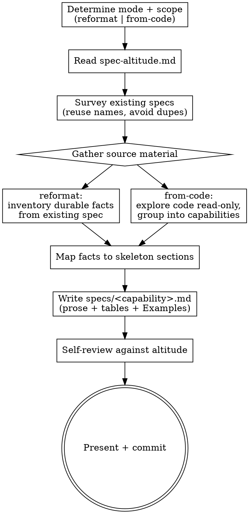

# Composing canonical specs

Write or rewrite the project's canonical specs (`.kepler/specs/<capability>.md`) directly, without running a change through the pipeline. This is the **front door for canonical specs**: capability behavior specs otherwise emerge when `kepler-finish-work` distills a completed change, while init establishes the separate canonical glossary. A project adopting Kepler — or one whose specs have drifted from the current format — otherwise has no way to get well-formed specs.

It has **two modes**:

- **reformat** — rewrite an existing spec (often in the older `### Requirement:` / `#### Scenario:` form, or otherwise off-altitude) into the human-readable skeleton, preserving every durable fact.
- **from-code** — explore the application read-only, identify its capabilities, and author a canonical spec for each from what the code actually does.

Both modes write **canonical** specs: human-readable documentation at altitude, never the change-side `SHALL` / `WHEN`/`THEN` delta form. Neither mode edits application code or creates a change directory — this skill operates only on `.kepler/specs/`.

## What it produces

- `.kepler/specs/<capability>.md`, one per capability, in the skeleton of `${XDG_CONFIG_HOME:-$HOME/.config}/vialactea-works/kepler/templates/requirements-spec.md`: `## Overview` / `## Contract` / `## Behavior` (+ **Examples**) / `## Invariants` / `## Decisions`.

## Inputs

- **The mode**, and its target:
  - reformat → one or more existing spec files, or the whole `.kepler/specs/` directory.
  - from-code → the application (optionally scoped to a subsystem or a named capability).
- The project's existing `.kepler/specs/` — to avoid duplication and reuse capability names.
- The canonical glossary (`.kepler/specs/glossary.md`), when present, is the main source of context-scoped project language. Supplement missing definitions from established project documentation with source references; surface conflicts rather than silently redefining terms.
- Relevant domain and architecture documentation, including confirmed ownership, context maps and design decisions. A proposed design is evidence of intent, not proof of current implementation.
- Project standards (`AGENTS.md`) — for the git workflow and any domain vocabulary.

If the mode is not given, infer it: an existing off-format spec as the target means reformat; a codebase with no (or partial) specs means from-code. When ambiguous, ask.

## References

Read reference files from this skill's own `references/` directory with the Read tool — they are co-located with this SKILL.md, **not** at `${XDG_CONFIG_HOME:-$HOME/.config}/vialactea-works/kepler/`.

- `references/spec-altitude.md` — the altitude rubric and canonical spec shape: the skeleton, register→section mapping, Examples-block treatment of scenarios, voice, and what a canonical spec must not contain. This is the core of both modes — read it first.

## Principles

- **Altitude over mechanism.** State what the capability guarantees — contracts, behaviors, invariants, decisions — not the mechanism one commit used. Apply the altitude test in `references/spec-altitude.md` to every statement.
- **Read like a human wrote it.** Use plain technical prose and tables, a natural voice, and `MUST`/`NEVER` only for invariants. No `### Requirement:` / `#### Scenario:` scaffolding.
- **Preserve, don't invent (reformat).** Change only shape and altitude: carry every durable fact across, dropping only mechanism and scaffolding. Never silently lose a contract, behavior, invariant, or decision the old spec recorded.
- **Document what is true (from-code).** Describe the behavior the code exhibits, not what it should do. Where the code is ambiguous or you infer intent, say so rather than inventing a guarantee. Do not treat a bug as a contract.
- **Capability scope.** A capability is a cohesive, durable area of responsibility with a clear boundary and an observable contract. It can represent a domain, subdomain or bounded context, including infrastructure responsibilities. A domain names the overall subject area, a subdomain names a problem area, and a bounded context delimits a model and language. Capability is the specification unit; identify its represented scope without treating these concepts as synonyms.
- **Right-size capabilities.** Use one spec per cohesive responsibility and contract, with the fewest scopes that cover the system without overlap. Infrastructure or integration scopes qualify: `rest-api` may own an external model, command/result translation and compatibility while domain contexts retain business rules. REST alone does not establish a bounded context; an HTTP adapter may belong to its owning context. An endpoint, file or wiring step alone is not a capability. Do not create overlapping parent and child capabilities that duplicate the same contracts, or merge unrelated contexts because they share technology. Preserve existing slugs, metadata and delta-to-spec paths; do not reclassify historical specs merely to fit new wording.
- **Right-size content.** Keep all five sections required by lint. Keep a section concise when it has no applicable facts, and omit optional subsections. A tiny capability can be brief without inventing guarantees. Lint, not this writing rubric, decides existing format validity.

## Domain and architecture grounding

Read the canonical glossary and authoritative project documentation before naming responsibilities. Cite sources for scoped meanings and ownership; disclose a missing glossary and record undefined or conflicting terms for requester resolution rather than redefining them or updating vocabulary here. Material language or boundary uncertainty must be resolved before publishing a claim that depends on it.

Identify relevant domains, subdomains, bounded contexts, terms, relationships, commands, events, states and invariants. Inspect package responsibilities, ports, adapters and significant code as evidence of implementation; a directory, transport or package is not proof of a context boundary. Distinguish domain rules, application use cases and infrastructure translation, and preserve existing capability boundaries and slugs.

Map supported durable facts into the existing five sections: responsibility and related contexts into Overview; consumer-visible ports, commands, events and data shapes into Contract; observable interactions and state transitions into Behavior with Examples; invariant obligations and ownership into Invariants; durable boundary and translation policies into Decisions. Use only applicable facts. Private wiring, implementation-package inventories and code attribution belong in design, not in canonical requirements. Public package APIs may be contracts; private file layout is not.

## Process

1. **Determine mode and scope.** Establish the mode and exact target (which files, or which part of the codebase). Read `references/spec-altitude.md` before writing anything.
2. **Survey existing specs.** List `.kepler/specs/` so you reuse existing capability names and do not create an overlapping or duplicate spec. Read the glossary as language support, not as an automatic behavior capability. When reformatting a whole directory, preserve the glossary's vocabulary and canonical artifact contract; do not turn its entries into application behavior.
3. **Gather the source material.**
   - **reformat:** read each target spec in full; preserve every durable contract, behavior, invariant and decision, including established ownership and translation policies. Use its language sources to clarify scope without forcing a reclassification. Separate mechanism and scaffolding from current guarantees; surface conflicting or undefined meanings instead of inventing a replacement model.
   - **from-code:** explore relevant code, interfaces, handlers, schemas, config and tests read-only, together with domain/architecture documentation. Trace package responsibilities, ports, adapters and rule ownership as evidence. A proposed change in design is not a current guarantee: verify what exists before documenting it. Group observed behavior into right-sized capabilities and label material uncertainty rather than treating an inference or bug as a contract.
4. **Map to the skeleton.** Place each capability's durable facts using the register→section mapping: consumer-facing shapes (schemas, payloads, endpoints, config keys, field names and types) → `## Contract`; observable input→output → `## Behavior` plus an **Examples** bullet; properties that always hold → `## Invariants`; reusable rules → `## Decisions`; a one-paragraph orientation → `## Overview`. In Overview, identify the supported scope kind and name, responsibility, related contexts and boundary ownership. Apply **Domain and architecture grounding** and the reference's mapping to preserve relevant model contracts and boundary policies without copying private wiring or source-code inventories. When an existing spec's scope is uncertain, flag it instead of inventing a domain model or forcing a historical reclassification.
5. **Write the spec.** For a new author-bearing canonical spec, read `git config user.name` and `git config user.email` and record the configured identity as `author: Name <email>` in the requirements-spec frontmatter. If either value is missing, stop and report the missing identity; never invent attribution. When revising an existing spec, preserve its recorded `author` exactly. Compose `.kepler/specs/<capability>.md` from the template in flowing prose and tables. Add `### <subsection>` anchors under Contract/Behavior when a capability has several distinct surfaces (event types, endpoints). Fold behaviors into greppable Examples bullets (input → outcome). Keep the voice natural; use `MUST`/`NEVER` only in Invariants.
6. **Lint each mutation.** After writing or editing each canonical spec, run `kepler workbench lint --file <spec-path>`. A nonzero lint result fails the gate: resolve the findings and rerun lint, or report the exact blocker without handing off or committing. Any correction during self-review is another mutation and requires the same file-scoped lint before handoff or commit.
7. **Self-review and commit.** Re-read each spec against `references/spec-altitude.md`: confirm scoped language, ownership, source support, current behavior and explicit unknowns. Do not publish an unresolved claim. Exclude control flow, private names that are not the contract, library calls and file paths as requirements; behavior must remain observable. Durable architectural policies belong in Decisions, even when checking compliance requires inspecting dependencies. For reformat, also confirm no durable fact from the original was lost. Show the composed or reformatted specs for review. On approval (or, running unattended, after self-review and a successful latest lint), commit following the project's git workflow. Reformatting a whole directory or bootstrapping a project is a large diff — group it into a sensible commit (e.g. one per capability, or one per run) per `AGENTS.md`.

## Boundaries

- Never edit application code, create a change directory, or run the change pipeline — this skill only reads code and writes `.kepler/specs/`.
- Never emit the change-side `### Requirement:` / `#### Scenario:` / `SHALL` form into a canonical spec.
- Never drop a durable fact when reformatting; never invent a guarantee the code does not make when writing from code.
- Ask first when the mode or capability boundaries are genuinely ambiguous.

## Output

Write canonical specs to `.kepler/specs/`, review and commit them per the project's git workflow. Report which capabilities you created or reformatted, and any uncertain capability boundaries or inferred behaviors.

## Process flow

