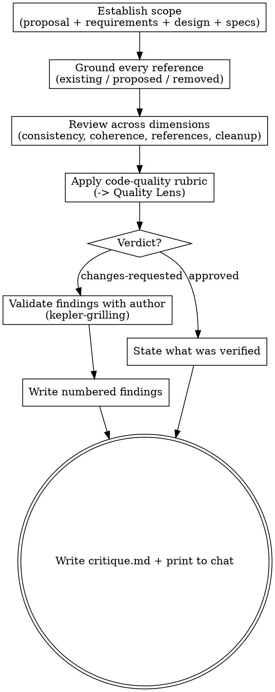

# Critiquing a change's artifacts

Review the proposal, requirements, and design a change committed to — before any code is
planned — and return a numbered findings report a person or agent can act on without
guessing which item you mean.

The **seven-stage core pipeline** is Kepler's fixed spec-driven sequence: init → propose → plan → code →
code-feedback → review → finish-work. This skill is an **optional design-phase gate outside the
seven-step core pipeline**: it critiques the proposal, requirements, and design produced by
`kepler-propose` before `kepler-plan` turns them into tasks. Unlike `kepler-review`, which
is the final whole-branch inspection gate, critique judges propose-phase artifacts before
implementation. Wayfinder is likewise optional and outside the core count.

**Judge, don't fix.** You produce a verdict and located findings. You never modify
`proposal.md`, `requirements/`, or `design.md`. The single `decision` field records what the
user did with the critique. Apply the supported settlement matrix in **Handoff**; a recorded
`skipped` decision or `accepted` changes-requested verdict is not settled. Preserve settled
dispositions and do not work them again unless the user requests a new critique pass.

## Inputs

- The change directory path (`.kepler/changes/<change>/`).
- The propose artifacts under review: `proposal.md` (why), `requirements/<capability>.md`
  (what), `design.md` (how). Any subset that exists — a change may skip some.
- **The actual codebase.** Check existing-code claims against the repository and clearly identified proposed references against their stated ownership, contracts and design rationale.
- The project's canonical specs (`.kepler/specs/`) — the current requirement truth each
  MODIFIED capability builds on.
- The change's `route_unit` frontmatter field (in the proposal), if present — follow it to the
  route unit's `backed_by` tickets; their Answers are committed decisions the artifacts
  must honor.
- The canonical glossary (`.kepler/specs/glossary.md`), when present, is the main source of context-scoped project language. Read established domain and architecture documentation for supplementary definitions, boundaries and the sources cited by the proposal. For an older project without a glossary, verify the documented fallback meanings.
- Project standards (`AGENTS.md`): idioms, ubiquitous language, boundaries.

## References

This skill ships with a `references/` folder. Read reference files using the Read tool on
the skill's own directory — they are co-located with this SKILL.md, **not** at
`${XDG_CONFIG_HOME:-$HOME/.config}/vialactea-works/kepler/` or `${XDG_CONFIG_HOME:-$HOME/.config}/vialactea-works/kepler/templates/`.

- `references/code-quality.md` — the design/plan-altitude rubric for judging structural
  quality, the same one `kepler-propose` self-reviews against.

## Principles

- **Evidence over claims.** Verify existing-code claims against source and language/ownership claims against the glossary and authoritative project documents. Confirm signatures before accepting a structural compatibility claim; a directory name alone cannot establish a bounded context.
- **Ground every reference.** Distinguish existing, proposed and removed code. An existing-code claim without matching source is a defect; a proposed addition is legitimate when its owner, contract and rationale are explicit. Confirm surviving consumers do not depend on code the change removes.
- **Specific and located.** Every finding names the artifact and place, says what is wrong
  and what to change, and cites the criterion or standard it violates. "`design.md:126`
  claims `RapClient` satisfies `RAPStatusChecker`, but their `IsDone` return types differ"
  is useful; "the design is inconsistent" is not.
- **Numbered, most-severe first.** Findings are one continuous numbered list so any reply
  can pick an item by its number. Order the list by severity, tag each item, and keep the
  numbering stable within a pass.
- **Proportionate.** Scale scrutiny to the change (`references/code-quality.md` says how).
  Separate what blocks the gate from what is a suggestion; don't gold-plate a small change.
- **Scope-aware.** Flag speculative surface — unused methods, interfaces with one caller,
  extension points no requirement asks for — as YAGNI, the same way you would in code.

## Process

1. **Establish scope.** Run `kepler workbench context <change-dir>` to
   learn which propose artifacts are present and which capabilities the change carries (if the
   Kepler CLI/workbench is unavailable, list the directory yourself), then read every one of them
   (`proposal.md`, `requirements/`, `design.md`) and the canonical specs the change builds on.
   Note which capabilities are new vs modified vs removed — the removed set drives the cleanup
   check. Read the glossary and cited domain/architecture documents before judging design goals, ownership or classifications; verify documented fallback language when the glossary is absent.
2. **Ground every reference in the codebase.** Classify each type, function, file or example as existing, proposed or removed. Read existing code and confirm the claimed signatures, return types, field names and behavior. Clearly proposed additions need not exist yet: check their owner, contract, rationale and compatibility with existing consumers. Flag unsupported existing-code claims, proposals that pretend to be implemented, and surviving steps that call, subclass or use code the change removes. Trace responsibility transfers rather than treating every proposed name as a phantom reference.
3. **Review across dimensions** (checklist below).
4. **Apply the structural rubric.** Run `design.md` and `requirements/` against
   `references/code-quality.md`, scaled to the change, and capture the outcome as a Quality
   Lens table (one row per principle you exercised).
5. **Decide a verdict:** `approved` or `changes-requested`.
6. **Validate findings with the author (changes-requested only).** When the verdict is
   `changes-requested`, invoke `kepler-grilling` with the findings as content and
   "every finding is validated" as the exit condition, before writing the report. A
   false positive can be rejected; where a finding offers several fixes, the author
   picks one. Unattended, skip the validation; the report is written from the unvalidated findings, and the handoff names the next step.
7. **Write the report** — the numbered format below — printed to chat **and** persisted to
   `critique.md` in the change directory, written from the findings that survived
   validation. Record `created`, `verdict`, and `decision` (`accepted`, `applied`, `rejected`,
   or `skipped`) in frontmatter; do not duplicate these fields as body metadata. Use
   `accepted` only when the user accepts an `approved` verdict that needs no remediation,
   `applied` when the user accepts and applies `changes-requested` findings, `rejected` when the
   user explicitly dismisses those findings, and `skipped` when no user decision is collected.
   `decision: accepted` on a `changes-requested` verdict does not settle its application. Never add a second resolution field. After you write the report, run
   `kepler workbench lint --file <change-dir>/critique.md` before printing it or handing it off.
   A nonzero lint result is a failed gate: correct the report and rerun lint, or stop with the
   exact finding without declaring the critique compliant.

## Review dimensions

- **Logical consistency:** No artifact contradicts another or itself. Every described flow
  is complete — each step's inputs exist and line up with the previous step's outputs, and
  no step depends on a branch the design says can't happen.
- **Semantic coherence:** One term per concept within each bounded context, used consistently across artifacts. Verify definitions and sources against the canonical glossary and supplementary project documentation. The same word may have distinct meanings across contexts; check explicit translations rather than demanding a global definition. Verify mappings to code names, including documented legacy aliases. An unsupported meaning or conflict with canonical language is a located finding.
- **Domain scope:** For new full-path proposals, check Domain Context names the involved subdomains and bounded contexts, their responsibilities, involvement and language sources. Each capability must identify a cohesive scope (domain, subdomain or bounded context), responsibility and relation to that context. Infrastructure responsibilities qualify when their model, boundary and contract support the claim; REST alone does not establish a context. A package or endpoint name is insufficient evidence. Flag overlapping parent/child contracts and independent goals bundled into one capability. Existing lint-valid historical proposals missing Domain Context are not invalid for that omission alone; do not demand retroactive backfill of approved history. Requirements-only changes need no proposal.
- **Boundary impact:** Verify ownership and contract changes across the named contexts, including data ownership, translation, trust, compatibility, migration and coordination obligations. Check that business rules remain with their stated owner rather than leaking into an infrastructure context. If the proposal says no boundary changes, verify its explanation against the stated change. A material unresolved ownership or meaning blocks approval; structural lint cannot establish semantic completeness.
- **Domain model:** For a new or revised design candidate, check sourced goals and relevant domains, subdomains, bounded contexts, relationships, commands, events, states and invariants. Confirm rule ownership and translation across contexts. Core/supporting/generic classifications need evidence or an explicit proposed decision. Distinguish current facts from the proposed model and flag unsupported claims or undefined/conflicting meanings. Missing material language or ownership blocks approval even when lint passes.
- **Architectural realization:** Check each package created, modified or removed for its responsibility, domain/context or infrastructure role, exposed and required ports, adapters, dependency direction and test seams. Verify data/contract ownership and boundary translation; business rules belong to their stated domain owner. Trace retirement or transfer of removed responsibilities and ports. Check replacement contracts and requirements retain existing callers' success and failure outcomes unless the change explicitly changes or retires them. Missing material contracts or consumers blocks approval even when structural lint passes.
- **Code attribution:** Verify affected code is mapped to its domain/context or infrastructure responsibility, with existing, proposed and removed references distinguished. Compare attribution against source and documented ownership; a package need not map one-to-one to a context. Flag unassigned relevant responsibilities, rule leakage into adapters, or contradictory mappings.
- **Proportionate design coverage:** Prose and upstream references can provide coverage without every optional subsection or table. Historical lint-valid designs are not invalid solely for missing the new model or mapping sections; do not rewrite approved history. Do not demand invented events, layers or interfaces, and do not excuse missing material evidence as irrelevant. Structural lint checks format, not semantic completeness.
- **Code-reference validity:** Existing references must match the real code and signatures; examples using existing APIs must honor their actual contracts. Explicitly proposed references need a supported owner and contract and must not claim an implemented API exists.
- **Cleanup consistency:** Nothing is planned to modify, call, or use-as-example any
  type/function/code the change removes. When the change is a cleanup, list what it deletes
  and confirm no surviving step still leans on it — and that the deletion list is complete.
- **Structural quality:** Cohesion, coupling, testable seams, dependency direction,
  right-sized abstraction, intention-revealing names — judged against
  `references/code-quality.md`, scaled to the change. A smell baked into the design is a
  design defect to fix now, before it is inherited by every line of code.
- **Scope & YAGNI:** Unused methods, one-caller interfaces, speculative extension points,
  config knobs no requirement asks for. Cut now, add the seam when the second case arrives.
- **Completeness:** Placeholders, TODOs, ambiguity, and unresolved contradictions that
  would leave the planner or coder guessing.

## Report format

Write the report to `.kepler/changes/<change>/critique.md`, following the
`${XDG_CONFIG_HOME:-$HOME/.config}/vialactea-works/kepler/templates/critique.md` format, and print the same content to chat. Findings are
**one continuous numbered list, ordered most-severe first**, each tagged
`[Critical]` (blocks the gate — a defect that would cause implementation confusion or a
runtime failure), `[Significant]` (a factual error or YAGNI violation to correct before the
gate), or `[Minor]` (a documentation or naming gap):

```
# Critique: <change> — <YYYY-MM-DD>

## Scope
<N artifacts cross-referenced against the codebase, the code-quality rubric, and each other>

The frontmatter `verdict` is `approved`, `changes-requested`, or `skipped`, and `decision` records
whether the critique was accepted, applied, rejected, or skipped.

## Findings
1. **[Critical]** <title>
   - Where: <artifact:loc>, <artifact:loc>
   - Problem: <what is wrong and why>
   - Fix: <what to change; sub-number 1./2. when there are options, marking the author's choice>
2. **[Significant]** <title>
   - Where: ...
   - Problem: ...
   - Fix: ...
3. **[Minor]** <title>
   - ...

## Quality Lens
| Principle | Verdict | Notes |
| --- | --- | --- |
| <principle from code-quality.md> | ✅ / ⚠️ (→ finding N) / ❌ | <one line> |

## Summary
| Severity | Count | Items |
| --- | --- | --- |
| Critical | <n> | <finding numbers> |
| Significant | <n> | <finding numbers> |
| Minor | <n> | <finding numbers> |

**Recommendation:** <which findings block the gate; what can be deferred>
```

When the verdict is `approved`, replace the Findings list with a short note of what you
verified (artifacts cross-referenced, references confirmed against the codebase, rubric
clean).

## Output

`critique.md` written to the change directory and the same report printed to chat, with a
verdict and a numbered findings list. This skill does not modify `proposal.md`,
`requirements/`, `design.md`, or any code.

## Handoff

- **Require a settled disposition before handoff.** An `approved` critique with decision
  `accepted`, `applied`, or `rejected` is settled under the shared supported matrix. New approved
  reports normally use `accepted`; preserve legitimate historical applied/rejected dispositions
  rather than forcing a replacement critique. A `changes-requested` critique is settled only when the requester records
  `decision: applied` after applying the findings, or `decision: rejected` after explicitly
  dismissing them. `changes-requested` with `accepted` or `skipped` holds at the artifact owner;
  `approved` with `skipped` and any `verdict: skipped` supply no clearance. A skipped decision
  means no owner disposition was collected. Never infer one from a named next stage, formal
  artifact status, template default, or unattended authorization. Return unresolved findings to
  `kepler-propose` for revision/reapproval or request the missing owner decision; do not dispatch
  planning/code while this hold remains. Applied/rejected critique decisions are settled: preserve
  them and never rerun `kepler-critique` merely to replace them with `approved`.
- **Name the next step only after the hold clears.** A settled critique may continue to the next
  applicable core stage. Critique remains optional; when no critique artifact exists, do not
  manufacture one. A critique disposition never substitutes for explicit revision-bound requester
  approval of formal proposal/design/requirements inputs.
- **Choose the applicable core stage.** With no `plan.md`, the next stage is
  `kepler-plan`. With an existing plan that remains valid after the revisions, the user may
  continue with `kepler-code` for one task or `kepler-orchestrate` for the whole plan. If
  the revisions invalidate an existing plan, hand off to `kepler-plan` in re-plan mode.
- **Hand back the decision.** Working with a person, state the verdict and ask whether to
  proceed rather than declaring readiness — and never invoke the next skill yourself.
  Running unattended, name the next step and return; the driver owns the loop.

## Process flow


