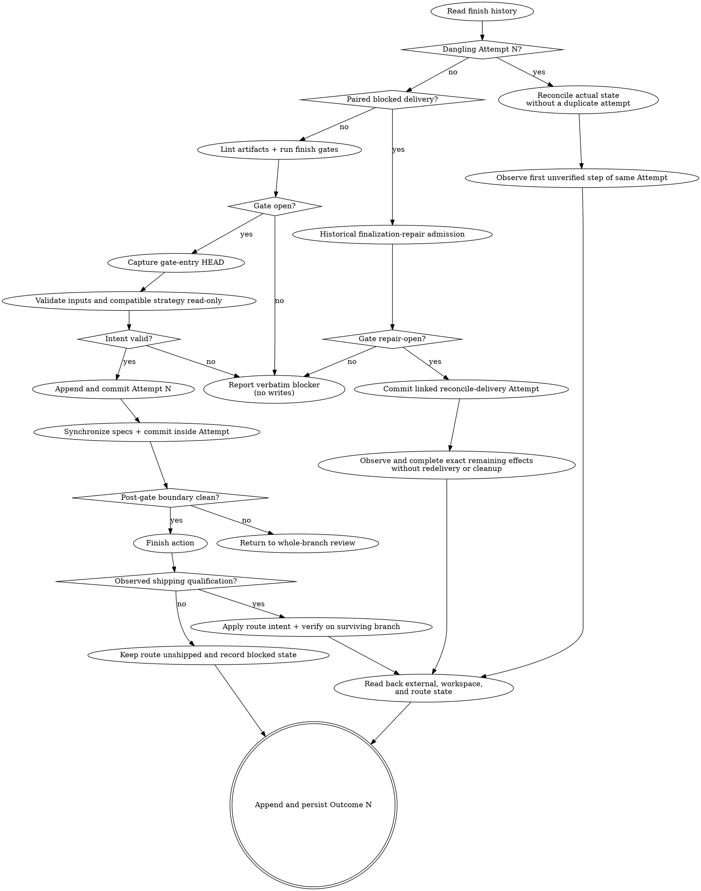

# Finishing a change

Close out a change only after its exact task evidence and whole-branch review open the finish
gate. Synchronize the canonical specifications, durably record the intended finish, carry out the
selected strategy, read the result back, and durably record what actually happened.

The **seven-stage core pipeline** is Kepler's fixed spec-driven sequence: init → propose → plan → code →
code-feedback → review → finish-work. Each step is a skill a person or an agent can run. This
skill is **step 6**, the finish-work step and the last one. Wayfinder and `kepler-critique` are
optional and remain outside the seven-step core count.

## Inputs

- The change directory path (`.kepler/changes/<change>/`) and its exact split-pipeline
  evidence:
  - `<change-dir>/plan.md` and the lint-valid root ledger at `<change-dir>/progress.md`.
  - The physically last implementation attempt in every active
    `<change-dir>/tasks/task-N/progress.md` and the physically last feedback pass in the matching
    `<change-dir>/tasks/task-N/feedback.md`.
  - The physically last whole-branch review pass in `<change-dir>/review.md`.
  - The append-only finish history at `<change-dir>/finish.md`, if it exists.
- The already approved specification inputs: `proposal.md`, `design.md`, and `requirements/`
  where present, plus the current canonical `.kepler/specs/` documents.
- The `route_unit` frontmatter field in `proposal.md` or `plan.md`, when the change executes a route
  unit, and that unit's exact `route.md` and `map.md` paths.
- The finish strategy: `local-merge`, `pull-request`, or `no-op`. If unspecified, use the
  project's explicit default or ask the user.
- Any explicit user waiver of material-change ancestry. Never infer one.
- Project standards from `AGENTS.md`: full test and build commands, base branch, git workflow,
  remote conventions, and pull- or merge-request tooling.

Use `kepler workbench lint --change-dir <change-dir>` for existing artifact format and schema;
its exit status is the single source of truth for validity. Required task and review evidence,
its committed state, and completion readiness are separate finish gates. Do not independently
reject a lint-valid artifact for its layout or for differences from a template.

## References

This skill ships with a `references/` folder. Read reference files using the Read tool on the
skill's own directory — they are co-located with this `SKILL.md`, not at `${XDG_CONFIG_HOME:-$HOME/.config}/vialactea-works/kepler/`.

- `references/spec-altitude.md` — the altitude rubric and the canonical spec's human-readable
  skeleton (`## Overview` / `## Contract` / `## Behavior` with Examples / `## Invariants` /
  `## Decisions`). Apply it during specification synchronization.

## Principles

- **Gate before effects.** Do not synchronize specs, mutate a route, allocate an attempt, merge,
  push, open a request, or remove a workspace until the exact preconditions pass.
- **Physical evidence governs.** Use the exact root ledger and physically last task and review
  records. Never recover an earlier approval from history.
- **Intent before action; observation after action.** Commit an `Attempt N` before canonical
  specs or any other finish side effect. Read back every effect before its matching `Outcome N`.
- **Finish history is paired and append-only.** The attempt says what will be done; the outcome
  says what was verified. Neither rewrites the other.
- **Specs are the truth.** Validate approved deltas read-only before journaling. Fold them into
  canonical specs at human-readable altitude only inside a verified durable Attempt.
- **Same-attempt ownership is narrow.** Expected canonical spec, route, map, and numbered finish
  mutations made by this skill do not invalidate the attempt whose gate admitted them. No other
  post-gate material edit receives that treatment.
- **Root progress is task state only.** Finish-work reads the root ledger but never changes root
  `progress.md` or any task-local execution artifact.
- **Honest completion.** Never infer an external effect from command success alone and never
  report a result that was not read back and persisted.

## Preconditions

For a new attempt, run `kepler workbench lint --change-dir <change-dir>` and stop with its
findings if it exits nonzero. Identify the complete test suite and build/typecheck commands from
`AGENTS.md`. Pass a command that runs both to the installed gate; do not guess or omit either:

```bash
kepler workbench precondition \
  --change-dir <change-dir> --test-cmd '<full test suite && build/typecheck>' \
  --target-branch <full-target-reference>
```

Use `--whole-change-waived` only for an explicit user waiver. The waiver changes only the
whole-branch review's material-change ancestry comparison. It does not waive the exact root task
ledger, task feedback, whole-branch review validity, verdict, blocking findings, range ancestry,
clean tree, or verification gates.

The precondition command is authoritative for completion readiness, not for adding artifact-format
requirements to lint. It must validate all of these facts and close with `gate: open`:

- The working tree is clean, and the full test suite and build/typecheck pass.
- The exact root task ledger has one ordered row for every active task, no extra row, the exact
  lowercase task-progress link, and status `done`. In every linked file, the physically last
  task attempt is well formed and has exactly one `Outcome: done`.
- Every active task's task-progress artifact is tracked and committed at `HEAD`; its latest
  implementation commit resolves, and the physically last task feedback pass is valid, fresh for
  that commit, `approved`, on the current branch, and has no blocking findings or unresolved
  `cannot verify from diff` finding. Its Base agrees with the canonical first-attempt checkpoint.
  Each task's current definition digest and selected-input handoff are verified against committed
  history; any input-impact classification is committed and verified, and affected tasks carry the
  required follow-up plan binding. A historical task whose input provenance is absent may use only
  a task-scoped `legacy_input_confirmations` entry that context and admission report as
  `legacy-current-confirmed`; its `historicalInputs: "unknown"` stays unknown and the record binds
  the unchanged task definition, canonical repository, current committed inputs/approval, owner and
  independent-review references, and rationale. This is a current scope confirmation, not historical
  proof, authentication, semantic review, or a waiver. All task-feedback, intent, review, cleanliness,
  test, and whole-change gates still apply. An explicit serial execution transition is committed,
  verified, and obeyed by task history; completed tasks retain numeric identity order and immutable
  definitions.
- Every present formal proposal/design/requirements input has explicit `approved` / `accepted`
  metadata, an exact full-commit plan reference and requester-held approval reference, and current
  bytes matching that committed revision. Tactical absence is valid; a plan's status/default or
  lint alone is not approval. If optional `critique.md` exists, its disposition must be settled.
  These owner references are assertions, not cryptographic authentication.
- The physically last whole-branch review pass is valid, durable, and on the current branch. It may
  be a full `approved` pass or a validated `approved-remediation` pass whose immutable full baseline,
  resolution map, target/range, intent, and correction coverage all pass the CLI gate. Either verdict
  must have no blocking findings. Its range must use the actual target merge base. Unless explicitly
  waived, its Head must also contain the latest material change commit. A metadata disposition such
  as `applied` never grants clearance; the waiver changes only material ancestry.

If the Kepler CLI/workbench is unavailable, stop: a hand-written artifact parser cannot replace
lint or the precondition command. Fail closed on missing evidence, contradictory state, unreachable
or stale commits, or an unverifiable finish gate.

If any gate fails, stop and report the gate output verbatim. Perform no finish action, do not
create or change `finish.md`, do not synchronize specs or route state, and do not write root
`progress.md`. A precondition failure has no finish-history record because no attempt began.

After the gate opens, require one `verified-head: <full-commit>` line and compare it with current
`HEAD` before capturing the named source branch, resolved delivery target, base branch, worktree
path, review Base and Head, latest material commit, waiver state, and route state. If the identity is
absent or differs, rerun preconditions. Use the verified identifier as gate-entry `HEAD`; do not
silently capture a newer revision. For new generation/finish effects, require the named source branch
to differ from the actual target by normalized refs and configured local/remote mapping, never tip
SHA. The only exception is the scoped A7 repair of an already-observed delivered effect on its
surviving base; that exception cannot authorize new code or delivery and must use A7's recorded
provenance and exact repair allowlist rather than ordinary source-branch admission. Before
canonical-spec synchronization or any finish intent, run `kepler workbench context <change-dir>` for
route-backed work. Require an unambiguous canonical route/unit, exact committed route-source
revision and owner/change/source/target/base match for an ordinary attempt; inspect visible claims
for another owner and stop on conflict or ambiguity. A7 repair verifies the original route/effect
provenance and cannot replay a route transition. This local scan is not distributed exclusivity. Before the first effect and each later
effect, confirm that `HEAD`, source/target branches, base branch, worktree identity, and target
repository still match the admitted boundary. A changed branch or worktree stops even when the
commit SHA is unchanged.

## Specification synchronization

Run `kepler workbench context <change-dir>` to identify the approved change
artifacts and capability deltas. If the Kepler CLI/workbench is unavailable, list those paths
directly. Before editing a canonical spec, confirm that the approved proposal, design, and requirement deltas are
complete and mutually consistent. Treat them as read-only inputs throughout finish-work.

For each approved `requirements/<capability>.md`, read the current
`.kepler/specs/<capability>.md` together with the delta, then draw durable rationale, decisions,
and reusable patterns from the approved `design.md` and `proposal.md`. Before writing a new
author-bearing canonical spec, read `git config user.name` and `git config user.email` and use
`author: Name <email>`; if either value is missing, stop without inventing attribution. When
editing an existing canonical spec, preserve its recorded author metadata exactly. Write
canonical `.kepler/specs/` documents only from those already approved change artifacts.

The content set comes from those approved change artifacts. Never invent canonical behavior from
the raw diff, root or task progress, task feedback, whole-branch review comments, or an external
request. Never add, edit, or rewrite a file under `requirements/` during finish-work.

During read-only validation, if synchronization would require a missing or incorrect change requirement,
abort before allocating an attempt or committing canonical specs. Route the defect to artifact revision, then require a
fresh whole-branch review before finish-work runs again. The same stop applies when the proposal,
design, and requirement deltas disagree. Report the affected artifact and mismatch without
repairing approved intent inside the finish stage.

Write canonical specifications in the human-readable skeleton from
`${XDG_CONFIG_HOME:-$HOME/.config}/vialactea-works/kepler/templates/requirements-spec.md`. Never copy the change-side
Requirement/SHALL/Scenario shape or its delta-group headings into a canonical spec. Translate
each delta into its anchored contract surface:

- **ADDED** adds a contract row, behavior and Examples bullet, invariant, or decision.
- **MODIFIED** rewrites the affected section or subsection to the new behavior.
- **REMOVED** removes that behavior from its anchored section.
- **RENAMED** renames the public subsection anchor when the rename belongs in the spec.

If no canonical spec exists, create it from the template and populate every applicable ADDED and
MODIFIED behavior. Apply `references/spec-altitude.md`: discard private mechanism, preserve
consumer-visible persisted fields in `## Contract`, fold observable scenarios into Examples,
and state reusable rules once. Reserve `MUST` and `NEVER` for invariants.

When the change has no requirement delta, compare its touched capabilities with existing specs.
If behavior changed, treat the absent delta as a missing change requirement: abort for artifact
revision and fresh whole-branch review. Otherwise record that no canonical spec changed. A
tactical path does not permit spec drift.

Do not mutate a canonical file during this validation. Resolve its exact planned target and approved
input blob identities first, then commit and verify the Attempt as specified in Process. Only inside
that same Attempt, after every canonical spec mutation, run `kepler workbench lint --file <file>` at the
mutation boundary. A nonzero lint result is a failed gate: correct the spec and rerun lint, or
stop with the exact finding without staging or committing it. This file-scoped lint is additive;
it does not replace the semantic, freshness, ancestry, or completion gates. Review the
synchronization and stage only canonical `.kepler/specs/` paths derived from the already
approved artifacts. If any changed, commit them after the verified finish Attempt, verify the
commit, and restore a clean tree. If none changed, observe no change without manufacturing an empty
commit. Record the actual synchronization paths/commit or verified no change in Outcome, never as
already-observed synchronization in the preceding intent. Either result is an expected finish-owned synchronization for this
attempt, but it does not make an unrelated edit safe.

## Finish history

`<change-dir>/finish.md` is the only finish-history artifact. On the first admitted attempt,
load and instantiate the exact installed `${XDG_CONFIG_HOME:-$HOME/.config}/vialactea-works/kepler/templates/finish.md` template. Populate its frontmatter fields `change`, `status`, `created`, `updated`, `strategy`,
`result`, and `decision`. Substitute the real change title and first complete attempt, remove the opening instruction block and every
inline hint, and ensure no authoring instruction or hint survives in the live file. Otherwise
run `kepler workbench lint --file <change-dir>/finish.md` before use, then derive the next
attempt from the cleaned record portion of that same installed template. A successful lint
must not be overridden by a separate body-format check. Retained authoring markup may be
removed, but `finish.md` is otherwise append-only: never alter or reorder a recorded attempt or outcome, and never write root
`progress.md`; finish work owns no root progress row or section.

Every pair uses `## Attempt N — <YYYY-MM-DD>` and `## Outcome N — <YYYY-MM-DD>`. For a fully
paired history, choose the next integer after the highest numbered Attempt or Outcome. Numbers
must be strictly monotonic, each number must occur once for each kind, and Outcome N must be the
matching observation for Attempt N. Lint decides whether the existing section format is valid;
check actual attempt/outcome evidence for a safe resume before any action.

Populate the template-defined attempt with durable gate evidence, planned specification targets and
approved input identities, selected strategy, intended workspace result, and route intent. Populate
Admission identity with the exact verified HEAD, original target ref/commit, review Base/Head and
artifact-only review commit, original explicit material-waiver reference or null, and unique approved
input paths/blob IDs. Source identity records the canonical absolute Git common directory, original
root, full source ref and absolute Git worktree identity. Route identity is null or records the exact
route/map/unit/source blob, previous in-progress state, owner/change/source/target/base and the resolved
shipping condition. Use canonical strategy tokens, not prose synonyms, in every new Strategy field.
These are recovery provenance, not authenticated owner approval. Append its matching outcome only
after reading back the effect, recording the completed or blocked result together with verified
external, workspace, route, and partial-state evidence. The installed template remains the exact
creation and attempt shape; these lifecycle rules govern later outcomes without duplicating that
shape here.

The attempt and outcome are separate commits because the external result cannot be known before
the action. Commit the attempt on the change branch and verify that exact commit before the first
finish effect. Commit the matching outcome on the branch or base that survives the strategy and
verify it there. For a strategy with a remote branch, push and read back the persisted outcome.

## Resume and recovery

If `finish.md` exists, lint it before starting preconditions for a new attempt. If the physical
history ends with Attempt N without matching Outcome N, reconcile it before any new action or
attempt allocation. Inspect, in order, the relevant git commits and refs, remote branch, pull
request or merge request, route files, and workspace/worktree state. Do not trust an earlier
agent response or command's exit status.

Compare observed state with that attempt's recorded strategy and intent:

- If the intended result already happened, append the matching completed Outcome N and persist
  it on the surviving branch or base.
- If the action failed or left a stable partial result, append the matching blocked Outcome N
  with that verified state and persist it where it survives.
- If evidence proves the action did not start or can safely continue, continue the same attempt
  from the first unverified step. Revalidate its attempt commit and the post-gate mutation
  boundary first.
- If state is ambiguous or unsafe to modify, stop and report the dangling attempt without
  changing it.

Never allocate or execute a duplicate attempt before this reconciliation, and never renumber the
dangling attempt. After a blocked outcome before any verified delivery, a later ordinary retry is a new attempt and
must pass current preconditions again. Never reopen or rewrite a paired blocked outcome.

If a paired blocked outcome follows verified delivery, do not run delivery again. Request
finalization-repair admission on the surviving branch/base:

```bash
kepler workbench precondition --change-dir <change-dir> \
  --test-cmd '<full test suite && build/typecheck>' \
  --target-branch <recorded-original-target> --recover-finish <original-delivery-attempt>
```

Require `admission: finalization-repair`, current `verified-head`, exact `remaining-effects`, and
`gate: repair-open`. This authorization cannot enter the ordinary synchronization/delivery path.
The CLI rereads immutable original task/review evidence at admitted HEAD, recomputes historical Base
against the original target commit rather than today's merged target, verifies the recorded review
artifact-only revision and original narrow waiver, reobserves delivery, and binds current clean
HEAD/tests/build/branch/worktree. A removed source branch is not an input to another merge.
A changed current merge base does not invalidate the already-delivered historical review.

Create a new numbered `reconcile-delivery` Attempt linked by Recovery of to the original attempt and
blocked-outcome commit, plus the previous failed-repair outcome commit or null. Copy the original
Admission/Source/Route identities and delivery identity; record only the exact remaining effects.
Preserve both original records. Complete only those named canonical/route/map/history effects,
observing each for idempotent reuse, then persist its separately verified Outcome. Never repeat merge,
request creation, or branch/worktree cleanup. A failed repair receives its own paired blocked Outcome;
a later repair binds the same original delivery and the latest failed repair and requires changed
conditions/evidence, not an identical retry. New application/test/design/requirement changes need an
ordinary change and review.

Any dirty surviving tree closes automated repair, even an exact owned route/map diff from failed
lint or commit. Report the paths and ask the owner to authorize preservation/restoration or a scoped
commit. Do not discard, stage, pre-commit or normalize them to manufacture cleanliness. Rerun
admission afterward. Missing/forged historical provenance, rewritten merge content, changed intent or
ambiguous delivery requires owner adjudication; legacy records remain immutable and do not receive
invented modern provenance.

## Post-gate mutation boundary

Use the gate's `verified-head` as gate-entry `HEAD` and compare every later commit and working-tree
path with it before each finish effect. Recheck the admitted branch, base branch, worktree identity,
and target repository at every effect boundary, including when a branch change keeps the same
commit SHA. The only allowed post-gate changes are canonical `.kepler/specs/` folding
derived from already approved artifacts, the exact route and map transition named by the
attempt, and the numbered `finish.md` mutations for that same `Attempt N` and `Outcome N`.

A change requirement is not finish-owned. Any post-gate edit to `proposal.md`, `design.md`, or
`requirements/` is an unrelated material edit, even if it appears to help synchronization.

Those finish-owned changes do not stale the same attempt. They are not a general freshness
exception and do not open a later attempt. An unrelated material edit, unexpected path, amended
reviewed commit, or unexplained dirty state must abort the attempt before the next effect and
return the change to whole-branch review. If an attempt commit already exists, persist a blocked
matching outcome when the verified repository state makes that safe. The ancestry waiver does
not excuse any post-gate mutation outside this allowlist.

## Route ownership and workspace retention

Before the first finish-owned write or route-backed attempt, run context and require one canonical
route/unit binding, its exact committed route-source revision, and agreement with the
owner/change/source/target/base recorded in the proposal or plan. For an ordinary attempt, require
the selected unit to remain owned by this change and in `in-progress`; A7 repair instead verifies
its recorded original route/effect state and never replays the transition. Inspect known
proposals/plans, local and visible remote branches, and worktrees for competing claims. Stop before writing finish intent on conflict or ambiguity. A map-level status is
an aggregate summary, not proof of unit ownership or shipment. Record the owner, change, full source
and target refs, base/input revision, route/unit and route-source revision in `Attempt N`. Record the
route blob revision after the route/map transition in `Outcome N`.

The designated user/controller authorizes any withdrawal or transfer. Before changing a claim,
inspect partial implementation, Git/provider effects, dependent work and every visible owner. Record
the authorized release/transfer in existing change intent, preserve branch/history and partial work,
and revalidate dependencies. Reset a unit to `pending` only when no verified shipment or partial
effect is being erased. Never reset `shipped`, infer rollback, or repeat delivery to release a claim.
Before removing a branch/worktree, prove it is exclusively owned by this change, clean, and safely
preserved, and confirm the selected strategy explicitly calls for removal. Retain and report shared,
dirty or ambiguously owned workspaces; isolation is not a cleanup-ownership certificate.

## Process

1. **Inspect existing history.** Validate `finish.md`. If an attempt is dangling, follow
   **Resume and recovery** and do not enter a new-attempt path first.
2. **Run preconditions.** For a new attempt, run the exact gate in **Preconditions**. On failure,
   report its output without writing anything.
3. **Capture gate entry.** Record the full admitted identities and establish the post-gate
   allowlist. Run the route-binding/ownership check described above before any canonical-spec
   synchronization or finish-history write.
4. **Validate synchronization read-only.** Check approved artifact consistency, exact input blobs,
   canonical targets and spec impact without changing canonical files. Missing/inconsistent inputs
   return to artifact revision and fresh whole-branch review without an Attempt or spec commit.
5. **Resolve compatible intent.** Detect the workspace with
   `kepler workbench isolate --check`, resolve the actual target branch and selected strategy, and
   identify any exact route and map transitions. For a route-backed change, run context again and
   record its exact committed route-source revision and owner-bound route/unit/source/target/base
   identity in the Attempt. Stop on a changed revision, conflicting binding, or competing owner.
   Capture the unit's old state and exact Shipping rules condition. Require the strategy to satisfy
   that condition within this invocation before any Attempt or effects. A merge-required route with
   a request-open strategy stops for a compatible strategy or authorized rule decision; do not create
   an awaiting-merge state, request or spec write. No-op qualifies only when the route explicitly
   permits it. Ask if the strategy is still unspecified and no project default exists.
6. **Commit intent.** Append the template-defined `Attempt N` with complete durable intent. Run
   `kepler workbench lint --file <change-dir>/finish.md` after the finish-history mutation and
   before committing. A nonzero lint result is a failed gate: correct the history and rerun lint,
   or report the exact blocker without committing or handing off. Commit that attempt alone on the
   change branch, verify the commit contains the expected finish path, and confirm it is reachable
   from the branch. This commit must exist before canonical specifications or any external finish action.
7. **Synchronize inside the Attempt.** Apply/lint approved canonical deltas, commit only exact
   derived spec paths and read back their actual result. Observe no change without an empty commit.
   An interruption before/after this commit resumes the same unmatched Attempt from its first
   unverified step; recheck approved identities and the admitted allowlist before continuing.
8. **Check the boundary.** Reinspect all post-gate commits and working-tree paths before each effect.
   Abort on any mutation not owned by this attempt. A changed input identity aborts recovery.
9. **Execute then qualify the strategy.** Follow exactly one branch in **Strategy execution**.
   Read back the qualifying Git/provider effect before route mutation. On the surviving branch,
   advance only the named unit from `in-progress` to `shipped`; lint every route/map mutation before
   continuing and commit/read back exact paths. Update the map only when every unit is verified
   shipped. Reuse an exact prior advancement only while the original unit/map/condition/input
   identity and observed qualification still hold. Preserve siblings and partial writes; route/map
   updates are not atomic and do not imply rollback. If not route-backed, record no route mutation.
10. **Read back actual state.** Query git, the request provider when applicable, the worktree
    list, and route files. Collect actual identifiers and states; do not draft the outcome from
    intended values.
11. **Persist the outcome.** Append the matching `Outcome N` as `completed` only when every
    intended effect was verified, otherwise as `blocked` with the verified partial state. Run
    `kepler workbench lint --file <change-dir>/finish.md` after the outcome mutation and before
    committing. A nonzero lint result is a failed gate: correct the history and rerun lint, or
    report the exact blocker without committing or claiming completion. Commit it on the surviving
    branch or base. Push and read it back when a remote branch participates.
12. **Report.** Re-read the persisted pair and disclose only the verified external, workspace,
    route, branch, request, and history state.

## Strategy execution

- **local-merge:** From the main checkout, merge the change branch including the verified
  attempt commit and admitted synchronization into the resolved base branch according to the project's
  workflow. Never remove a worktree from inside itself. Remove the linked worktree and delete the
  change branch only when the project workflow calls for it and the Route ownership and workspace
  retention checks prove exclusive ownership, clean state and preserved work. Then read back the
  base ref and workspace list: verify the base contains the attempt, the merge result is present,
  and the worktree is absent when removal was authorized and intended. Only after that qualifying
  merge, apply/lint/commit and read back the named route/map advancement on base. Append the matching `Outcome N`
  on the base branch, commit it there, and verify that commit and pair on the base. If the base is
  pushed by the workflow, push the outcome commit and verify the remote base ref too.
- **pull-request:** Push the change branch containing the attempt and synchronization, verify the
  remote ref, then open the pull request or merge request using approved artifacts. Read back its
  canonical URL, provider/repository, open state, head commit, source and base. Request-open qualifies
  only when Shipping rules permit it. Then apply/lint/commit route/map on the change branch, push and
  verify it. Leave the branch and worktree in place. A historical already-open request requiring
  merge remains unshipped and blocked until actual merged readback qualifies; linked repair may use
  that merged state and immutable content provenance without requiring the object to remain open
  or creating a duplicate. Rewritten/ambiguous content stops for owner adjudication. Append the matching `Outcome N`, commit it on the change
  branch, push that commit, and verify the request head and remote branch include the outcome
  commit. A locally committed outcome that did not reach the remote request is blocked, not
  completed.
- **no-op:** Perform no merge, push, request creation, branch deletion, or worktree removal.
  Verify that the intended branch and worktree remain. Only an explicit no-op Shipping rule may
  qualify route intent; then apply/lint/commit its named advancement and read it back. No-op never
  implies an external delivery.
  Append the matching `Outcome N` on the unchanged change branch, commit it there, then re-read
  the branch, worktree, route, and paired history before reporting completion.

## Partial failure

When a command fails after the finish action begins, stop issuing forward actions and inspect the
actual partial state. Determine which commits, refs, remote objects, route transitions, and
workspaces really exist. Never infer rollback or success.

When safe, append the matching Outcome N as `blocked`, name every verified effect and missing
effect, and commit it on the surviving branch or base. If a remote branch exists, push and read
back the blocked outcome from the remote when possible; if persistence or push fails, report that
exact fact and leave the attempt for recovery. Never report the attempt as completed, and never
allocate a replacement attempt during the same recovery.

## Boundaries

- Never edit application code or delete, weaken, or rewrite tests to open the gate.
- Never write finish state into root `progress.md`, task progress, task feedback, or root review.
- Never create an attempt before the gates and read-only validation, or commit specs before intent.
- Never mutate a route before observed compatible shipping qualification.
- Never use repair-open to allocate an ordinary delivery attempt or replay a delivered effect.
- Never begin a route or strategy effect before the attempt commit is verified.
- Never overwrite, reorder, pair loosely, or backfill finish history from memory.
- Never remove a worktree from inside it.
- Never fabricate a merge, request, route transition, workspace removal, pushed commit, or
  persisted outcome.
- Ask first when no finish strategy is supplied and project standards provide no default.

## Output

Before an action begins, output is either the verbatim gate blocker with no writes or a request
for the missing strategy. After an attempt begins, report its number, the verified external
result, actual route and workspace state, surviving branch or base, and the commit containing the
persisted Outcome N. Include the verified request URL and remote head for a pull-request strategy.

Never claim a merge, pull request, no-op, route transition, workspace removal, or outcome until
that specific result has been read back. If outcome persistence itself failed, say that the
attempt remains dangling instead of describing an unpersisted result as history.

Outcomes with modern provenance record Result, Specification synchronization result (exact paths and
commit or verified no change), Delivery identity (observed Git result, canonical request or no-op), and
Remaining effects (exact typed paths or an empty array). Repairs retain original identity and report
new provider qualification/readback separately. Persist and push the route and Outcome before any
completed claim. A pending or failed qualifying effect leaves the unit unshipped.

## Process flow


