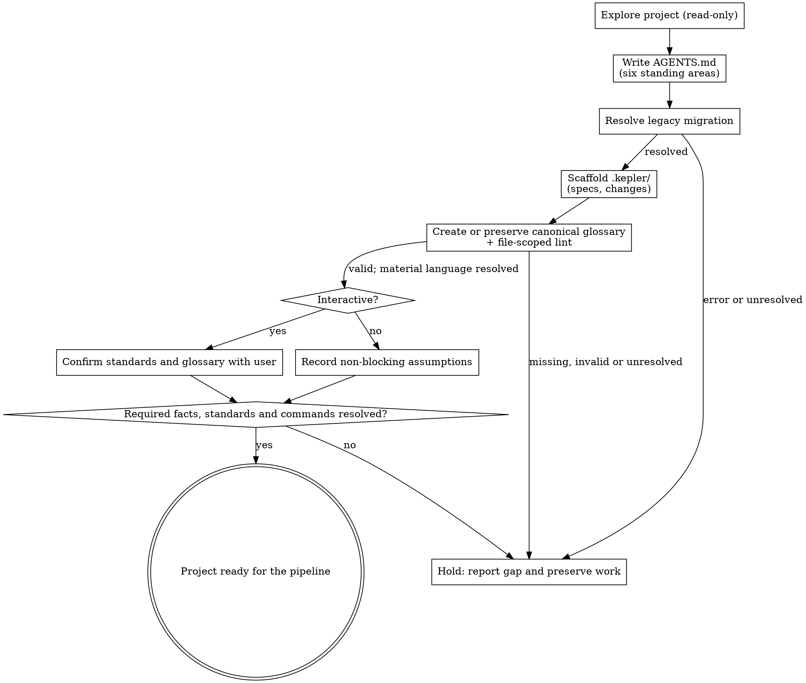

# Initializing a project

Prepare an existing project for the pipeline: record how it works in `AGENTS.md`, establish its canonical language in `.kepler/specs/glossary.md`, and create the workspace later steps need. Run this once, up front.

The **seven-stage core pipeline** is Kepler's fixed spec-driven sequence: init → propose → plan → code → code-feedback → review → finish-work. Each step is a skill a person or agent can run. This skill is **step 0**: it runs before any change and produces the standing project standards every later step reads. Wayfinder and `kepler-critique` are optional and remain outside the seven-step core count.

## What it produces

- `AGENTS.md` at the project root — the project's standing standards.
- `.kepler/` workspace: `specs/` and `changes/`.
- `.kepler/specs/glossary.md` — the main source of context-scoped project terminology.

This skill does not create templates. Global artifact templates live at `${XDG_CONFIG_HOME:-$HOME/.config}/vialactea-works/kepler/templates/`; the `kepler setup` command installs them for projects to share.

## Inputs

- An existing project (a git repository).
- Anything the user wants emphasized in the standards (optional).

## Process

1. **Explore (read-only).** Learn the project's languages and versions, build and test commands, directory layout, conventions, and CI. Read package manifests, config, and a sample of the code. Read existing domain documentation and specs for established terms and context boundaries; distinguish documented meanings from code-based inferences. Make no edits in this step.
2. **Write `AGENTS.md`.** Cover the six standing areas below. Create the file if missing; otherwise extend it without overwriting the user's content.
   - **Commands** — the exact build / test / lint commands, with flags.
   - **Testing** — the framework, where tests live, how to run them, coverage expectations.
   - **Project structure** — where source, tests, and docs live.
   - **Code style** — naming and formatting rules, plus one short real example from the code.
   - **Git workflow** — branch naming, commit format, pull-request conventions, and the default finish strategy (`local-merge` or `pull-request`) `kepler-finish-work` reads.
   - **Boundaries** — three tiers: Always / Ask first / Never (e.g. "Never commit secrets").
3. **Check for legacy project data before scaffolding.** If `.hamilton/` exists and `.kepler/` does not, run `kepler workbench context --all` from the project root before creating `.kepler/`; this copies existing data to the canonical path and leaves the legacy source intact. A `no .kepler/changes/` result with exit code `1` means there are no changes to list; confirm `.kepler/` exists and continue. Stop on any other migration error. When both directories exist, Kepler uses `.kepler/` without merging or modifying `.hamilton/`.
4. **Scaffold `.kepler/`.** Create missing directories only; preserve any data copied from `.hamilton/`.
   - `specs/` — canonical capability truth.
   - `changes/` — one directory per change.
5. **Establish the canonical glossary.** Check `.kepler/specs/glossary.md` after migration and scaffolding. If the glossary already exists, including one copied from `.hamilton/`, read and preserve its content and recorded author; do not overwrite or reformat it during init. If it is missing, read the installed `${XDG_CONFIG_HOME:-$HOME/.config}/vialactea-works/kepler/templates/glossary.md`. Before creating this author-bearing requirements-spec, read `git config user.name` and `git config user.email` and write `author: Name <email>`. If either identity value is missing, stop and report it rather than inventing attribution. Keep the canonical metadata and all five required sections; delete instruction blocks and replace or remove every placeholder.
   Seed terms from established project documentation and specs, with a definition, bounded-context scope, relevant aliases or terms to avoid, and source references. Confirm code-derived meanings with the requester before treating them as established language. The same word may have different meanings in different contexts. If no project-specific terms are supported, say so instead of inventing vocabulary. Keep unresolved or conflicting definitions out of canonical entries; ask when attended, otherwise report the gap, and never invent a resolution or requester approval. Keep `decision: skipped` unless the requester actually confirms the language. After creating the canonical glossary, run `kepler workbench lint --file .kepler/specs/glossary.md`; also lint a preserved existing glossary. A missing template or unavailable lint command blocks readiness. A nonzero lint result fails the gate: resolve the findings and rerun for a new glossary, or request owner-directed repair of an existing artifact and preserve its bytes while reporting the exact blocker. This gate runs before handoff or commit. Lint checks structure, not the truth or completeness of definitions.
6. **Confirm or record.** Working with a person, show the drafted `AGENTS.md` and the glossary for correction before finishing. Verify documented build/test/lint commands against current repository evidence or requester input. Do not declare the project ready while migration or any required project fact, standard, or verification command remains unresolved. A missing or lint-invalid glossary or a material terminology conflict also remains unresolved: ask when attended, otherwise report the exact gap and preserve completed work. Rerun file-scoped lint after any authorized glossary correction. Unattended assumptions may cover only non-blocking details.

## Principles

- **Read, don't guess.** Ground standards and glossary definitions in repository evidence or requester-confirmed facts. Wrong language misleads every downstream step.
- **Don't clobber.** If `AGENTS.md` exists, extend it and preserve its content.
- **Idempotent.** A rerun updates `AGENTS.md` and fills missing workspace pieces and the canonical glossary without touching existing specs or changes. Preserve a migrated glossary as an existing spec.

## Output

`AGENTS.md` written or updated, `.kepler/{specs,changes}/` in place, and `.kepler/specs/glossary.md` created or preserved and lint-valid. The project is ready for `kepler-propose` (or `kepler-plan` for tactical changes) only after migration and required facts, standards, verification commands and material terminology are resolved. If any remain unresolved, the project is not ready: preserve completed work and report the exact gap.

## Process flow

