# Orchestrating a plan

Run every active `plan.md` task through implementation and fresh approval, then run the whole branch through its whole-branch review gate. At every decision, resume from committed artifacts, Git ancestry, and the in-session todo list.

The **seven-stage core pipeline** is Kepler's fixed spec-driven sequence: init → propose → plan → code → code-feedback → review → finish-work. This driver coordinates the per-task `kepler-code` ↔ `kepler-code-feedback` loop, then one whole-branch `kepler-review`, followed by `kepler-finish-work`. Wayfinder and `kepler-critique` are optional and remain outside the seven-step core count.

As coordinator, the orchestrator owns guarded task admission, scope reservation, integration, and root status publication.

It dispatches three stage owners:

- `kepler-code` owns one task's implementation, task-local progress and original task commit.
- `kepler-code-feedback` judges one task's stable diff and owns its feedback artifact.
- `kepler-review` judges the complete branch and owns the root review artifact.

**Continuous execution.** Execute the task dependency graph without asking whether to continue. `Depends on` defines prerequisites; task numbers and document order do not define execution order. Dispatch compatible ready tasks in independently admitted, isolated lanes. Hold descendants until their prerequisites are fully gated; unrelated ready tasks may proceed. Stop when no safe work can proceed because of an unresolved blocker, an upstream artifact defect, or an unsafe workspace state, or when the fresh whole-branch approval gate is complete.

**Coordinate; never implement.** Dispatch the skills that own code, planning, and review. Do not hand-edit implementation, tests, `plan.md`, progress, feedback, or review artifacts. Use guarded `kepler workbench task-state` commands for coordinator-owned admission, reservation, and publication. The todo display mirrors durable state; it cannot replace it.

**Who marks a task done?** The `kepler-code` worker commits its task-local `done` evidence. The coordinator then invokes `task-state --publish --response done` with the required binding and exact Verify command. The CLI integrates the original worker commit if needed, runs Verify on the integrated work, and commits `done` to root `progress.md` only after those checks pass. This does not require editing `plan.md`: `kepler-plan` owns task definitions and scaffold creation, while root progress records execution status. Independent `kepler-code-feedback` approval makes the published task fully gated; root `done` alone does not release dependents.

## Inputs

- A change directory at `.kepler/changes/<YYYY-MM-DD-title>/` containing `plan.md`.
- The root `<change-dir>/progress.md` task ledger and linked `<change-dir>/tasks/task-N/progress.md` files.
- Task-local `<change-dir>/tasks/task-N/.base` checkpoints and `feedback.md` files when present.
- Root `<change-dir>/review.md` when present.
- The change's proposal, requirements, and design artifacts when present.
- Project standards from `AGENTS.md` or the repository equivalent.

Before dispatching, run `kepler workbench lint --change-dir <change-dir>` on the existing change. Its exit status is the single source of truth for artifact format and schema. If lint exits nonzero, report its findings without dispatching. Apply **Plan format** before admission or execution. Read active task ids from `plan.md` and their current status from the root ledger. Require the task logs needed for the selected stage, but classify absent files as missing evidence, not a format failure. Do not reject lint-valid frontmatter, additional content, or a layout merely because it differs from a skill-specific template.

## References

Read the scope-specific prompt that matches each dispatch:

- `references/implementer-prompt.md` dispatches `kepler-code` for one exact Task N.
- `references/code-feedback-prompt.md` dispatches `kepler-code-feedback` for one exact Task N.
- `references/whole-branch-review-prompt.md` dispatches `kepler-review` for the complete branch.

Do not combine the two review scopes into a conditional prompt. Task feedback and whole-branch review have different evidence, inspection boundaries, artifact destinations, and handoffs.

## Plan format

Execute only plans declaring `execution: {version: 2, mode: dependencies}`. Version-1 and unversioned plans are read-only historical context: never execute, migrate or rewrite them through this skill. If the selected plan uses either format, stop before admission or dispatch and return to the owner for a current plan. Unsupported or malformed execution metadata also stops dispatch; never infer the format from installed skills.

## Principles

### Task graph and ownership

Derive verified ready, held, and fully gated sets from workbench context using current committed evidence. Readiness alone does not admit a task; root `done` records implementation status, not clearance. Admit the observed expected worker and lane before dispatch, and dispatch only compatible isolated lanes. Keep descendants held until every declared prerequisite has fresh, committed, independent feedback and is fully gated.

Workers own only isolated, task-local attempts and task commits. One coordinator owns shared common-gitdir mutations: it serializes integration of original worker commits, then performs guarded root publication for `done` or `blocked` only. Treat `interrupted` and `unavailable` as neutral worker responses. Preserve each admission's original Base across retries, corrections, and cache loss; never turn partial work or an unavailable response into a fabricated attempt or `done`/`blocked` outcome. After integration, require the exact integrated Verify before publishing `done`. Feedback remains independently authored and artifact-only. Require fresh, committed, independent feedback for every active task before whole-branch review or finish, regardless of root completion.

Use the configured `kepler` executable for workbench commands; source-backed development fixtures may provide a fixture-local CLI bridge. `kepler workbench context <change-dir>` derives readiness. Guarded commands use `workbench task-state --admit [--retry] --task N --change-dir <path> --expected-head <full40> --worker <observed-worker> --worktree <linked-lane> --target-branch <full-ref>`, `--reserve --task N --change-dir <path> --expected-head <full40> --reservation '<exact JSON>'`, and `--publish --task N --change-dir <path> --expected-head <full40> --task-head <full40> --verify '<exact Verify>' --response done|blocked`.

Confirm command-specific compatibility from the actual CLI. Reservations bind before edits. Allow at most two lifetime reservations per task, with at most four paths each; never restore consumed quota. `workbench diff --record --task N --change-dir <path>` cannot replace admission. For feedback packaging, use `workbench diff --task N --change-dir <path>`; `--record` writes or validates a cache, not a diff package.

### Dispatch rules

- **Read state, then dispatch.** Before every action, recompute readiness and apply the relevant routing table using root status, the physically last verdict, and reviewed-range freshness.
- **Admit before dispatch.** Only compatible ready tasks in independently admitted isolated lanes may run concurrently. Readiness alone is not admission.
- **One task, one checkpoint.** Preserve the original admission Base across retries, corrections and cache loss; never rebase the task range.
- **Stage-owned evidence.** Workers own task-local attempts and commits; the coordinator owns guarded root publication; code feedback owns task feedback; whole-branch review owns root review.
- **Commit every gate.** A feedback or review verdict is not a completed checkpoint until its owner creates and verifies the required artifact-only commit.
- **Files carry detail.** Task progress is the only detailed implementer report. Keep dispatch output to status and commit information; diff packages and verdict artifacts carry review evidence.
- **Fail closed on actual gate failures.** An absent, lint-invalid, unreachable, contradictory, or stale last pass never inherits an earlier approval. Do not add a separate format check.
- **Specify every model.** Every dispatch names its model according to **Model roles**.

## Checkpoint establishment and recovery

Admission binds the original Base to the task, plan, actor, lane, repository, and prerequisite approval identities. Reuse that Base across retries, corrections, and cache loss; never reset it to current `HEAD`. The ignored `tasks/task-N/.base` file is a cache, not authority. Recover a missing cache only from verified admission history. Conflicting or ambiguous checkpoint evidence stops the affected dispatch for owner diagnosis. Preserve partial work and existing evidence.

Only the coordinator serializes shared integration and guarded publication. An unavailable worker response remains unresolved; it is neither an attempt nor a terminal status. Root `done` requires integration and exact Verify. A fully gated task also requires fresh, independently committed feedback approval.

## Durable task approval

The driver may consume an approval only when every part of this predicate succeeds for the exact `tasks/task-N/feedback.md` path:

- the feedback path is tracked at current `HEAD`: `git ls-files --error-unmatch` succeeds for the exact path and the path exists in the `HEAD` tree;
- the feedback path's index entry is unchanged from current `HEAD`: `git diff --cached --quiet HEAD --` succeeds for the exact path;
- the feedback path's worktree content is unchanged from the index: `git diff --quiet --` succeeds for the exact path;
- the latest commit that touched the feedback path is artifact-only, and the commit's path list contains only `tasks/task-N/feedback.md`;
- lint accepts the feedback artifact; the physical last pass belongs to this task, says `approved`, contains no blocking findings, and is fresh by the task range rules below.

Evaluate this predicate from repository state, never from subagent output. Any failed condition, including a worktree-only approval, an untracked file, or a mixed latest feedback-touching commit, requires the driver to dispatch `kepler-code-feedback` for the same task; it never authorizes a dependent task admission or whole-branch review. Evaluate the index and worktree conditions independently: a staged feedback blob that differs while the worktree matches `HEAD` must fail the index condition.

## Task handoff consistency

Before applying task outcome routing, require `kepler workbench lint` to accept the root progress ledger. Its frontmatter task list and Markdown rows must match exactly by ordered task id, title, status, and progress link. The root artifact's aggregate `status: complete` means all active implementation rows are done; it is only an implementation summary, never a substitute for per-task feedback or whole-branch approval and never a finish-work gate.

Interpret task-local evidence by phase. Root `in-progress` with an initialized local `status: pending` log and no attempt is the supported first-attempt boundary. A correction may also have a prior finalized local status and attempt while its root row is `in-progress`; preserve that history. For root `done` or `blocked`, require matching root frontmatter/row status and matching local status/latest terminal Outcome. Lint rejects a latest attempt with duplicate Outcomes before its value is used.

If a task's root or local evidence contradicts its claimed terminal state, hold that task and its dependents. Diagnose task-local evidence with the coder and root publication with the coordinator. The coder may repair a proven task-local recording omission while preserving sibling evidence and history. Root status changes remain coordinator-owned and require guarded publication. Feedback does not change implementation status, and the driver never invents a done attempt. If completion evidence is insufficient, resume normal verification rather than making a bookkeeping-only repair.

## Task outcome routing

First recompute the verified readiness projection (`ready`, `held`, and `fullyGated`) with `kepler workbench context <change-dir>`. Readiness is not admission; root `done` is not clearance; and no terminal worker response bypasses publication or feedback.

| Worker / publication evidence | Coordinator action |
| --- | --- |
| Ready, not admitted | Admit the observed expected worker/lane against current full HEAD and prerequisites before dispatch; readiness alone never authorizes a worker. |
| Held, including a descendant of an incomplete prerequisite | Do not dispatch; preserve completed work and wait for prerequisite fully gated feedback. |
| Root `pending` and verified ready | Admit first, then dispatch only the expected worker/lane. |
| Root `blocked` and newly resolved input | Preserve prior evidence; retry only after a changed resolution and guarded admission. |
| Root `in-progress` or interrupted worker | Inspect its assigned lane, task commits, checkpoint and local evidence; resume that admission or hold the task. Unrelated compatible ready tasks may proceed under their own admissions. |
| Worker response absent or unavailable | Preserve partial lane and admission Base; inspect durable worker/task evidence. Missing response is not an attempt, blocked result, or done result. |
| Worker reports blocked with truthful local evidence | Coordinator may publish only `blocked`; preserve uncommitted partial work and do not count fully gated. |
| Worker done with original task commit | Serialize integration of that original commit; run its exact Verify on integrated bytes; publish `done` only through guarded publication. |
| Worker blocked | Preserve partial work; coordinator publishes blocked through guarded publication only when worker supplied truthful task-local evidence. Never fabricate an attempt or mark done. |
| Worker interrupted, unavailable, or response missing | Preserve the lane and partial work; keep unresolved/in-progress and inspect evidence. No fabricated terminal outcome: do not synthesize done or blocked or retry from a new Base. |
| Feedback absent | Dispatch independent artifact-only feedback for the integrated task range; do not count fully gated. |
| Feedback untracked or changed from `HEAD` | Re-review the same integrated range; untracked or modified verdicts never clear. |
| Latest feedback-touching commit is mixed | Require a fresh artifact-only feedback commit on the same task range. |
| Feedback stale or lint-invalid | Route stale evidence to its owner; do not issue an identical retry or infer approval. |
| Feedback fresh `skipped` | Request a new feedback pass; skipped does not clear. |
| Fresh changes-requested code-defect | Dispatch same task worker for correction with guarded `--admit --retry` against original Base and remaining lifetime reservations; integrate and verify, publish separately, then obtain new independent feedback. |
| `cannot verify from diff` / evidence-gap | Adjudicate located evidence on unchanged Base/Head; re-feedback same-Head only with new evidence, or route a confirmed code gap to correction. |
| Fresh `changes-requested` intent-defect | Return to approved intent owner; do not ask worker to work around it. |
| Fresh durable `approved`, no blockers | Count fully gated only after current context confirms prerequisite gates; then recompute readiness. |
| Integrated task has fresh durable approved feedback | Count fully gated only if readiness projection confirms prerequisites; then recompute all ready/held descendants. |

Only compatible ready tasks with independently admitted isolated lanes may run concurrently. Each worker owns its task-local attempt and original task commit; one coordinator serializes shared integration and guarded root publication. Publish only `done` or `blocked`; `interrupted` and `unavailable` are worker responses, not root statuses. Reuse the admission-bound original Base through retries, corrections, and cache loss. Before whole-branch review or finish, require fresh, committed, independent feedback for every active task and confirm that each task is fully gated.

## Task feedback and recovery

A task feedback pass is fresh only when its full Base and Head are valid commits, Base is an ancestor of Head, Head is an ancestor of current `HEAD`, and Head contains the latest commit that touched `tasks/task-N/progress.md`. Establish range validity, material coverage, and unresolved findings separately. A stale `changes-requested` pass retains its blocker set for classification; staleness does not erase obligations or authorize the old verdict. Before any repeated dispatch, name the changed code, located evidence, external condition, or corrected protocol input that could change the result. If none changed, stop automated retries and ask the finding's owner to adjudicate.

Classify each new Blocking finding as `code-defect`, `evidence-gap`, or `intent-defect`, and retain its stable `pass-N-blocking-M` identity when carried forward. A kind guides routing, not approval. For legacy untyped task findings, retain the canonical `cannot verify from diff` fallback; adjudicate ambiguous kinds rather than inventing a code defect. A located evidence gap may return to feedback on the same Base and Head only after the driver supplies the exact newly checked evidence; do not create a code commit or move the reviewed Head for evidence-only re-feedback.

For `in-progress`, inspect only that task's working tree, commits, checkpoint, and physical latest attempt. Determine whether an interrupted implementer is still running, whether its work can be resumed by a fresh `kepler-code` dispatch, or whether it must finish through the canonical blocked path. Never manufacture an attempt entry or infer completion from code alone.

For `blocked`, read the latest task attempt before dispatch. Supply missing context, a resolved external condition, or a more suitable explicitly named model. If nothing has changed, do not repeat the same dispatch. A task too large or impossible as planned is a plan defect and stops for re-plan or user adjudication rather than an improvised split.

## TDD refactor handoff

A green implementation does not advance the task. The existing `kepler-code-feedback` dispatch serves as the task's refactor-phase review: it receives the task-local red/green/refactor evidence and judges whether the implementation preserves behavior.

A `changes-requested` refactor-phase review with a confirmed `code-defect` returns the same Task N to `kepler-code`; relevant verification is required before a fresh `kepler-code-feedback` pass. An `evidence-gap` requires independent located-evidence adjudication, not an invented code change; an `intent-defect` returns to the owning proposal/design stage. Preserve and classify all blockers before freshness routing. Only fresh durable `approved` feedback releases the task's dependents. The whole-branch gate requires every active task to be fully gated; unrelated ready tasks need not wait.

## Whole-branch resume matrix

Use this matrix only after every active task is `done` with fresh `approved` feedback and no blocking findings. `Review state` means the physically last pass in root `review.md`, validated against the current branch and latest material change commit.

| Review state | Action |
| --- | --- |
| absent | Obtain a full whole-branch review with explicit target and actual merge base. |
| lint-invalid, undurable, or off-branch | Diagnose the exact invalid evidence with its owner; do not grant clearance or repeat an identical dispatch. |
| valid latest `changes-requested` | Preserve and classify all blockers before choosing remediation scope, even when material coverage is stale. |
| `approved`, valid range, material stale | Require new coverage; choose full review unless A4's bounded remediation conditions hold. |
| valid `skipped` | Obtain a non-skipped review with a stated review purpose. |
| valid full `approved` or `approved-remediation`, with current clearance | Hand off to `kepler-finish-work`. |

Check whole-branch validity, the actual target merge base, current material coverage, and outstanding findings separately. The physically last pass governs; never scan backward to an earlier approval. After a full `changes-requested` pass, preserve and classify every finding before routing. For code defects, append numbered remediation tasks and run them through ordinary gates. An evidence-gap-only case may use independently checked, new located evidence on the unchanged material/plan range without inventing tasks. Use bounded review only when the modern full baseline, immutable artifact commit, retained scoped history, unchanged approved intent, exact target/Base, cumulative Head bounds, and correction-path classification all validate. Plan amendments may append tasks with explicit dependencies; keep original definitions, Notes, and initialization frozen. Otherwise, require a new full inspection. Each repeated review dispatch must name an evidence change that could alter the result; if none changed, stop and ask the responsible owner to adjudicate. Do not rerun approved current tasks or review merely because conversation history was compacted or lost.

## Guarded coordination

Use the configured `kepler` executable; development fixtures may expose it through a source-backed local bridge. First run `workbench context <change-dir>` and derive verified `ready`, `held`, and `fullyGated` sets. For each selected ready task, observe and admit its expected worker/lane before dispatch using `workbench task-state --admit [--retry] --task N --change-dir <path> --expected-head <full40> --worker <observed-expected-worker> --worktree <linked-lane> --target-branch <full-ref>`. Ready is not admitted; compatible isolated admissions may execute concurrently, but no worker may mutate shared root evidence.

For a necessary prerequisite reservation, coordinator records it before edits with `workbench task-state --reserve --task N --change-dir <path> --expected-head <full40> --reservation '<exact JSON>'`; when reserving before admission include the target-branch flag required by the actual parser. The JSON binds `id`, `attempt`, `prerequisite`, `necessity`, `evidence`, concrete `paths`, and `verify`. Lifetime limit: two reservations per task, at most four paths per reservation, no refund across retry, abandonment, or correction. Reservations do not authorize new dependencies, public API changes, or security-policy changes; goal-serving unlisted edits alone do not require reservation. If necessity/intent is unresolved, bounds are exhausted, or changes exceed authority, preserve work and hold for re-plan.

Workers return original task commits plus truthful task-local evidence. The coordinator serializes `workbench task-state --publish --task N --change-dir <path> --expected-head <full40> --task-head <full40> --verify '<exact Verify>' --response done|blocked`. This guarded command integrates original worker commits without rewriting their ancestry, runs exact Verify for `done`, and commits the root outcome. Use the source parser's accepted response and option combinations; never pass incompatible admission flags to reserve/publish. The publication commit changes only the root ledger; it does not grant feedback clearance. Package the actual integrated range with `workbench diff --task N --change-dir <path>`; do not use `--record`, which writes or validates a checkpoint cache. Missing/interrupted/unavailable worker responses preserve partial lane work and original admission Base, without fabricated attempts or terminal results. A blocked publication is coordinator-owned and does not discard partial edits. After every integration/publication recompute context; descendants remain held until prerequisites have fresh, durable, independent feedback approvals.

Before whole-branch review or finish, every active task must be fully gated: integrated completion, guarded publication, and fresh committed independent feedback covering the integrated range. Root `done` or ready status alone never clears a task. Feedback remains independently authored and artifact-only; feedback outcome routing remains: approved clears only its task, skipped does not clear, changes-requested code-defect returns to that task's worker with verification, evidence-gap gets located independent evidence without invented code, intent-defect returns to intent owner, and invalid/stale evidence holds for owner diagnosis. Preserve all outcomes across missing/interrupted responses and never repeat unchanged dispatches.

## Process

1. **Verify workspace isolation.** Run `kepler workbench isolate --check --change-dir <change-dir>`. Continue only when its last line is `isolated: yes`. If the Kepler CLI/workbench is unavailable, verify that the change directory is under the repository root and the branch is not the default branch. Otherwise stop before dispatching.
2. **Load durable state.** Run `kepler workbench lint --change-dir <change-dir>` first and stop with its findings on nonzero exit. This lint includes exact consistency between root progress metadata and body rows. Read `plan.md` and enforce **Plan format** before continuing. Then run `kepler workbench context <change-dir>` and read the plan's active task identities and dependencies and root `progress.md` for current per-task status. Treat its aggregate `status` as an implementation summary only. Require stage inputs, without independently validating artifact layout. Read detailed task evidence only for the task currently being diagnosed, implemented, or reviewed. Determine verdicts from the physically last lint-valid pass and check its Base and Head against Git rather than trusting a summary. During this load, evaluate **Durable task approval** for every apparent approval before marking any task fully gated.
3. **Mirror the task graph in the todo tool.** Create one visible entry per active task and one whole-branch review entry. Use numeric identity order for display only and represent the plan's `Depends on` relationships. Reflect root status and fresh approval; never use display order as a schedule or the todo tool as durable execution authority.
4. **Run the pre-flight scan once.** Before the first task attempt, require `formal-intent: tactical` or `formal-intent: approved-reference`; `approval-required` and `stale` return to `kepler-propose`. If `critique-disposition` is present, require `settled`; `owner-decision-required`, `application-required`, and `no-clearance` hold at the artifact owner. An absent optional critique is not a hold. If `input-impact-history` or `execution-history` is present, require `verified`; uncommitted or blocked history stops before selection. For the selected task, require input standing `current`, `impact-reviewed-unaffected`, or `legacy-current-confirmed`; missing, stale, or `legacy-confirmation-stale` returns to the owner for scoped diagnosis. A legacy confirmation records current inputs with historical provenance explicitly unknown, not an old snapshot, and does not authenticate or replace any task or review gate. Scan the plan for internal conflicts or mandates that its own task feedback gate would reject. Batch genuine conflicts for user adjudication. If every gate is clean, continue without pausing. For a route-backed change, require context to resolve one canonical route/unit and its exact committed route-source revision. Resolve the actual delivery target from the route Shipping rules and map `branch:`; stop if source/target identity cannot be verified. Before any new task checkpoint or code write, scan known proposals/plans, local and visible remote branches, and worktrees for another owner of that unit. Resume only this same owner/change/source branch; send a competing or ambiguous claim to the designated controller for explicit resume/transfer or a stop. This local scan shows visible claims only and cannot prove cross-clone exclusivity; concurrent cross-clone claims and shipping are unsupported.
5. **Select ready work.** Recompute the verified `ready`, `held` and `fullyGated` sets from context and apply **Task outcome routing**. Select compatible ready tasks for isolated lanes, not a numeric prefix or the next document entry. Re-evaluate **Durable task approval** for each selected task's declared prerequisites. Hold descendants of any failed gate while unrelated ready work may proceed. A fully gated task stays complete; root `done` alone does not clear it.

   Bind each dispatch to the full `HEAD`, full named source branch ref, resolved full delivery-target ref, canonical repository root, canonical worktree Git directory and exact assigned worker/run/session identity. For route-backed work, also bind owner/change, canonical route/unit, route-source revision and base/input revision. Recheck that the source branch differs from its target by normalized refs and configured local/remote mapping, never by tip SHA. Obtain current worker identity independently through the execution harness. If identity is allocated only at startup, keep the child read-only until admission; unavailable identity holds that dispatch. This binding is handoff evidence, not another workflow ledger or approval.
6. **Admit each worker and preserve its checkpoint.** Apply **Guarded coordination** and **Checkpoint establishment and recovery**. Use `kepler workbench task-state --admit` with the observed worker identity, isolated lane, current full HEAD and required bindings; use `--retry` for an eligible correction or resolved retry. The command owns root admission and checkpoint establishment. Never substitute `workbench diff --record` for admission or derive a new Base from partial work.

   Execute kepler-code's read-only **Dispatch identity readback** against the admission before handing off code and on resume, including the source/target role check. For route-backed work, recheck context's binding/revision and visible claims. Recheck task input standing and prerequisite approvals. A newly inserted prerequisite requires documented and verified quiescence and partial-work preservation/restoration authority before dispatch. After an unaccounted plan, HEAD, worker, branch, repository, worktree or route-binding change, discard selection and recalculate; an unchanged plan commit cannot authorize a different HEAD. Stop for owner diagnosis when checkpoint recovery or identity is ambiguous.
7. **Dispatch `kepler-code` for each admitted task.** Populate `references/implementer-prompt.md` with one exact Task N, its matching root metadata entry and row, task log, task-local input/context handoff and cited source blobs, verified quality/decision constraints, current full plan commit, original Base, prerequisite approval commits, and admitted HEAD/source-branch/target/repository/worktree/worker binding. Include route ownership and source revision when applicable, the independent worker identity readback source, required prerequisite interfaces, and either first-attempt context or the fresh `changes-requested` feedback path. Preserve frozen task definitions and approved intent. Require task-local red/green/refactor evidence or a justified exception with repeatable alternative verification; do not request a second detailed report.

   When a worker returns, validate its lane artifacts with scoped lint and independently inspect its committed task-local status, latest attempt/Outcome and original commit. The root row remains `in-progress` until guarded publication. Diagnose contradictory evidence with the coder; neither a concise worker response nor feedback can manufacture status. Missing, interrupted or unavailable responses preserve the lane and original Base without a fabricated attempt or terminal outcome. Apply **Task outcome routing** before publication.
8. **Publish implementation status and package the integrated diff.** For truthful `done` or `blocked` evidence, the coordinator serializes `kepler workbench task-state --publish` with the required bindings and response. For `done`, supply the exact planned Verify command. The CLI preserves original worker ancestry during integration, runs Verify on the integrated work, and commits the root ledger outcome only after its checks pass. Inspect the publication result and committed root metadata/row; failed integration, verification or publication leaves the task unresolved and does not authorize feedback clearance. Preserve partial work on blocked or interrupted paths.

   After successful `done` publication, or when re-reviewing a published done task, run `kepler workbench diff --task N --change-dir <change-dir>`. Capture the printed full Base, Head and scratch package path. Require Base to equal the original admission checkpoint and Head to contain the integrated task progress commit. Recompute context after publication; dependents remain held until fresh independent feedback approves the task.
9. **Dispatch `kepler-code-feedback`.** Fill `references/code-feedback-prompt.md` with the exact task, full Base and Head, diff package, task-local progress path, feedback destination, task-local TDD evidence, project standards, verbatim task acceptance and cited constraints, the same verified quality/decision context used by code (dispatch-supplied for legacy tasks lacking these fields), its latest attempt's criterion/check evidence, and bounded located-risk context. Preserve the frozen contract; quality context cannot expand Acceptance/Files or waive review. Use `none` for an ordinary located-risk pass. Separately supply peer-approved commit/path context when the cumulative range contains a prerequisite or peer task: exact task IDs, reviewed Base/Head, approval feedback commit/path, approval boundary, and covered production commits with their changed paths. Use `none` only when there is no peer context; never invent approval for an unattributed commit. Verify each approval against its committed artifact and artifact-only commit at that boundary. Retain the original Task N Base and full cumulative package, including overlapping files. The reviewer performs the task's refactor-phase review with commit-attributed inspection of the complete range; never exclude whole filenames or conceal later unapproved Task N changes behind peer approval. It persists the supplied full range in `tasks/task-N/feedback.md`.
10. **Confirm the feedback artifact-only commit.** Require the feedback subagent to commit only `tasks/task-N/feedback.md`, verify the commit's path list, and re-read the physical last pass. Verify its format and durability separately from approval. Preserve and classify every valid latest requested-change blocker before freshness routing, whether its material coverage is fresh or stale. A `changes-requested` refactor-phase review with a confirmed `code-defect` returns the same Task N to `kepler-code`; relevant verification is required before fresh feedback. Route an `evidence-gap` through independent located-evidence adjudication on the same Base/Head and an `intent-defect` to the owning proposal/design stage. Invalid or stale evidence needs owner diagnosis; do not issue an identical retry without changed useful input. Re-evaluate **Durable task approval** after the handoff, then recompute context and apply **Task outcome routing**. Only fresh durable `approved` feedback can release this task's dependents; unrelated compatible ready tasks may proceed independently.
11. **Adjudicate a bounded evidence gap.** For a typed `evidence-gap`, or a legacy finding with canonical `cannot verify from diff` wording, the driver adjudicates only its concrete named risk. For a confirmed code gap, dispatch `kepler-code` for the correction and then `kepler-code-feedback` with the located gap. If located evidence resolves the concern without a code change, re-dispatch the reviewer with the exact evidence and require a new physical pass on the same Base and Head. If no relevant evidence or external condition changed, stop repeated dispatches and ask the owner to adjudicate.
12. **Enter the whole-branch gate.** Before entering the whole-branch gate, re-evaluate **Durable task approval** for every active task. Any failed predicate prohibits whole-branch packaging. Apply task outcome routing: route task-local disagreement to the coder, root publication disagreement to the coordinator, classified findings to their owner, and changed reviewable evidence to feedback. Do not repeat an identical feedback dispatch merely because a predicate failed. Only when all active tasks are fully gated may the driver apply **Whole-branch resume matrix**. For a required full or bounded review, run `kepler workbench diff --whole-change --target-branch <target-branch>`, then fill `references/whole-branch-review-prompt.md` with the actual merge base, current Head, complete package, approved change intent, root ledger, and linked task evidence.
13. **Confirm the review artifact-only commit.** Require `kepler-review` to commit only root `review.md`, verify the commit's path list, and re-read its physical last pass. Apply the whole-branch matrix again rather than trusting transient output.
14. **Route whole-branch findings.** Apply **Whole-branch findings** to every valid latest `changes-requested` pass, fresh or stale. Preserve and classify all blockers before scope or freshness routing. Code corrections return through numbered tasks and ordinary gates; evidence-only adjudication preserves the material/plan range, and an intent defect returns to approved proposal revision. No changed useful input means no identical automated retry.
15. **Hand off after current clearance.** When the physical last whole-branch pass is valid, durable, fresh, and either full `approved` or validated `approved-remediation`, with no blocking findings, confirm the worktree and change directory are clean and hand off to `kepler-finish-work`. Do not merge or open a pull request here.

Transient subagent output or parseable worktree text never substitutes for committed evidence and never authorizes the driver to advance.

## Whole-branch findings

Preserve the complete finding set before choosing a route. For confirmed `code-defect` findings consistent with approved requirements and design, send those classified obligations to `kepler-plan` in re-plan mode. Re-plan must append one or more appropriately sized numbered remediation tasks, initialize their root rows and task progress files, and commit its artifacts. Each new task runs through the ordinary `kepler-code` and `kepler-code-feedback` loop. After those gates, repeat the whole-branch review gate in the selected full or bounded mode under the resume matrix. For `evidence-gap` only, independently adjudicate new located evidence on the unchanged material/plan range without invented code or tasks. Preserve the complete finding set throughout either route.

Classify every whole-review blocker by its typed kind and stable identity before routing. Route `code-defect` findings consistent with approved intent to numbered remediation tasks; route `evidence-gap` findings through bounded located-evidence adjudication and stop identical retries; route `intent-defect` findings to the owning proposal/design stage. When any finding requires changing an approved requirement or design decision, stop and return the affected artifacts and finding to `kepler-propose` for revision and approval. Do not ask re-plan or code to work around an upstream defect.

All whole-branch implementation corrections enter re-plan. Frozen completed tasks remain unchanged, and every correction becomes a numbered active task present in `plan.md` with its own ordinary implementation and feedback ownership. After those gates, select a bounded review against the retained modern full changes-requested baseline only when A4's provenance, intent, target, plan-amendment, range, and coverage checks pass. Otherwise dispatch a new full review. An approved intent defect returns to `kepler-propose` and always requires full review after re-approval.

## Durable resume

Root `progress.md` is the current implementation ledger. On start, compaction, or interruption, read its canonical rows instead of reconstructing task status from attempt history. Task-local progress remains append-only evidence and is opened only for the current task.

Combine each root row with the task's physical latest feedback verdict and freshness. Resolve the latest implementation commit as the latest commit touching `tasks/task-N/progress.md`, and require that task artifact to be committed exactly at HEAD with consistent terminal evidence. Context verifies task feedback freshness against the original admission-bound checkpoint and committed history. Its whole-review `range-fresh; clearance-unverified` label proves range coverage only; independently check target, clearance scope, outstanding findings and retained evidence before handoff. Use lint for the last pass's format, then check its full Base and Head, ancestry, and containment. Before every code attempt, validate `tasks/task-N/.base` against the original admission Base. If it is missing or malformed, apply **Checkpoint establishment and recovery**; never replace it with the resume-time `HEAD`. Count a task as fully gated only when its root row is `done`, its last feedback pass is fresh `approved` without blocking findings, and context confirms its prerequisite gates.

After every task passes, inspect root `review.md` the same way. Its physical last pass and latest material change commit determine the whole-branch matrix. A committed earlier approval, a todo checkmark, an agent response, or remembered conversation never overrides current physical state.

## Model roles

Specify a model on every dispatch.

- **Task implementer (`kepler-code`):** use a fast, economical model for narrow mechanical work and a standard model for multi-file or integration-heavy tasks. Escalate a blocked retry only when greater reasoning capability addresses the recorded blocker.
- **Task feedback (`kepler-code-feedback`):** use a standard model scaled to the task diff's risk. Subtle security, concurrency, or contract changes warrant the strongest suitable task reviewer.
- **Whole-branch review (`kepler-review`):** use the most capable available model because this pass owns integration, affected-consumer, and omission analysis across the repository.
- **Remediation planning (`kepler-plan`):** use a model capable of splitting the complete finding set into independently verifiable numbered tasks without changing approved intent.

## File handoffs

- **Implementation evidence:** the root Task N row supplies current status and `<change-dir>/tasks/task-N/progress.md` supplies the detailed physical latest attempt, including red/green/refactor evidence or a justified exception. There is no second implementer narrative artifact.
- **Task range:** `kepler workbench diff --task N --change-dir <change-dir>` packages the unchanged task-local checkpoint through current `HEAD`. Pass its printed full Base, Head, and scratch path to the code-feedback prompt.
- **Task verdict:** `<change-dir>/tasks/task-N/feedback.md` is append-only and committed alone before dispatching a correction or releasing dependent tasks. Its fresh durable `approved` pass gates dependents; unrelated ready tasks may proceed independently.
- **Whole-branch range:** `kepler workbench diff --whole-change --target-branch <target-branch>` packages the actual merge base with the explicitly selected full target reference through current `HEAD`. Bounded remediation also receives a cumulative `kepler workbench diff --base <delta-base>` package from its retained full-review Head. Pass the complete package, approved intent, and baseline provenance to the whole-branch prompt.
- **Whole-branch verdict:** `<change-dir>/review.md` is append-only and is committed alone before the driver re-plans or hands off to finish-work.
- **Constraints:** task feedback receives only the task's acceptance criteria and cited binding sections. Whole-branch review receives the complete approved requirements and design.

## Boundaries

- Always: verify isolation and the supported plan format; use lint for artifact validity; derive readiness from the task graph; apply task outcome routing and the whole-branch resume matrix; admit each observed worker/lane before dispatch; preserve the original admission Base; name a model on every dispatch; serialize shared integration and guarded publication; verify artifact-only verdict commits; require fresh approval before releasing dependents.
- Ask first: starting on the default branch; a finding that conflicts with plan-mandated behavior; a blocker that proves the plan itself invalid and lacks an already specified re-plan path.
- Never: hand-edit implementation, tests, `plan.md` or stage-owned evidence in the controller; bypass guarded task-state commands for coordinator-owned mutations; dispatch incompatible or unadmitted lanes; infer scheduling order from task numbers; infer task identity from a title; read sibling task detail without a concrete current-state reason; clear dependents on root `done` alone; accept stale or lint-invalid approval; send whole-branch findings directly to code; merge or open a pull request.

## Output

Every active plan task is committed with root status `done`, canonical task progress, and a physically last task-feedback pass that is valid, fresh, `approved`, and free of blocking findings. The complete branch has a committed root review pass that is valid, fresh, and either `approved` or fully validated `approved-remediation`, free of blocking findings. The worktree and change directory are clean, and control is handed to `kepler-finish-work`. If an unresolved blocker or upstream artifact defect remains, report it plainly and stop in its owning stage.

## Process flow

```dot
digraph kepler_orchestrate {
    "Verify format + isolation + durable state" [shape=box];
    "Recompute readiness + inspect task evidence" [shape=box];
    "All tasks fully gated?" [shape=diamond];
    "Select compatible ready tasks" [shape=box];
    "Admit workers + preserve original Bases" [shape=box];
    "Dispatch isolated kepler-code workers" [shape=box];
    "Inspect worker evidence" [shape=diamond];
    "Serialize guarded integration + Verify + publication" [shape=box];
    "Package integrated task range" [shape=box];
    "Dispatch independent kepler-code-feedback" [shape=box];
    "Confirm feedback-only commit + classify findings" [shape=diamond];
    "Adjudicate new task evidence + same Base/Head" [shape=box];
    "Hold affected task + preserve lane" [shape=box];
    "Stop for owner diagnosis or unchanged input" [shape=octagon];
    "Read physical whole-branch review pass" [shape=box];
    "Whole-review state?" [shape=diamond];
    "Select full or validated bounded review" [shape=diamond];
    "Adjudicate new whole-review located evidence" [shape=box];
    "Package merge-base..HEAD" [shape=box];
    "Package whole range + original full Head delta" [shape=box];
    "Dispatch kepler-review" [shape=box];
    "Confirm review-only commit" [shape=box];
    "Classify complete findings" [shape=diamond];
    "Dispatch kepler-plan re-plan\n(numbered remediation tasks)" [shape=box];
    "Stop at kepler-propose\n(upstream artifact defect)" [shape=octagon];
    "Hand off to kepler-finish-work" [shape=doublecircle];

    "Verify format + isolation + durable state" -> "Recompute readiness + inspect task evidence";
    "Recompute readiness + inspect task evidence" -> "All tasks fully gated?";
    "All tasks fully gated?" -> "Read physical whole-branch review pass" [label="yes"];
    "All tasks fully gated?" -> "Select compatible ready tasks" [label="no; new or eligible retry"];
    "Select compatible ready tasks" -> "Admit workers + preserve original Bases";
    "Admit workers + preserve original Bases" -> "Dispatch isolated kepler-code workers";
    "Dispatch isolated kepler-code workers" -> "Inspect worker evidence";
    "Recompute readiness + inspect task evidence" -> "Inspect worker evidence" [label="resume admitted task"];
    "Inspect worker evidence" -> "Serialize guarded integration + Verify + publication" [label="truthful done / blocked"];
    "Inspect worker evidence" -> "Hold affected task + preserve lane" [label="interrupted / unavailable / contradictory"];
    "Serialize guarded integration + Verify + publication" -> "Package integrated task range" [label="published done"];
    "Serialize guarded integration + Verify + publication" -> "Hold affected task + preserve lane" [label="blocked / failed"];
    "Recompute readiness + inspect task evidence" -> "Package integrated task range" [label="published done; feedback needed"];
    "Package integrated task range" -> "Dispatch independent kepler-code-feedback";
    "Dispatch independent kepler-code-feedback" -> "Confirm feedback-only commit + classify findings";
    "Confirm feedback-only commit + classify findings" -> "Recompute readiness + inspect task evidence" [label="approved / code-defect correction"];
    "Confirm feedback-only commit + classify findings" -> "Adjudicate new task evidence + same Base/Head" [label="evidence-gap"];
    "Confirm feedback-only commit + classify findings" -> "Stop at kepler-propose\n(upstream artifact defect)" [label="intent-defect"];
    "Confirm feedback-only commit + classify findings" -> "Hold affected task + preserve lane" [label="invalid / stale / skipped"];
    "Adjudicate new task evidence + same Base/Head" -> "Dispatch independent kepler-code-feedback" [label="new useful evidence"];
    "Adjudicate new task evidence + same Base/Head" -> "Hold affected task + preserve lane" [label="unchanged input"];
    "Hold affected task + preserve lane" -> "Recompute readiness + inspect task evidence" [label="unrelated ready work"];
    "Hold affected task + preserve lane" -> "Stop for owner diagnosis or unchanged input" [label="no safe work"];
    "Read physical whole-branch review pass" -> "Whole-review state?";
    "Whole-review state?" -> "Select full or validated bounded review" [label="absent / valid stale approval / skipped with new purpose"];
    "Whole-review state?" -> "Stop for owner diagnosis or unchanged input" [label="lint-invalid / undurable / off-branch"];
    "Select full or validated bounded review" -> "Package merge-base..HEAD" [label="full"];
    "Select full or validated bounded review" -> "Package whole range + original full Head delta" [label="remediation"];
    "Package merge-base..HEAD" -> "Dispatch kepler-review";
    "Package whole range + original full Head delta" -> "Dispatch kepler-review";
    "Dispatch kepler-review" -> "Confirm review-only commit";
    "Confirm review-only commit" -> "Read physical whole-branch review pass";
    "Whole-review state?" -> "Classify complete findings" [label="changes-requested, fresh or stale"];
    "Classify complete findings" -> "Dispatch kepler-plan re-plan\n(numbered remediation tasks)" [label="code-defect"];
    "Dispatch kepler-plan re-plan\n(numbered remediation tasks)" -> "Recompute readiness + inspect task evidence";
    "Classify complete findings" -> "Adjudicate new whole-review located evidence" [label="evidence-gap"];
    "Adjudicate new whole-review located evidence" -> "Select full or validated bounded review" [label="changed useful evidence, unchanged material/plan range"];
    "Adjudicate new whole-review located evidence" -> "Stop for owner diagnosis or unchanged input" [label="no changed useful input"];
    "Classify complete findings" -> "Stop at kepler-propose\n(upstream artifact defect)" [label="intent-defect"];
    "Whole-review state?" -> "Hand off to kepler-finish-work" [label="approved / approved-remediation, current"];
}
```

