# Orchestrating a plan

Run every active task in a `plan.md` through implementation and fresh approval, then run the
complete branch through its whole-branch review gate. At every decision, resume from committed
artifacts and Git ancestry; conversation memory and an in-session todo list never provide state.

The **seven-stage core pipeline** is Kepler's fixed spec-driven sequence: init → propose → plan → code →
code-feedback → review → finish-work. This driver coordinates the per-task `kepler-code` ↔
`kepler-code-feedback` loop, then one whole-branch `kepler-review`, followed by
`kepler-finish-work`. Wayfinder and `kepler-critique` are optional and remain outside the
seven-step core count.

The driver coordinates three distinct roles:

- `kepler-code` owns one task's implementation status and task-local progress.
- `kepler-code-feedback` judges one task's stable diff and owns its feedback artifact.
- `kepler-review` judges the complete branch and owns the root review artifact.

**Continuous execution.** Run tasks in plan order without asking whether to continue. Stop only
for an unresolved blocker, an upstream artifact defect, unsafe workspace state, or completion of
the fresh whole-branch approval gate.

**Coordinate; never implement.** Dispatch the skills that own code, planning, and review. Do not
edit implementation, tests, `plan.md`, progress, feedback, or review artifacts in the controller.
The only controller state is its todo display, which mirrors rather than replaces durable state.

## Inputs

- A change directory at `.kepler/changes/<YYYY-MM-DD-title>/` containing `plan.md`.
- The root `<change-dir>/progress.md` task ledger and linked
  `<change-dir>/tasks/task-N/progress.md` files.
- Task-local `<change-dir>/tasks/task-N/.base` checkpoints and `feedback.md` files when present.
- Root `<change-dir>/review.md` when present.
- The change's proposal, requirements, and design artifacts when present.
- Project standards from `AGENTS.md` or the repository equivalent.

Before dispatching, run `kepler workbench lint --change-dir <change-dir>` on the existing
change. Its exit status is the single source of truth for artifact format and schema. On nonzero
lint, report its findings without dispatching. Active task ids come from `plan.md`; read their
current status from the root ledger. Require the task logs needed for the selected stage as
inputs, but name absent files as missing evidence rather than a format failure. Do not reject
lint-valid frontmatter, additional content, or a layout merely because it differs from a
skill-specific template.

## References

Read the scope-specific prompt that matches each dispatch:

- `references/implementer-prompt.md` dispatches `kepler-code` for one exact Task N.
- `references/code-feedback-prompt.md` dispatches `kepler-code-feedback` for one exact Task N.
- `references/whole-branch-review-prompt.md` dispatches `kepler-review` for the complete branch.

Do not combine the two review scopes into a conditional prompt. Task feedback and whole-branch
review have different evidence, inspection boundaries, artifact destinations, and handoffs.

## Principles

- **Read state, then dispatch.** Before every action, recompute the applicable matrix from the
  root row, the physically last verdict, and reviewed-range freshness.
- **One active task lane.** Never dispatch task implementers in parallel. Select from the
  validated `execution.order` when explicit, otherwise numeric legacy identity order. Resolve the
  earliest active task that has not reached `done` plus fresh approval before selecting another.
- **One task, one checkpoint.** Create `<change-dir>/tasks/task-N/.base` from current `HEAD` only
  before a genuine first attempt. Every later dispatch validates the historical checkpoint or
  recovers that same commit from unambiguous durable evidence; it never rebases the task range.
- **Stage-owned evidence.** Code owns the root status and task progress, code feedback owns only
  task feedback, and whole-branch review owns only root review.
- **Commit every gate.** A feedback or review verdict is not a completed checkpoint until its
  owner makes and verifies the required artifact-only commit.
- **Files carry detail.** Task progress is the only detailed implementer report. Dispatch output
  is concise status and commit information; diff packages and verdict artifacts carry review
  evidence.
- **Fail closed on actual gate failures.** An absent, lint-invalid, unreachable, contradictory,
  or stale last pass never inherits an earlier approval. Do not add a separate format check.
- **Specify every model.** Every dispatch names its model according to **Model roles**.

## Checkpoint establishment and recovery

Before any first-attempt `--record`, inspect the exact task's Files and Acceptance, working tree,
and attributable Git history for task-owned committed and uncommitted implementation changes.
The CLI's mechanical eligibility does not prove the absence of task-owned work. A clean tree,
pending row, or empty log cannot establish that absence. If task-owned work already exists or its
attribution is ambiguous, stop for owner diagnosis and never record current `HEAD` as a new Base;
preserve existing work and evidence. Do not dispatch code with an unresolved checkpoint.

After that inspection, before every code dispatch, run `kepler workbench diff --record --task N --change-dir <change-dir>`.
With no task attempt or feedback history, the CLI records current `HEAD` only when the root row is
`pending`, the committed task log has no attempt, and the worktree is clean. The initial pending-log
creation commit is not an implementation attempt and does not define the historical Base.

When durable task history exists, the CLI derives the canonical Base from the first parent of the
earliest committed task-progress revision that adds the first attempt. Every valid feedback `Base:`
must agree; the Base must resolve, precede the attempt, and remain an ancestor of every valid
feedback `Head:` and current `HEAD`. The existing ignored `tasks/task-N/.base` is a no-overwrite
cache: the CLI validates it against this result, restores it only when it is missing and history
proves the value, and never treats it as authority. A malformed or conflicting existing cache,
missing or ambiguous historical evidence, imported/rewritten history, or invalid ancestry stops
before dispatch and requires owner diagnosis. Never substitute current `HEAD`, `HEAD~1`, or a
planner's pending-log commit for the canonical historical Base.

## Durable task approval

The driver may consume an approval only when every part of this predicate succeeds for the exact
`tasks/task-N/feedback.md` path:

- the feedback path is tracked at current `HEAD`: `git ls-files --error-unmatch` succeeds for the
  exact path and the path exists in the `HEAD` tree;
- the feedback path's index entry is unchanged from current `HEAD`:
  `git diff --cached --quiet HEAD --` succeeds for the exact path;
- the feedback path's worktree content is unchanged from the index: `git diff --quiet --` succeeds
  for the exact path;
- the latest commit that touched the feedback path is artifact-only, and the commit's path list
  contains only `tasks/task-N/feedback.md`;
- lint accepts the feedback artifact; the physical last pass belongs to this task, says
  `approved`, contains no blocking findings, and is fresh by the task range rules below.

Evaluate this predicate from repository state, never from subagent output. Any failed condition,
including a worktree-only approval, an untracked file, or a mixed latest feedback-touching commit,
requires the driver to dispatch `kepler-code-feedback` for the same task; it never authorizes a
later task checkpoint or whole-branch review. Evaluate the index and worktree conditions
independently: a staged feedback blob that differs while the worktree matches `HEAD` must fail the
index condition.

## Task handoff consistency

Before applying the task resume matrix, require `kepler workbench lint` to accept the root
progress ledger. Its frontmatter task list and Markdown rows must match exactly by ordered task
id, title, status, and progress link. The root artifact's aggregate `status: complete` means all
active implementation rows are done; it is only an implementation summary, never a substitute
for per-task feedback or whole-branch approval and never a finish-work gate.

Interpret task-local evidence by phase. Root `in-progress` with an initialized local `status:
pending` log and no attempt is the supported first-attempt boundary. A correction may also have a
prior finalized local status and attempt while its root row is `in-progress`; preserve that history.
For root `done` or `blocked`, require matching root frontmatter/row status and matching local
status/latest terminal Outcome. Lint rejects a latest attempt with duplicate Outcomes before its
value is used.

If a task's root or local evidence contradicts its claimed terminal state, stop before selection
or advancement and diagnose the exact evidence with the owning coder. The coder may repair a
proven recording omission while preserving sibling rows, metadata, and history. Feedback does not
change implementation status, and the driver never invents a done attempt. If completion evidence
is insufficient, resume normal verification rather than making a bookkeeping-only repair.

## Task resume matrix

Apply this matrix to the earliest active task that is not fully gated. `Feedback state` means the
physically last pass in `tasks/task-N/feedback.md`, validated against the latest commit that
touched that task's progress file.

| Root status | Feedback state | Action |
| --- | --- | --- |
| `pending` | any | Dispatch `kepler-code` for Task N. |
| `blocked` | any | Dispatch `kepler-code` for Task N with the recorded blocker and newly available resolution. |
| `in-progress` | any | Inspect Task N's git state and task-local log before resuming or resolving it; never select another task. |
| `done` | absent | Dispatch `kepler-code-feedback` for the stable Task N range. |
| `done` | feedback untracked or changed from `HEAD` | Dispatch `kepler-code-feedback` for the stable Task N range. |
| `done` | latest feedback-touching commit is mixed | Dispatch `kepler-code-feedback` for the stable Task N range. |
| `done` | stale or lint-invalid, after any valid latest requested-change findings have been classified | Route to the owner of the invalid or stale evidence; do not issue an identical retry. |
| `done` | fresh `skipped` | Dispatch `kepler-code-feedback` for a new pass; the artifact is valid but does not approve the task. |
| `done` | `changes-requested`, fresh or stale | Preserve and classify every outstanding finding before freshness routing. Route code defects to `kepler-code`, evidence gaps through bounded located-evidence adjudication, and intent defects to the owning proposal/design stage. |
| `done` | durable, fresh `approved` with no blocking findings | Advance to the next active task or the whole-branch gate. |

A task feedback pass is fresh only when its full Base and Head are valid commits, Base is an
ancestor of Head, Head is an ancestor of current `HEAD`, and Head contains the latest commit that
touched `tasks/task-N/progress.md`. Establish range validity, material coverage, and unresolved
findings separately. A stale `changes-requested` pass retains its blocker set for classification;
staleness does not erase obligations or authorize the old verdict. Before any repeated dispatch,
name the changed code, located evidence, external condition, or corrected protocol input that could
change the result. If none changed, stop automated retries and ask the finding's owner to adjudicate.

Classify each new Blocking finding as `code-defect`, `evidence-gap`, or `intent-defect`, and retain
its stable `pass-N-blocking-M` identity when carried forward. A kind guides routing, not approval.
For legacy untyped task findings, retain the canonical `cannot verify from diff` fallback; adjudicate
ambiguous kinds rather than inventing a code defect. A located evidence gap may return to feedback
on the same Base and Head only after the driver supplies the exact newly checked evidence; do not
create a code commit or move the reviewed Head for evidence-only re-feedback.

For `in-progress`, inspect only that task's working tree, commits, checkpoint, and physical latest
attempt. Determine whether an interrupted implementer is still running, whether its work can be
resumed by a fresh `kepler-code` dispatch, or whether it must finish through the canonical
blocked path. Never manufacture an attempt entry or infer completion from code alone.

For `blocked`, read the latest task attempt before dispatch. Supply missing context, a resolved
external condition, or a more suitable explicitly named model. If nothing has changed, do not
repeat the same dispatch. A task too large or impossible as planned is a plan defect and stops for
re-plan or user adjudication rather than an improvised split.

## TDD refactor handoff

A green implementation is not an advancement point. The existing `kepler-code-feedback`
dispatch is the task's refactor-phase review: it receives the task-local red/green/refactor
evidence and judges whether the implementation is behavior-preserving.

A `changes-requested` refactor-phase review with a confirmed `code-defect` returns the same Task N
to `kepler-code`; relevant verification is required before a fresh `kepler-code-feedback` pass.
An `evidence-gap` requires independent located-evidence adjudication, not an invented code change;
an `intent-defect` returns to the owning proposal/design stage. Preserve and classify all blockers
before freshness routing. Only a fresh durable `approved` feedback pass permits advancement
to another task or the whole-branch gate.

## Whole-branch resume matrix

Use this matrix only after every active task is `done` with fresh `approved` feedback and no
blocking findings. `Review state` means the physically last pass in root `review.md`, validated
against the current branch and latest material change commit.

| Review state | Action |
| --- | --- |
| absent | Obtain a full whole-branch review with explicit target and actual merge base. |
| lint-invalid, undurable, or off-branch | Diagnose the exact invalid evidence with its owner; do not grant clearance or repeat an identical dispatch. |
| valid latest `changes-requested` | Preserve and classify all blockers before choosing remediation scope, even when material coverage is stale. |
| `approved`, valid range, material stale | Require new coverage; choose full review unless A4's bounded remediation conditions hold. |
| valid `skipped` | Obtain a non-skipped review with a stated review purpose. |
| valid full `approved` or `approved-remediation`, with current clearance | Hand off to `kepler-finish-work`. |

Whole-branch validity, actual target merge base, current material coverage, and outstanding
findings are separate checks. The physically last pass governs; never scan backward to an earlier
approval. After a full `changes-requested` pass, preserve and classify all findings before routing.
For code defects, append numbered remediation tasks and pass ordinary gates. An evidence-gap-only
case may use independently checked new located evidence on the unchanged material/plan range without
inventing tasks. Use bounded review only when the modern full baseline, immutable artifact commit,
retained scoped history, unchanged approved intent, exact target/Base, cumulative Head bounds and
correction-path classification all validate. Plan amendments may append tasks or carry an approved
execution-only transition with a fully gated prefix; original definitions, Notes and initialization
remain frozen. Otherwise require a new full inspection.
Repeated review dispatches must name the evidence change that could alter the result; with no such
change, stop and ask the responsible owner to adjudicate. Do not rerun approved current tasks or
review merely because conversation history was compacted or lost.

## Process

1. **Verify workspace isolation.** Run
   `kepler workbench isolate --check --change-dir <change-dir>`. Continue only when
   its last line is `isolated: yes`. If the Kepler CLI/workbench is unavailable, verify that the
   change directory is under the repository root and the branch is not the default branch. Otherwise
   stop before dispatching.
2. **Load durable state.** Run `kepler workbench lint --change-dir <change-dir>` first and
   stop with its findings on nonzero exit. This lint includes exact consistency between root
   progress metadata and body rows. Then run `kepler workbench context <change-dir>` and read
   `plan.md` for active task identity and shared constraints and root `progress.md` for current
   per-task status. Treat its aggregate `status` as an implementation summary only. Require stage
   inputs, without independently validating artifact layout.
   Read detailed task evidence only for the task currently being diagnosed, implemented, or
   reviewed. Determine verdicts from the physically last lint-valid pass and check its Base and
   Head against Git rather than trusting a summary. During this load, evaluate **Durable task
   approval** for every apparent approval before marking any task fully gated.
3. **Mirror the plan in the todo tool.** Create one visible entry per active task, in validated
   execution order (numeric identity order for legacy plans),
   and one trailing whole-branch review entry. Reflect root status and fresh approval, but never
   use the todo tool as a resume source.
4. **Run the pre-flight scan once.** Before the first task attempt, require `formal-intent:
   tactical` or `formal-intent: approved-reference`; `approval-required` and `stale` return to
   `kepler-propose`. If `critique-disposition` is present, require `settled`; `owner-decision-required`,
   `application-required`, and `no-clearance` hold at the artifact owner. An absent optional critique
   is not a hold. If `input-impact-history` or `execution-history` is present, require `verified`;
   uncommitted or blocked history stops before selection. For the selected task, require input
   standing `current`, `impact-reviewed-unaffected`, or `legacy-current-confirmed`; missing, stale,
   or `legacy-confirmation-stale` returns to the owner for scoped diagnosis. A legacy confirmation
   records current inputs with historical provenance explicitly unknown, not an old snapshot, and
   does not authenticate or replace any task or review gate. Scan the plan for internal conflicts or
   mandates that its own task feedback gate would reject. Batch genuine conflicts for user
   adjudication. If every gate is clean, continue without pausing. For a route-backed change,
   require context to resolve one canonical route/unit and its exact committed route-source
   revision. Resolve the actual delivery target from the route Shipping rules and map `branch:`;
   stop if source/target identity cannot be verified. Before any new task checkpoint or code write,
   scan known proposals/plans, local and visible remote branches, and worktrees for another owner
   of that unit. Resume only this same owner/change/source branch; send a competing or ambiguous
   claim to the designated controller for explicit resume/transfer or a stop. This local scan shows
   visible claims only and cannot prove cross-clone exclusivity; concurrent cross-clone claims/
   shipping are unsupported.
5. **Select the current task.** Apply **Task resume matrix** to active tasks in the validated
   execution order (numeric identity order for legacy plans). Mark
   only its todo entry active. A fully gated task stays complete; a root `done` row alone does not
   authorize advancement. Before selecting a later task and recording its checkpoint, re-evaluate
   **Durable task approval** for the immediately preceding task. On failure, route that task to
   `kepler-code-feedback` and do not record the next task checkpoint.
   Bind admitted dispatch identity to the full `HEAD`, full named source branch ref, resolved full
   delivery-target ref, canonical repository root, canonical worktree Git directory, and exact
   assigned worker/run/session identity. For route-backed work, also bind owner/change, canonical
   route/unit, route-source revision, and base/input revision. Recheck that the source branch differs
   from its target by normalized refs/configured local/remote mapping, never by tip SHA. Obtain
   current worker identity independently through the execution harness. If identity is allocated only at
   startup, keep that child read-only until its binding is admitted; unavailable identity holds.
   This binding is handoff evidence, not another workflow ledger or approval.
6. **Resolve and validate the task checkpoint before code.** Execute kepler-code's read-only
   **Dispatch identity readback** against the admitted binding before checkpoint writes and again
   before handing off code; this includes the source/target role check. For route-backed work,
   recheck current context's binding/revision and the visible claim scan before dispatch. Then apply
   **Checkpoint establishment and recovery** and run
   `kepler workbench diff --record --task N --change-dir <change-dir>` before
   every code dispatch. The CLI records a new checkpoint only for a clean, committed, pending
   task with no attempt or feedback; otherwise it validates or reconstructs the original Base from
   durable first-attempt and feedback history. Stop for intervention when recovery is ambiguous.
   Recheck the selected task's input standing before dispatch. A legacy task without versioned input
   provenance may use only a committed, task-scoped `legacy_input_confirmations` entry reported as
   `legacy-current-confirmed`; never convert its current input list into historical evidence. For
   explicit execution metadata, re-run context and scoped lint, require `execution-history:
   verified`, and confirm the order has not changed since selection. Dispatch only its first slot
   that is not fully gated, with the current full plan commit, slot number, previous sequence-slot
   task ID and that task's durable fresh approval evidence. A newly inserted prerequisite cannot
   dispatch until the required quiescence and exact partial-work preservation/restoration authority
   are documented and verified; otherwise stop for owner intervention. After any plan/order/HEAD/worker/
   branch/repository/worktree-identity change, discard selection and recalculate. An unchanged plan
   commit cannot authorize a different HEAD. Legacy plans use numeric
   order and the same one-task-plus-fresh-approval gate.
7. **Dispatch `kepler-code`.** Populate `references/implementer-prompt.md` with one exact Task N,
   its matching root metadata entry and row, task log, either its task-local version-1 input/context
   handoff or the task's scoped `legacy-current-confirmed` record with `historicalInputs: "unknown"`,
   and cited source blobs, verified quality/decision constraints, the current full plan commit,
   admitted dispatch HEAD/source-branch/target/repository/worktree/worker binding, route ownership
   and source-revision binding when applicable, and independent worker identity readback source. For legacy tasks missing task-local quality fields, supply a task-scoped current
   quality/decision record checked against the unchanged contract and repository sources; preserve
   frozen task definitions and do not add Acceptance or Files. New tasks carry the record in their
   block. Include explicit sequence/slot/predecessor approval evidence when applicable, minimal prior
   interfaces and either
   first-attempt context or its fresh `changes-requested` feedback path. Require the task-local
   report to carry the red/green/refactor evidence or a justified exception and repeatable
   alternative verification. Do not provide a
   second detailed reporting destination. When the subagent returns, rerun
   `kepler workbench lint --change-dir <change-dir>` and stop on nonzero exit before further
   dispatch. Then independently read the committed root metadata entry and row, task-local status,
   and physical latest attempt/Outcome instead of trusting its concise response. Diagnose any disagreement with the coder before
   applying the task matrix; do not advance or ask feedback to manufacture status. A `blocked` or
   interrupted result returns to the task matrix.
8. **Package the task diff after code marks the task `done`, or when re-reviewing a done task.** Run
   `kepler workbench diff --task N --change-dir <change-dir>`. Capture the
   printed full Base and Head and scratch package path. Require Base to equal the unchanged task
   checkpoint and Head to contain the latest task progress commit.
9. **Dispatch `kepler-code-feedback`.** Fill `references/code-feedback-prompt.md` with the exact
   task, full Base and Head, diff package, task-local progress path, feedback destination,
   task-local TDD evidence, project standards, verbatim task acceptance and cited constraints,
   the same verified quality/decision context used by code (dispatch-supplied for legacy tasks
   lacking these fields), its latest attempt's criterion/check evidence, and bounded located-risk
   context. Preserve the frozen contract; quality context cannot expand Acceptance/Files or waive
   review. Use `none` for an ordinary located-risk pass.
   Separately supply peer-approved commit/path context when the cumulative range contains a
   prerequisite or peer task: exact task IDs, reviewed Base/Head, approval feedback commit/path,
   approval boundary, and covered production commits with their changed paths. Use `none` only
   when there is no peer context; never invent approval for an unattributed commit. Verify each
   approval against its committed artifact and artifact-only commit at that boundary. Retain the
   original Task N Base and full cumulative package, including overlapping files. The reviewer
   performs the task's refactor-phase review with commit-attributed inspection of the complete
   range; never exclude whole filenames or
   conceal later unapproved Task N changes behind peer approval. It persists the supplied full
   range in `tasks/task-N/feedback.md`.
10. **Confirm the feedback artifact-only commit.** Require the feedback subagent to commit only
    `tasks/task-N/feedback.md`, verify the commit's path list, and re-read the physical last pass.
    Verify its format and durability separately from approval. Preserve and classify every valid
    latest requested-change blocker before freshness routing, whether its material coverage is
    fresh or stale. A `changes-requested` refactor-phase review with a confirmed `code-defect`
    returns the same Task N to `kepler-code`; relevant verification is required before fresh feedback.
    Route an `evidence-gap` through independent located-evidence adjudication on the same Base/Head
    and an `intent-defect` to the owning proposal/design stage. Invalid or stale evidence needs
    owner diagnosis; do not issue an identical retry without changed useful input.
    Re-evaluate **Durable task approval** immediately after the handoff and complete this check
    before proceeding to **Select the next active task**. Apply the task matrix again: only a
    fresh durable `approved` feedback pass may advance.
11. **Adjudicate a bounded evidence gap.** For a typed `evidence-gap`, or a legacy finding with
    canonical `cannot verify from diff` wording, the driver adjudicates only its concrete named risk.
    For a confirmed code gap, dispatch `kepler-code` for the correction and then
    `kepler-code-feedback` with the located gap. If located evidence resolves the concern without a
    code change, re-dispatch the reviewer with the exact evidence and require a new physical pass on
    the same Base and Head. If no relevant evidence or external condition changed, stop repeated
    dispatches and ask the owner to adjudicate.
12. **Enter the whole-branch gate.** Before entering the whole-branch gate, re-evaluate
    **Durable task approval** for every active task. Any failed predicate routes that task to
    `kepler-code-feedback` and prohibits whole-branch packaging. Only when all active tasks are
    fully gated may the driver apply **Whole-branch resume matrix**. For a required full or bounded
    review, run `kepler workbench diff --whole-change --target-branch <target-branch>`, then fill
    `references/whole-branch-review-prompt.md` with the actual merge base, current Head, complete
    package, approved change intent, root ledger, and linked task evidence.
13. **Confirm the review artifact-only commit.** Require `kepler-review` to commit only root
    `review.md`, verify the commit's path list, and re-read its physical last pass. Apply the
    whole-branch matrix again rather than trusting transient output.
14. **Route whole-branch findings.** Apply **Whole-branch findings** to every valid latest
    `changes-requested` pass, fresh or stale. Preserve and classify all blockers before scope or
    freshness routing. Code corrections return through numbered tasks and ordinary gates;
    evidence-only adjudication preserves the material/plan range, and an intent defect returns
    to approved proposal revision. No changed useful input means no identical automated retry.
15. **Hand off after current clearance.** When the physical last whole-branch pass is valid,
    durable, fresh, and either full `approved` or validated `approved-remediation`, with no blocking
    findings, confirm the worktree and change directory are clean and hand off to
    `kepler-finish-work`. Do not merge or open a pull request here.

Transient subagent output or parseable worktree text never substitutes for committed evidence and
never authorizes the driver to advance.

## Whole-branch findings

Preserve the complete finding set before choosing a route. For confirmed `code-defect` findings
consistent with approved requirements and design, send those classified obligations to `kepler-plan`
in re-plan mode. Re-plan must append one or more appropriately sized numbered remediation tasks,
initialize their root rows and task progress files, and commit its
artifacts. Each new task runs through the ordinary `kepler-code` and `kepler-code-feedback` loop.
After those gates, repeat the whole-branch review gate in the selected full or bounded mode under
the resume matrix. For `evidence-gap` only,
independently adjudicate new located evidence on the unchanged material/plan range without invented
code or tasks. Preserve the complete finding set throughout either route.

Classify every whole-review blocker by its typed kind and stable identity before routing. Route
`code-defect` findings consistent with approved intent to numbered remediation tasks; route
`evidence-gap` findings through bounded located-evidence adjudication and stop identical retries;
route `intent-defect` findings to the owning proposal/design stage. When any finding requires changing
an approved requirement or design decision, stop and return the affected artifacts and finding to
`kepler-propose` for revision and approval. Do not ask re-plan or code to work around an upstream defect.

All whole-branch implementation corrections enter re-plan. Frozen completed tasks remain
unchanged, and every correction becomes a numbered active task present in `plan.md` with its own
ordinary implementation and feedback ownership. After those gates, select a bounded review against
the retained modern full changes-requested baseline only when A4's provenance, intent, target,
plan-amendment, range, and coverage checks pass. Otherwise dispatch a new full review. An approved
intent defect returns to `kepler-propose` and always requires full review after re-approval.

## Durable resume

Root `progress.md` is the current implementation ledger. On start, compaction, or interruption,
read its canonical rows instead of reconstructing task status from attempt history. Task-local
progress remains append-only evidence and is opened only for the current task.

Combine each root row with the task's physical latest feedback verdict and freshness. Resolve the
latest implementation commit as the latest commit touching `tasks/task-N/progress.md`. Use lint
for the last pass's format, then check its full Base and Head, ancestry, and containment. Before
every code attempt, validate `tasks/task-N/.base` as the original pre-implementation commit. If it is missing or
malformed after historical evidence exists, apply **Checkpoint establishment and recovery**;
never replace it with the resume-time `HEAD`. A task is selectable as complete only when the row
is `done` and that last pass is fresh `approved` without blocking findings.

After every task passes, inspect root `review.md` the same way. Its physical last pass and latest
material change commit determine the whole-branch matrix. A committed earlier approval, a todo
checkmark, an agent response, or remembered conversation never overrides current physical state.

## Model roles

Specify a model on every dispatch.

- **Task implementer (`kepler-code`):** use a fast, economical model for narrow mechanical work
  and a standard model for multi-file or integration-heavy tasks. Escalate a blocked retry only
  when greater reasoning capability addresses the recorded blocker.
- **Task feedback (`kepler-code-feedback`):** use a standard model scaled to the task diff's
  risk. Subtle security, concurrency, or contract changes warrant the strongest suitable task
  reviewer.
- **Whole-branch review (`kepler-review`):** use the most capable available model because this
  pass owns integration, affected-consumer, and omission analysis across the repository.
- **Remediation planning (`kepler-plan`):** use a model capable of splitting the complete
  finding set into independently verifiable numbered tasks without changing approved intent.

## File handoffs

- **Implementation evidence:** the root Task N row supplies current status and
  `<change-dir>/tasks/task-N/progress.md` supplies the detailed physical latest attempt, including
  red/green/refactor evidence or a justified exception. There is no second implementer narrative
  artifact.
- **Task range:**
  `kepler workbench diff --task N --change-dir <change-dir>` packages the
  unchanged task-local checkpoint through current `HEAD`. Pass its printed full Base, Head, and
  scratch path to the code-feedback prompt.
- **Task verdict:** `<change-dir>/tasks/task-N/feedback.md` is append-only and is committed alone
  before the driver selects another task or dispatches a correction. Its fresh durable `approved`
  pass is the only advancement authorization.
- **Whole-branch range:** `kepler workbench diff --whole-change --target-branch <target-branch>`
  packages the actual merge base with the explicitly selected full target reference through current
  `HEAD`. Bounded remediation also receives a cumulative `kepler workbench diff --base <delta-base>`
  package from its retained full-review Head. Pass the complete package, approved intent, and
  baseline provenance to the whole-branch prompt.
- **Whole-branch verdict:** `<change-dir>/review.md` is append-only and is committed alone before
  the driver re-plans or hands off to finish-work.
- **Constraints:** task feedback receives only the task's acceptance criteria and cited binding
  sections. Whole-branch review receives the complete approved requirements and design.

## Boundaries

- Always: verify isolation; use lint for artifact validity; read task identity and state; use the
  two resume matrices; create a checkpoint only for a genuine evidence-free first attempt; validate or unambiguously
  recover the original checkpoint before later code; name a model on every dispatch; serialize
  task work; verify each verdict's artifact-only commit; require fresh approvals before advancing.
- Ask first: starting on the default branch; a finding that conflicts with plan-mandated behavior;
  a blocker that proves the plan itself invalid and lacks an already specified re-plan path.
- Never: edit implementation, tests, plan, or stage-owned evidence in the controller; dispatch two
  implementers concurrently; infer task identity from a title; read sibling task detail without a
  concrete current-state reason; advance on root `done` alone; accept a stale or lint-invalid pass;
  send whole-branch findings directly to code; merge or open a pull request.

## Output

Every active plan task is committed with root status `done`, canonical task progress, and a
physically last task-feedback pass that is valid, fresh, `approved`, and free of blocking findings.
The complete branch has a committed root review pass that is valid, fresh, and either `approved` or
fully validated `approved-remediation`, free of blocking findings. The worktree and change directory are clean, and control is handed to
`kepler-finish-work`. If an unresolved blocker or upstream artifact defect remains, report it
plainly and stop in its owning stage.

## Process flow

```dot
digraph kepler_orchestrate {
    "Verify isolation + load durable state" [shape=box];
    "All tasks done + fresh approved feedback?" [shape=diamond];
    "Read earliest task row + physical feedback pass" [shape=box];
    "Task state?" [shape=diamond];
    "Classify task findings before freshness" [shape=diamond];
    "Adjudicate new task evidence + same Base/Head" [shape=box];
    "Stop for owner diagnosis or unchanged input" [shape=octagon];
    "Inspect interrupted task state" [shape=box];
    "Resolve checkpoint state" [shape=box];
    "Valid task-N/.base?" [shape=diamond];
    "Create at HEAD\n(pending + no evidence only)" [shape=box];
    "Recover original base\n(or stop for intervention)" [shape=box];
    "Validate task-N/.base" [shape=box];
    "Dispatch kepler-code" [shape=box];
    "Package task .base..HEAD" [shape=box];
    "Dispatch kepler-code-feedback" [shape=box];
    "Confirm feedback-only commit" [shape=box];
    "Read physical whole-branch review pass" [shape=box];
    "Whole-review state?" [shape=diamond];
    "Select full or validated bounded review" [shape=diamond];
    "Adjudicate new whole-review located evidence" [shape=box];
    "Package merge-base..HEAD" [shape=box];
    "Package whole range + original full Head delta" [shape=box];
    "Dispatch kepler-review" [shape=box];
    "Confirm review-only commit" [shape=box];
    "Classify complete findings" [shape=diamond];
    "Dispatch kepler-plan re-plan\n(numbered remediation tasks)" [shape=box];
    "Stop at kepler-propose\n(upstream artifact defect)" [shape=octagon];
    "Hand off to kepler-finish-work" [shape=doublecircle];

    "Verify isolation + load durable state" -> "All tasks done + fresh approved feedback?";
    "All tasks done + fresh approved feedback?" -> "Read earliest task row + physical feedback pass" [label="no"];
    "Read earliest task row + physical feedback pass" -> "Task state?";
    "Task state?" -> "Inspect interrupted task state" [label="in-progress"];
    "Inspect interrupted task state" -> "Resolve checkpoint state" [label="resume"];
    "Task state?" -> "Resolve checkpoint state" [label="pending / blocked with changed resolution"];
    "Task state?" -> "Classify task findings before freshness" [label="changes-requested, fresh or stale"];
    "Classify task findings before freshness" -> "Resolve checkpoint state" [label="code-defect"];
    "Classify task findings before freshness" -> "Adjudicate new task evidence + same Base/Head" [label="evidence-gap"];
    "Classify task findings before freshness" -> "Stop at kepler-propose\n(upstream artifact defect)" [label="intent-defect"];
    "Adjudicate new task evidence + same Base/Head" -> "Dispatch kepler-code-feedback" [label="changed useful evidence"];
    "Adjudicate new task evidence + same Base/Head" -> "Stop for owner diagnosis or unchanged input" [label="no changed useful input"];
    "Task state?" -> "Stop for owner diagnosis or unchanged input" [label="invalid evidence / unchanged blocked input"];
    "Resolve checkpoint state" -> "Valid task-N/.base?";
    "Valid task-N/.base?" -> "Validate task-N/.base" [label="yes"];
    "Valid task-N/.base?" -> "Create at HEAD\n(pending + no evidence only)" [label="genuine first attempt"];
    "Create at HEAD\n(pending + no evidence only)" -> "Validate task-N/.base";
    "Valid task-N/.base?" -> "Recover original base\n(or stop for intervention)" [label="historical evidence"];
    "Recover original base\n(or stop for intervention)" -> "Validate task-N/.base" [label="unambiguous"];
    "Validate task-N/.base" -> "Dispatch kepler-code";
    "Dispatch kepler-code" -> "Read earliest task row + physical feedback pass";
    "Task state?" -> "Package task .base..HEAD" [label="done + absent feedback / valid stale approval with changed coverage input"];
    "Package task .base..HEAD" -> "Dispatch kepler-code-feedback";
    "Dispatch kepler-code-feedback" -> "Confirm feedback-only commit";
    "Confirm feedback-only commit" -> "Read earliest task row + physical feedback pass";
    "Task state?" -> "All tasks done + fresh approved feedback?" [label="done + fresh approved"];
    "All tasks done + fresh approved feedback?" -> "Read physical whole-branch review pass" [label="yes"];
    "Read physical whole-branch review pass" -> "Whole-review state?";
    "Whole-review state?" -> "Select full or validated bounded review" [label="absent / valid stale approval / skipped with new purpose"];
    "Whole-review state?" -> "Stop for owner diagnosis or unchanged input" [label="lint-invalid / undurable / off-branch"];
    "Select full or validated bounded review" -> "Package merge-base..HEAD" [label="full"];
    "Select full or validated bounded review" -> "Package whole range + original full Head delta" [label="remediation"];
    "Package merge-base..HEAD" -> "Dispatch kepler-review";
    "Package whole range + original full Head delta" -> "Dispatch kepler-review";
    "Dispatch kepler-review" -> "Confirm review-only commit";
    "Confirm review-only commit" -> "Read physical whole-branch review pass";
    "Whole-review state?" -> "Classify complete findings" [label="changes-requested, fresh or stale"];
    "Classify complete findings" -> "Dispatch kepler-plan re-plan\n(numbered remediation tasks)" [label="code-defect"];
    "Dispatch kepler-plan re-plan\n(numbered remediation tasks)" -> "All tasks done + fresh approved feedback?";
    "Classify complete findings" -> "Adjudicate new whole-review located evidence" [label="evidence-gap"];
    "Adjudicate new whole-review located evidence" -> "Select full or validated bounded review" [label="changed useful evidence, unchanged material/plan range"];
    "Adjudicate new whole-review located evidence" -> "Stop for owner diagnosis or unchanged input" [label="no changed useful input"];
    "Classify complete findings" -> "Stop at kepler-propose\n(upstream artifact defect)" [label="intent-defect"];
    "Whole-review state?" -> "Hand off to kepler-finish-work" [label="approved / approved-remediation, current"];
}
```

