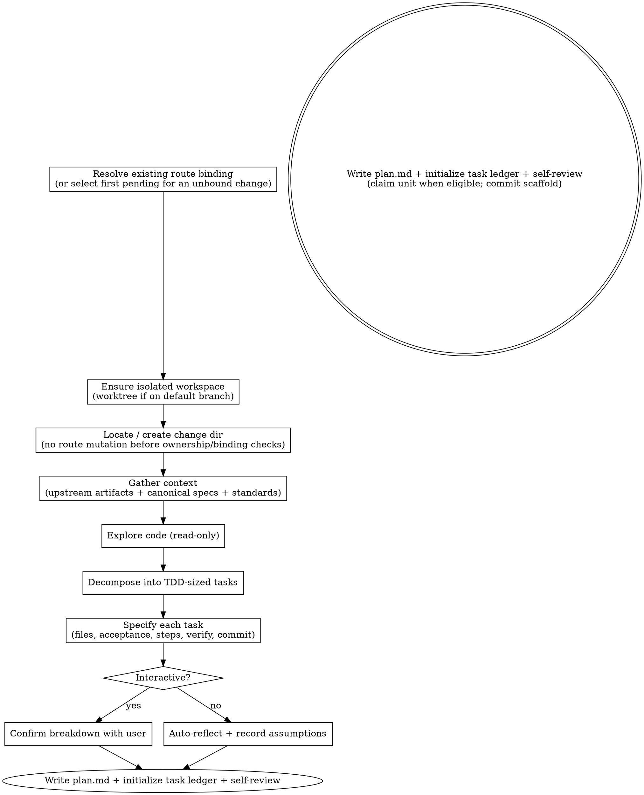

# Planning a change

Turn a change — whether it already has a design and requirements, or is just a
request — into `plan.md`: an ordered ledger of small, independently verifiable tasks that
a coder (human or agent) implements one at a time.

The **seven-stage core pipeline** is Kepler's fixed spec-driven sequence: init → propose → plan → code →
code-feedback → review → finish-work. Each step is a skill that a person or an agent can run.
This skill is **step 2**, the plan step. Wayfinder and `kepler-critique` are optional and
remain outside the seven-step core count.

`plan.md` is the required planning artifact and the handoff contract between planning and
coding. Finalizing it also initializes the split execution ledger and task-local evidence
files. This skill produces planning artifacts only. **It never writes production code.**

## Inputs

- A change directory at `.kepler/changes/<YYYY-MM-DD-title>/`. Create it if missing —
  `plan.md` always lives inside one, even when the pipeline starts at this step.
- Rich path: `design.md` and `requirements/` already exist — plan from them.
- Minimal path: only a user request. Capture the why/what in the plan's Overview and proceed.
- Project standards: `AGENTS.md`, for test/build commands, project structure, code style,
  and boundaries. Read it — do not guess conventions.
- The project's canonical specs (`.kepler/specs/`): the current, consolidated requirement
  truth for each capability. Read the specs the change touches so the plan stays consistent
  with established behavior and prior decisions — especially on the minimal path, where no
  per-change `requirements/` exists and the specs are your only view of existing behavior.
- Relevant project decision history, when the harness provides a memory search. Search only
  for decisions and failure modes relevant to this change; memory is optional context, never
  approval or lifecycle evidence.

## References

This skill ships with a `references/` folder. Read reference files using the Read tool on
the skill's own directory — they are co-located with this SKILL.md, **not** at
`${XDG_CONFIG_HOME:-$HOME/.config}/vialactea-works/kepler/` or `${XDG_CONFIG_HOME:-$HOME/.config}/vialactea-works/kepler/templates/`.

- `references/code-quality.md` — the self-review rubric for plan quality.

## Principles

- **Plan-first, read-only.** Explore the code you will touch before writing the plan.
  Understand existing patterns and how tests run. Make no edits in this step.
- **TDD-sized tasks.** Each task is small enough to implement and verify in isolation —
  about one Red → Green → Refactor loop. "Build authentication" is too big; "add a
  registration endpoint that validates email format" is right.
- **One task at a time.** The coder consumes a single task and nothing else, so each task
  must be self-contained: its files, acceptance, and verification stand alone.
- **Steps are executed verbatim.** The coder follows a task's Steps exactly and adds no
  design of its own (it may be a weak model). Specify the complete Red → Green → Refactor
  sequence, or a justified alternative Red when a conventional failing check is impossible.
  The coder cannot invent missing steps or treat Green as completion.
- **Reference, don't copy.** Point to `design.md` / `requirements/`; do not duplicate them.
- **Honor the canonical specs.** Before decomposing, read the `.kepler/specs/` entries for
  the capabilities the change touches. They record the conventions and decisions the project
  has already committed to; a plan that quietly contradicts them regresses agreed behavior.
  Follow them, or surface the conflict — do not plan around it silently.
- **Plan for quality.** The coder executes verbatim and adds no design, so the plan carries
  the quality — not the code step. Decompose so each task preserves the design's structure
  and stays independently testable, and make any code snippet model the clean shape rather
  than a shortcut the coder will copy. Judge the plan against `references/code-quality.md`
  (read it from this skill's references directory), proportional to the change's size.
- **Detail scales to risk.** Include code or exact commands only where they remove
  ambiguity. Otherwise state intent and let the coder think — do not pre-write the diff.
- **Write flowing prose.** In `plan.md` — overviews, task descriptions, acceptance
  criteria, and every other narrative field — let paragraphs run as continuous lines. Do
  not hard-wrap text at ~80 characters or any fixed width; insert a line break only at a
  real boundary (between paragraphs, list items, or headings). Code blocks and commands
  keep their own formatting; soft-wrapping prose is the reader's job, not yours.

## TDD task contract

Plan each ordinary behavior-changing task as a complete Red → Green → Refactor cycle before
its final Verify command. A task may need several related checks or cycles, but split independent
behaviors into separate tasks. Write the phase actions in each task's Steps so a coder who reads
only that block can execute them in order:

- **Red:** Write or update a failing behavioral check and run it before production edits. Name the
  command and intended failure; an already-passing check or broken harness does not establish
  Red. If a conventional failing behavioral check cannot be written, specify the
  concrete technical reason before production edits and a repeatable alternative verification that
  distinguishes the pre-change and post-change states. Run and record the alternative as Red
  before production edits. Preference alone is not a valid exception.
- **Green:** Make the smallest passing implementation and rerun the same check (or documented
  alternative) until it passes for the intended reason. Green is not task completion.
- **Refactor:** Specify behavior-preserving cleanup and rerun relevant tests after Green. If no
  cleanup is needed, inspect for opportunities, record that decision, and still rerun the
  relevant behavioral and regression checks; do not invent a cosmetic edit to satisfy the phase.

After Refactor, run the task's Verify command and the full test/build commands from `AGENTS.md`
unless those standards explicitly scope a per-task suite. Require exact commands and observed
results for every phase in task-local progress, including the technical reason and observations
for an exceptional Red. If a phase fails for the wrong reason, Verify fails, or feedback is
`changes-requested`, record the correction and repeat Red → Green → Refactor with relevant
verification within the same task. If the correction falls outside the task's Files or acceptance
boundaries, block for re-plan rather than improvise.

Do not invoke feedback in task Steps during implementation: `kepler-code` owns the task attempt
and commit, and the driver dispatches `kepler-code-feedback` as the refactor-phase review
afterward. A fresh durable `approved` pass is required before the next task or whole-branch
review. `changes-requested` feedback returns the same task for a correction cycle with
verification and another feedback pass. This handoff belongs to the driver, not the coder's Steps.

## Process

1. **Detect map-aware mode and preserve existing bindings.** If the request points at a
   `.kepler/maps/<effort>/` folder containing `route.md`, resolve the canonical route under this
   project, require its file-scoped lint and route/body identity checks to pass, and read its
   synthesized body as the semantic handoff. Map-level `open`, `cleared`, `shipping`, or `shipped`
   status cannot replace this compiled route. Before selecting a unit, resolve any existing
   change's `proposal.md` and `plan.md` bindings through `kepler workbench context`. A nonzero
   route-conflict result stops. If `plan.md` exists, its `route_unit` owns the selection; any
   non-null proposal reference must match it, including when the plan reference is null. If no
   plan exists and the proposal has a non-null `route_unit`, preserve that proposal-bound unit
   while creating the plan. For an existing binding, resume that exact unit for its owning change;
   never replace it with another pending unit because the bound unit is already in progress or a
   later unit is pending. If the bound unit, owner, or claim cannot be verified, stop for owner
   adjudication. Only a new, unbound change selects the first `pending` unit in frontmatter order
   and derives its title from that unit's `name`. If that first pending unit is blocked, report the
   exact prerequisite and stop rather than selecting a later unit; a later-unit choice needs
   explicit owner authorization. If there is no pending unit, resume only an existing in-progress
   unit demonstrably owned by this change; otherwise stop without changing unit state. In every
   case, verify each selected unit dependency is `shipped` **and** reachable from the actual
   delivery base; if finished but unmerged, stop and ask the owner to merge it or deliberately
   branch from its work.
2. **Resolve visible claims and source role before writes.** The designated user/controller
   serializes route-unit claims and delivery, with one owner per unit and one writer per
   change/worktree. Before creating/suffixing a workspace or changing a route unit, scan known
   change proposals/plans, local and visible remote branches, and `git worktree list --porcelain`
   for the canonical route/unit reference. Prefer resuming its owner; a competing or ambiguous
   claim requires owner-directed resume/transfer or a stop, never a suffix workaround. Transfer or
   release requires explicit owner authorization, inspection of partial work and Git/provider
   effects, preservation of history/work, and dependency revalidation. Retain shared, dirty, or
   ambiguously owned workspaces. A local scan is not distributed exclusivity; concurrent
   cross-clone claims/shipping are unsupported. Do not add a claim database, distributed lock, or
   coordination service.

   Resolve the actual delivery target from route Shipping rules and the map's `branch:` (or the
   project's explicit target rules for a non-route change). `isolate --check` reports workspace
   shape only. Require a named source branch from `git symbolic-ref --quiet --short HEAD` and
   verify normalized source/target branch identity through refs and configured local/remote
   mapping, never tip SHAs. A detached linked worktree, non-default checkout, or `isolated: yes`
   is insufficient. If the source is the target or identities are unresolved, stop for
   owner-directed creation/switching and verify again before any plan, route, or code write.
3. **Ensure an isolated workspace — then confirm you are inside it.** Run
   `kepler workbench isolate --check`; its last line is only the workspace-shape result.
   Once claim and target-role checks pass, `isolated: yes` permits use of that workspace; it does
   not grant route or change ownership. `isolated: no` means derive a kebab-case title from the
   change (its existing directory name, selected unit name, or the request on the minimal path)
   and create one:

   ```bash
   kepler workbench isolate <title>   # last line: the new worktree's path
   cd <that path>
   kepler workbench isolate --verify <title>
   ```

   If create mode reports that `.worktrees/<title>` or branch `<title>` already exists, inspect
   its owner and partial state. Resume only with that owner's authorization; never use a suffix to
   bypass a visible claim. If the Kepler CLI is not installed (`kepler setup` has not run), create
   or verify a named source branch only after the same ownership and target checks; workspace shape
   can be inspected by hand if
   `git rev-parse --git-dir` differs from `--git-common-dir` (a linked worktree, and you are not
   in a submodule) or `git rev-parse --abbrev-ref HEAD` is not the default branch; otherwise
   `git worktree add .worktrees/<title> -b <title>` under the git-ignored `.worktrees/`
   directory, `cd` in, and confirm `git rev-parse --show-toplevel` ends in `.worktrees/<title>`.

   Creating the worktree does **not** move you into it — a fresh `git worktree add` leaves your
   shell and every file tool rooted in the original checkout. You must `cd` into the worktree
   and then **verify the switch took effect** before doing anything else. **Do not proceed to
   step 4 until `--verify` succeeds.** If you skip this check you will silently plan and write on
   the default branch — the exact failure this step exists to prevent.

   From here on, every path in this skill is relative to that worktree root: the change directory,
   all code you explore, and `plan.md` are created **inside** `.worktrees/<title>/`, never in the
   original checkout. When in doubt, use the absolute worktree path returned by
   `git rev-parse --show-toplevel` as the base for file operations.

4. **Locate the change.** Find or create `.kepler/changes/<YYYY-MM-DD-title>/`.
5. **Gather context.** When an existing plan is missing root progress or any initialized task
   log, run read-only `kepler workbench context <change-dir>` before the normal existing-artifact
   lint gate. Continue only if it reports `scaffold-recovery: eligible`; inspect the original
   proof and every present file before writing. If the result is blocked, absent, malformed or
   ambiguous, stop for owner evidence and preserve all files. Follow **Initial scaffold recovery**.
   For a complete change directory, run normal scoped lint before interpreting its plan.
   When the change directory already holds artifacts — the rich path, or a re-plan — open with
   `kepler workbench context <change-dir>` to see which
   exist, how large they are, and where the tasks and reviews stand, then read in full only what
   it says is there. (If the Kepler CLI is not installed, list the directory instead.) On the minimal
   path, where the directory is new and empty, skip straight to the reading.
   Read upstream artifacts if present (proposal, design, requirements),
   the canonical specs (`.kepler/specs/`) for the capabilities the change touches, and the
   project standards (commands, structure, style, boundaries). In map-aware mode, read
   the synthesized route body as the primary current context: Destination, Path chosen,
   Shipping rules, and the selected unit's body, including its destination contribution,
   goal, observable completion outcome, and binding constraints. Treat the destination and
   those binding constraints as committed context while leaving implementation decomposition
   to this planning step. Builder latitude may be resolved here only when the choice remains
   local and cannot alter the destination; if the route cannot be satisfied, return to
   Wayfinder rather than designing around the contradiction. If a `route_unit` field is
   present in frontmatter, preserve it as the route path plus unit number and use it to
   follow the selected unit's `backed_by` tickets for optional drill-down only. Ticket
   Answers must not replace or require reconstruction of the destination from the
   synthesized route.
   In map-aware mode, preserve the selected route path and unit number in `route_unit`; it is
   the provenance link finish-work uses to update the unit. Resolve proposal/plan bindings through
   `kepler workbench context` and stop on a nonzero route-conflict result. The plan owns the
   selected binding; any non-null proposal reference must agree, including when the plan reference
   is null. A null proposal reference may accompany a valid planned binding. Preserve matching
   legacy references, but never mix a modern null with a legacy body guess. Record the route-source
   revision reported by context as the selection input, plus owner/change, named source branch,
   actual target, and base/input revision in the existing Overview and dispatch handoff. The route
   metadata is machine-readable frontmatter; the specs carry the conventions and decisions already
   committed for those capabilities — follow them so the plan stays consistent. On the minimal
   path, where no per-change `requirements/` exists, the specs are your primary source of existing
   behavior; write a two-line why/what for the Overview.

   Before decomposing, compare the requested externally observable behavior with the canonical spec for each touched capability. Record a `Spec impact` decision in the plan `Overview`: either the approved minimal `requirements/<capability>.md` delta for changed behavior, or `no canonical behavior change` with its rationale. A behavior-changing tactical task still needs that requirement delta and explicit requester approval tied to the exact committed revision before code dispatch. Internal implementation changes that leave the canonical contract unchanged need no delta or heavyweight proposal; do not label changed behavior internal. If classification is unresolved, stop and ask the requester before finalizing the plan. A missing or stale approval for a required delta follows the formal-input gate below.

   If `plan.md` exists and all initialized root/task paths are present, run
   `kepler workbench lint --change-dir <change-dir>` before interpreting it or its linked artifacts.
   For a missing initial path, use only the read-only `scaffold-recovery: eligible` result
   described above, then run scoped lint after the complete recovered scaffold exists. Treat lint's
   exit status as the single source
   of truth for existing artifact format and schema; a successful lint must not be overridden
   by a skill-specific layout or template comparison. On nonzero lint, report the findings
   without mutating artifacts. Require the existing root ledger and task logs needed for
   re-planning as inputs; name missing evidence separately, since lint does not check absent
   files. A change without `plan.md` is pre-plan, not legacy.
   For an existing plan, require every present formal proposal/design/requirements input to have
   `status: approved`, `decision: accepted`, an exact `intent_approvals` entry with its owner-held
   reference and full commit ID, and current bytes matching that committed revision. On first
   planning, verify each input is explicitly approved and committed, obtain its requester-held
   reference from the approved handoff, and record the path/reference/full commit in the new plan.
   A lint-valid draft, template default, plan status, or `decision: accepted` alone does not
   authorize formal intent. If approval is missing or stale, return to `kepler-propose`: use its
   requirements-only tactical path for a bounded behavior delta that needs no broader proposal or
   design; use its full path when scope or design requires it. Never approve formal intent during
   planning.
   Tactical absence is valid. Authorized unattended planning may self-review the breakdown and
   record assumptions but cannot manufacture formal approval.
6. **Explore (read-only).** Map the files and modules involved, the patterns to follow,
   and the test setup. Make no edits. Test each recalled decision against current source,
   approved intent and standards. Carry only applicable constraints into the exact task that
   needs them; record stale or conflicting advice as rejected context with its current-source
   reason. Do not add abstractions for an inapplicable rubric principle.
7. **Decompose.** Break the work into TDD-sized tasks. Order them and mark logical dependencies
   without implying concurrent implementation: the driver uses one task lane and serial execution.
   For each task, put the applicable structural quality constraint and verified decision/source
   in that task block, not only in Overview. If no relevant memory is available, state that and
   use current repository context. A coder receives one task at a time and will not infer sibling
   task constraints from plan-wide notes.
   Prefer more small tasks over few large ones. Cut the seams along the design's boundaries so
   each task lands one cohesive unit — a task you cannot describe without "and" is usually two.
8. **Specify each task.** For every task capture: files (created / modified / deleted),
   acceptance criteria (testable; cite the requirement scenario when one exists — and cover
   the error/edge behavior, not just the happy path), Steps ordered Red → Green → Refactor
   (or a technically justified alternative Red) followed by a Verify command with its expected
   result, and a commit message. In Red, explicitly run the check and observe the intended failure before
   production edits; in Green, rerun that check; in Refactor, rerun relevant tests after cleanup.
   Include the correction rule from **TDD task contract** in each task block, since the coder reads
   no sibling block or plan-wide instructions. Where a step includes a code snippet, make it
   model the clean shape from `references/code-quality.md`; the coder copies it verbatim.
9. **Confirm or auto-reflect.** If working with a person, present the task breakdown and
   confirm it before finalizing. If running unattended with explicit authority to plan, self-review
   against the checklist below and record assumptions inline in the plan. This approval covers only
   the breakdown; it never creates approval for formal proposal/design/requirements inputs.
10. **Write `plan.md` and initialize execution progress.** Instantiate the installed
   `${XDG_CONFIG_HOME:-$HOME/.config}/vialactea-works/kepler/templates/plan.md`, `${XDG_CONFIG_HOME:-$HOME/.config}/vialactea-works/kepler/templates/progress.md`, and
   `${XDG_CONFIG_HOME:-$HOME/.config}/vialactea-works/kepler/templates/task-progress.md` templates as concrete cleaned artifacts: remove each
   template's opening instruction block and every inline hint before writing it. For a new plan,
   read the configured repository identity with `git config user.name` and `git config user.email`.
   If either Git value is missing or an identity is unavailable, ask the user for it and stop;
   do not invent or substitute an agent name, placeholder, or other identity. Populate `plan.md` frontmatter with
   concrete `artifact`, `change`, `status`, `created`, `author`, `decision`, and `route_unit`
   values, using `author: Name <email>` from both Git values and a valid lifecycle status. In
   map-aware mode, resolve proposal/plan binding through context before writes and stop on conflict.
   Record the canonical route and unit, owner/change, named source branch, actual delivery target,
   base/input revision, and exact selected route-source revision in the existing plan Overview.
   Before the first scaffold write, record the full current Git `HEAD` in `initialization.base`, an
   explicit requester authority reference, the SHA-256 `taskBreakdownDigest`, and the original task IDs.
   Preserve that initialization proof on every re-plan; it certifies only the initial breakdown.
   An unattended self-review reference authorizes the planning breakdown only and cannot approve
   formal proposal/design/requirements. On a re-plan, preserve the existing author exactly.

   Derive one ordered active-task list from the final plan and use that same ordered task list
   for all three artifacts. Root `progress.md` frontmatter must contain concrete `artifact`, `change`, `status`,
   `updated`, `decision`, and `tasks` values. Add one `tasks` metadata entry per active task in
   numeric identity order with its numeric `id`, exact unescaped `title`, `status: pending`, and
   `progress: tasks/task-N/progress.md`. The root Markdown table must contain exactly one row per
   active task from that same ordered list, with columns `Task`, `Status`, and `Progress`; the
   only status vocabulary is `pending`, `in-progress`, `blocked`, and `done`. Render each
   identity as `Task N: <escaped display title>`, initialize it to `pending`, and use the
   exact link `[details](tasks/task-N/progress.md)`. Apply standard Markdown table escaping to
   display titles, including escaping `|` and other delimiters; identity is not derived from the title.
   Derive the numeric identity and lowercase `task-N` directory from `Task N`, never from the title.

   Initialize each active `tasks/task-N/progress.md` from the cleaned task-progress template with
   concrete `artifact`, `change`, numeric `task`, `status: pending`, `updated`, and `decision`
   frontmatter, followed by the exact heading `# Task Progress: Task N — <title>` using the
   unescaped title. Its creation portion must have matching change and task identities, no attempt
   record (`## Attempt` or other execution-history record), and no template placeholder. Root progress
   remains only the current task ledger: it contains no changed paths, commands, notes, attempts,
   task feedback verdicts, whole-branch review summaries, or finish outcomes.

   After the complete scaffold of `plan.md`, root `progress.md`, and every active task log is
   written, recheck the route-source revision and owner binding. For a new route claim, change only
   the selected unit from `pending` to `in-progress`; resume an existing `in-progress` unit only
   when its owner/change/branch match, and never reset a shipped unit. Update map status only as an
   aggregate summary when its rule holds; contradictory state is a stop. After each route/map write,
   run `kepler workbench lint --file <path>`, then run `kepler workbench lint --change-dir <change-dir>`.
   Commit the matching route/map claim
   with the complete change scaffold, then rerun context and include its exact route-source
   revision in the handoff. Resolve every lint finding and rerun before handoff; do not invent an
   attempt or otherwise mutate execution history to satisfy lint.

## Task-sizing heuristics

- Implementable and testable in isolation — about one Red → Green → Refactor loop.
- Split independently changing behaviors, not the related checks needed to prove one behavior and its edge cases.
- A task whose title contains "and" is often two tasks.

## Re-plan mode

When a plan defect surfaces mid-run — a mis-sliced task, a wrong step, a missing dependency —
re-enter this skill in re-plan mode. Run the existing-artifact lint gate in Process step 5 before
making changes. Do not reject a lint-valid artifact because it has additional frontmatter or
body content. Read `plan.md` and the root `<change-dir>/progress.md` current-status table —
`kepler workbench context <change-dir>` summarizes them in one call — and
amend the plan without reading or rewriting sibling attempt histories.

- Tasks the root ledger marks `done` are frozen: do not alter their task definition, title,
  status row, identifier, link, directory, or task-local history.
- Renumber nothing and never reuse an abandoned task id. Stable numeric task ids and
  `tasks/task-N/` paths are the execution identity.
- Preserve each surviving task's actual status in both the root frontmatter `tasks` metadata
  entry and Markdown row, including frozen `done` tasks and existing non-done tasks. Keep their
  exact numeric identity, title, link, directory, and append-only history.
- Append each new active task with a new numeric id, add matching frontmatter metadata and root row
  in amended plan order with status `pending`, and initialize its `tasks/task-N/progress.md` heading.
  Give remediation tasks the same Red → Green → Refactor steps, exceptional Red rule, and feedback
  handoff as ordinary tasks; an evidence-only task must observe a real pre-change defect, not
  manufacture one.
- Before renaming, inspect the assigned `tasks/task-N/feedback.md` path. If it exists, preserve
  the task title, ID, path, task-progress heading and every feedback pass. Do not rewrite
  reviewer-owned feedback. If a new identity is needed, explicitly abandon the unfinished task
  with the canonical suffix and append a new max+1 ID, retaining all history. If feedback exists
  but is incomplete or ambiguous, stop for owner diagnosis. Only a feedback-free non-done task may
  use the existing synchronized rename transition; never rename a done task.
- A renamed non-done task updates its root Markdown table display title with correct Markdown
  escaping, while the exact unescaped title is written to its assigned root frontmatter metadata
  entry, active plan heading, and task-progress heading. Preserve its current status in both root
  representations, numeric id, exact path and link, and every existing append-only `## Attempt N`
  block; leave done tasks byte-for-byte unchanged. After the complete amendment, run
  `kepler workbench lint --change-dir <change-dir>`.
- Preserve an existing plan's `author` attribution exactly across re-plans; do not replace it
  with current Git values, an agent name, or a placeholder. If a new plan needs attribution and
  either `git config user.name` or `git config user.email` is unavailable, ask the user instead of
  inventing an identity.
- Mark an abandoned task with the canonical heading
  `### Task N: <title> (abandoned — <reason>)`. Only a heading that ends with this complete
  canonical form and supplies a nonempty reason is abandoned. Headings that use
  `(abandoned - reason)`, `(abandoned — )`, or `(abandoned — reason) trailing` do not match;
  retain them as active unless lint rejects the plan. Remove an exactly abandoned task's row
  from the active root table and retain its existing task directory and append-only history. Do not delete them or reuse the numeric id.
- Do not make a new task edit a sibling's task progress, feedback, checkpoint, root metadata
  entry, or status row. Each task owns only its listed implementation files and its own execution
  evidence. If correcting a frozen task requires editing its owned evidence, report the
  ownership conflict and stop for
  adjudication instead of planning a task that `kepler-code` cannot execute.
- Preserve all other existing task directories and append-only evidence, and record the reason
  for the amendment in the plan's Overview.

Re-plan mode is the one sanctioned way `plan.md` changes after coding begins; every other
skill treats the plan as read-only.

## Input impact and task-local decision context

At each planning handoff, capture the exact task definition and the selected relevant approved
requirements/design/specs, route constraints, project standards and repository identity. Use
`kepler workbench context <change-dir> --input <repository-relative-path>` for each selected input
blob and record the resulting version-1 JSON handoff in that task's `Notes`: canonical repository
identity, formal approval commit or explicit tactical authority reference, the task's SHA-256
definition digest, selected input paths and full 40-hex Git blob IDs. Record an applicable `impactPlanCommit` only when that handoff is introduced by a committed input-impact plan. These hashes identify revisions; they do not judge semantic equivalence or authorize work.

Before reusing prior tasks after a selected input changes, classify each change at the actual
preceding plan revision. Record `input_impact` with prior/current blobs, affected unfinished
tasks, unaffected tasks, new obligations, unresolved-intent state and a rationale. Require an
independent review of the impact reasoning and preserve its owner-held reference; if no
independent reviewer is available, stop before dispatch. Return unresolved formal intent to its
owner. Revise affected unfinished work through planning, append new obligations under new IDs
after frozen done tasks, and retain unaffected approvals and historical definitions. A completed
task cannot be rewritten or reclassified as affected. Commit the impact classification first;
then bind affected/new task Notes to that plan commit in a follow-up plan revision. Do not invent
legacy snapshots or rerun unrelated tasks solely because an input blob changed.

For a historical task whose versioned input provenance is genuinely absent, keep its existing task
block, Notes, IDs, attempts, feedback, and approvals frozen. Never reconstruct historical hashes.
Use a scoped current confirmation only when the committed plan at that task's implementation also
has no versioned input context and the task definition is unchanged. Add one optional, version-1
`legacy_input_confirmations` frontmatter record for that task, with its canonical repository path,
current `taskDefinition` digest, current approved `intentCommit` (or `tactical:<ownerReference>`),
selected current committed `inputs` and full Git blob IDs, `historicalInputs: "unknown"`, distinct
`owner` and `reviewer` identities and references, and a concrete `rationale`. Capture each input
with `kepler workbench context <change-dir> --input <repository-relative-path>`; require matching
HEAD, index, and worktree bytes, and commit the confirmation in the plan authority. Context and the
finish gate must report `legacy-current-confirmed` only while this exact scope remains current.
These references are asserted evidence, not authentication or semantic review, and they waive no
intent, task-feedback, whole-review, test, or finish gate. Missing, malformed, dirty, stale, mismatched,
or unverifiable evidence stays held. If a known changed input affects a frozen task, append new
obligations rather than confirming a rewritten task. Do not add this metadata to ordinary new plans.

Before code generation, its exact task block must carry concrete applicable quality constraints
and their source, plus verified decision context or a reason it does not apply. Relevant memory,
when available, must be checked against current source/approved intent; stale or conflicting
advice is recorded as rejected context. Unavailable memory is non-fatal and does not replace
repository-owned specs, standards or task constraints.

## Serial execution order and prerequisite insertion

Use the serial `execution` metadata only when a newly discovered prerequisite cannot be completed
within the existing plan order. First quiesce every current task writer. If the blocked task has
partial production edits, do not dispatch another writer until its owner and requester authorize
a scoped preservation/isolation method and a verifiable locator for restoration. Name the exact
paths and method; verify the preserved bytes, do not stage or commit them, do not use a broad stash,
and never discard them. If safe parking or restore authority is unavailable, stop for owner
intervention. Reconcile the preserved work through its original task owner after the prerequisite
clears, retaining the original task Base and history.

Before adding `execution`, verify the installed context/lint reader supports it. Keep physical plan
headings, task directories, root metadata/table rows and attempts in immutable numeric identity
order. New task IDs are max+1; append the prerequisite's complete scope and initialize its own
pending log. Preserve every old task definition/title/path/history and existing fully gated prefix.
An authorized plan amendment records `execution: {version: 1, order: [1, 4, 2, 3]}` (or the actual
validated serial sequence), `execution_transition` with the actual previous plan commit, previous
order, derived fully-gated prefix, owner approval reference, reason and affected obligations, and
the matching Overview evidence. Preserve surviving old IDs' relative order. Validate visible
`Depends on` declarations against the schedule; all declared prerequisites must be active and
earlier. Unknown versions, malformed explicit order, forward/cyclic dependencies and ambiguous
prerequisites hold without numeric fallback. A genuine cycle returns to the owner. This is one
serial lane, not a DAG or parallel scheduler.

When a changed input also requires input-impact classification, record the authorized input and
execution transition together at the same actual preceding-plan boundary. Commit that amendment,
then bind new/affected task handoffs to the introducing plan commit in a follow-up revision. Run
context and scoped lint again; require `execution-history: verified` before dispatch. If the plan
order, worker, branch or relevant repository identity changes after selection, invalidate the
pending dispatch and recalculate from committed evidence.

The driver selects the first task in the validated execution sequence that is not fully gated.
Task status `done` alone is insufficient: every task still needs its latest durable fresh independent
`approved` feedback before it or a later slot counts as gated. The predecessor is the prior sequence
slot, not numeric ID N−1. Task 4 receives its own exact code/TDD/feedback cycle before Task 2 resumes;
it cannot expand Task 2's Acceptance or Files, change Task 2's status, or approve Task 2. A direct
human/code dispatch must obey the same authorized selected slot and preceding-gate contract.

## Initial scaffold recovery

Before first scaffold mutation, record the original full pre-scaffold `HEAD`, authorized breakdown
digest/task IDs and owner authority in `plan.md` initialization proof. If interruption leaves any
initial root or task file missing, distinguish recovery from re-plan and code. Run read-only
`kepler workbench context <change-dir>` and proceed only when `scaffold-recovery: eligible`.
Before writing, inspect that exact original revision, complete task definitions and IDs, and every
present file. Confirm all present state is pending and history-free, no attempt/feedback/checkpoint
or task-owned work exists since the base, and no missing path has earlier execution-bearing history.
Fill only missing files from the proven original task list; preserve every present byte, author and
identity. If proof or a locator is unavailable, any task has begun, or deleted history is found,
stop for owner diagnosis. Never synthesize an Attempt. Run full scoped lint on the complete scaffold
and commit it before code dispatch. A truly empty new plan remains invalid; all-abandoned plans
follow their separate existing path.

## Self-review

Before finishing, confirm:

- You are inside the intended worktree, not the default branch: `git rev-parse --show-toplevel`
  ends in `.worktrees/<title>` (or you were legitimately working in place per step 3), and
  `plan.md` was written under that root.
- Every task is independently verifiable, with a concrete Verify command.
- Each task's Steps run Red before production edits, rerun the same check to Green, and verify
  behavior after Refactor. Any alternative Red has a concrete technical reason and repeatable
  pre-change/post-change check; none is a preference-based omission.
- Each task includes the conditional correction cycle and its own task-local phase evidence; no
  task Step invokes `kepler-code-feedback` or edits sibling evidence. The driver obtains fresh
  approval before advancing.
- Each task's Steps are explicit enough to follow with no further design.
- Each Files list is complete (created / modified / deleted).
- Each acceptance criterion ties to a requirement scenario where one exists.
- Dependencies are correct and acyclic.
- The task seams follow the design's boundaries; no task bundles unrelated changes, and each
  lands a unit that can be tested in isolation (`references/code-quality.md`, proportional to
  the change).
- Any code snippet in a task models the clean shape — the coder copies it verbatim.
- "Done when" requires all tasks `done`, tests and build passing, fresh committed `approved`
  feedback for every task before advancement, and an approved whole-branch review.
- Root progress has exactly one correctly ordered row per active task, uses only `pending`,
  `in-progress`, `blocked`, and `done`, and every link resolves to an initialized task progress
  file.
- Display titles are Markdown-escaped, while numeric ids and `tasks/task-N/` paths remain stable.

**Blocking.** For a non-trivial change — one that adds or restructures units, not a mechanical
or single-file edit — do not finalize `plan.md` while a task carries an unresolved structural
smell (bundles unrelated changes, cannot be tested in isolation, or embeds a snippet with a
shortcut the coder will copy). Re-slice the tasks, or record a deliberate exception in the
plan's **Quality notes** (Overview). The coder adds no design of its own, so a smell left in
the plan ships to the code.

## Output

`.kepler/changes/<change>/plan.md`, `<change-dir>/progress.md`, and one initialized
`<change-dir>/tasks/task-N/progress.md` per active task, following the installed plan, root
progress, and task-progress templates. Re-plan reconciles those artifacts without rewriting
done tasks or append-only attempt history.

## Handoff

Close by orienting the user, not by silently stopping.

- **Disclose the workspace.** If step 3 created a worktree for this change, state its path
  (`.worktrees/<title>`) and branch — `plan.md`, and all the code to come, live there, not in
  the original checkout. If you were already isolated and worked in place, name that branch.
- **Name the next step.** `plan.md` is the handoff contract; what follows is `kepler-code`
  (one task at a time) or `kepler-orchestrate` (the whole plan in one session).
- **Hand back the decision.** Working with a person, ask whether to proceed to implementation
  rather than declaring you are "ready" — and never invoke the next skill yourself. Running
  unattended, name the next step and return without asking; the driver owns the loop.

## Process flow


