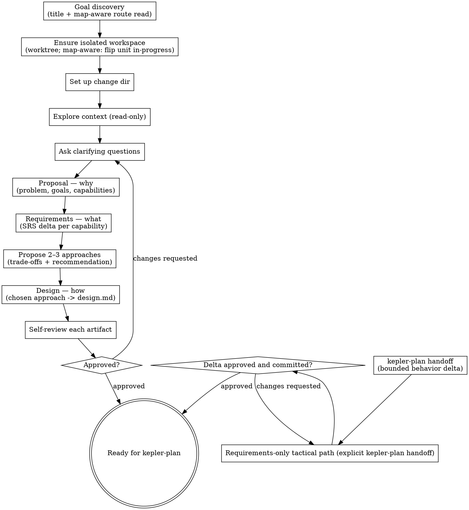

# Proposing a change

Turn an idea into a well-formed change by writing its proposal (why), requirements (what),
and design (how) — refined with the user through dialogue before any implementation begins.

The **seven-stage core pipeline** is Kepler's fixed spec-driven sequence: init → propose → plan → code →
code-feedback → review → finish-work. Each step is a skill a person or an agent can run. This
skill is **step 1** — the optional heavyweight front door that produces the PRD, the SRS, and
the SDD. A change that does not warrant that depth skips this step and starts at
`kepler-plan`. When `kepler-plan` identifies a bounded behavior-changing tactical task that needs
only a minimal requirements delta, use the requirements-only path below; it does not require a
proposal or design. Wayfinder and `kepler-critique` are optional and remain outside the seven-step
core count.

**Gate.** In the full path, do not hand off to `kepler-plan` or code until every formal artifact is
explicitly requester-approved over its exact committed revision and the design clears the
`references/code-quality.md` self-review. The requirements-only path creates no proposal or design;
do not return to planning or code until every required delta has explicit requester approval over its
exact committed revision. A draft/default decision, lint result, critique verdict, or unattended
planning authorization cannot create formal approval. For a non-trivial full-path design, an
unresolved structural smell blocks the gate (see step 11).

## What it produces

In `.kepler/changes/<YYYY-MM-DD-title>/`, using the templates at `${XDG_CONFIG_HOME:-$HOME/.config}/vialactea-works/kepler/templates/`:

The full path produces:

- `proposal.md` — the PRD: why, what changes, the sourced domain language, involved subdomains and bounded contexts, capability scope, and affected boundaries.
- `requirements/<capability>.md` — the SRS (delta form) for each capability.
- `design.md` — the SDD: the change's domain model, architectural boundaries, package responsibilities, ports and adapters, code attribution, and supporting decisions.

The requirements-only path produces only the minimal approved
`requirements/<capability>.md` delta files needed for a bounded tactical behavior change. It does
not create `proposal.md` or `design.md`.

## Inputs

- A change idea or request. If none is given, ask what to build.
- The project's canonical specs (`.kepler/specs/`) — the current requirement truth for each
  capability. Read them to tell new capabilities from modified ones, and to keep the proposal
  and requirements consistent with the conventions and decisions already committed.
- The canonical glossary (`.kepler/specs/glossary.md`) — the main source of context-scoped project language, created by `kepler-init`. Read it when present; for older projects without it, use established project documentation with explicit source references.
- Relevant domain and architecture documentation — supplementary definitions, responsibilities and context boundaries.
- Project standards (`AGENTS.md`).
- For requirements-only mode, an explicit `kepler-plan` handoff naming the exact change directory,
  touched existing capabilities, requested behavior, and any selected route/source-revision context.

## Domain language and capability scope

The canonical glossary takes precedence for established meanings. Use established project documentation to supplement missing definitions, recording each source. If the glossary is absent, disclose that gap and use documented language rather than inventing a replacement glossary. Define the problem, goals and proposed change with those terms, and carry the same meanings into requirements and design. The same word may have different meanings in different bounded contexts; name the context and any translation instead of imposing one global definition.

Surface any terminology conflict to the requester; do not silently redefine canonical terms or modify the glossary during proposal drafting. Record proposed additions or meaning changes in Open Questions for explicit resolution through domain modeling. A material unresolved meaning or boundary blocks approval; unattended work remains draft rather than inventing a decision.

A capability is a cohesive, durable area of responsibility with a clear boundary and an observable contract. It can represent a domain, subdomain or bounded context, including infrastructure responsibilities. A domain is the overall subject area, a subdomain is a problem area within it, and a bounded context defines where a particular model and language apply. Capability is Kepler's specification unit, not a synonym for those concepts. Identify the chosen scope and the related subdomains and contexts; their relationship is not necessarily one-to-one.

For example, `rest-api` can represent an infrastructure bounded context with its own external request/response model, vocabulary, translation into domain operations, and compatibility obligations. State which domain contexts retain business rules and data ownership. REST alone does not establish a bounded context: an HTTP adapter may belong to an existing context. A package, deployment unit or endpoint is not automatically a context or capability. Do not create overlapping parent and child capabilities that duplicate the same contracts.

Preserve existing capability slugs, frontmatter metadata and the file mapping from `requirements/<capability>.md` to `.kepler/specs/<capability>.md`. Record scope in prose, not new mandatory metadata. Historical proposals and specs remain valid under their existing lint contract; do not rewrite approved history to add these sections or classifications. New full-path proposals use the expanded authoring contract below. The glossary is shared vocabulary support, not automatically a capability requiring a new delta.

## Design authoring contract

Describe the change in its project's domain and architectural language before explaining implementation choices. Use the installed design template as an outline, with coverage proportional to the change:

- **Language and goal:** Express goals in sourced, context-scoped terms from the canonical glossary and authoritative project documents. Cite their sources or the proposal's Domain Context; do not create a replacement glossary. Record undefined or conflicting meanings in Open Questions. A material unresolved meaning or owner blocks approval; obtain requester resolution through domain modeling, and keep unattended work draft.
- **Model:** Describe relevant domains, subdomains, bounded contexts, terms, relationships, commands, events, states and invariants, including who owns each rule and how meanings translate across contexts. Use core, supporting or generic classifications only when supported by project evidence or an explicit proposed decision. Separate current facts from the proposed model; a package or transport alone does not establish a context.
- **Packages and boundaries:** For each package created, modified or removed, identify its responsibility, domain/context ownership and domain, application or infrastructure role, the contracts it exposes and those it depends on. Explain data ownership, interactions, trust and compatibility across boundaries. For removals, trace responsibility transfers or retirements and affected consumers. Trace existing callers' success and failure outcomes into replacement contracts and requirements; retire or change an outcome only when the change explicitly authorizes it. A package can contain several contexts; attribute individual responsibilities rather than forcing one-to-one ownership.
- **Ports and adapters:** Name inbound use-case contracts and outbound capabilities, their owners, consumers/providers and relevant inputs, results, errors and invariant obligations. Identify each adapter and model translation. Reuse existing functions and injected collaborators as ports where suitable; dependencies point toward the application core. Distinguish dependency direction from runtime flow and describe unchanged seams when relevant.
- **Code attribution:** Map affected code to its domain/context or infrastructure responsibility, marking references as existing, proposed or removed. Verify existing references in the repository; proposed code needs an explicit owner and contract, not a claim that it already exists. Explain where removed responsibilities go and check surviving consumers. This mapping records responsibility, not author metadata or plan task steps.
- **Proportionate coverage:** Keep the seven lint-required headings from the design template, with concise explanations when no facts apply. Omit optional sections and tables when prose or upstream references provide the relevant coverage. Do not invent events, states, interfaces, layers or definitions to fill the outline; missing material evidence remains a question. Historical lint-valid designs are not invalid for lacking the new model or mapping sections. These are semantic authoring and review expectations, not new CLI schema requirements.

Architectural realization leads into the decisions and trade-offs that support it. Tie testing to contracts, state transitions and invariant owners: core tests substitute outbound capabilities, while adapter checks exercise translation and failure boundaries.

## Tactical requirements-only approval

Use this path only when called from an explicit `kepler-plan` handoff for a bounded externally
observable behavior change on existing capabilities and the requester needs a minimal requirements
delta without a broader proposal or design. Internal-only changes need no delta. A new capability, unresolved
behavior, architecture choice, or request spanning independent subsystems needs the full path; do
not narrow it to fit this shortcut.

1. Confirm the exact change directory, affected capability/spec names, request, and any route
   binding or source revision supplied by `kepler-plan`. Read the current canonical specs, glossary
   when present, and `AGENTS.md`. Apply the language-source rules above without creating a proposal or a domain-context artifact. Preserve existing authors, approved artifacts, task history, and
   change identity. Do not create or suffix a change to evade ownership.
2. Draft or revise only the required `requirements/<capability>.md` files from the installed
   requirements-change template. State the whole changed behavior in normative requirements with
   testable WHEN/THEN scenarios. Do not create or edit `proposal.md`, `design.md`, `plan.md`, task
   progress, or route-claim state. If an existing formal artifact is stale, preserve it and follow
   its normal revision-bound approval gate.
3. Before writing, verify the configured Git author identity and resolve any existing owner or route
   conflict using the handoff and current workbench context. This path never creates or transfers a
   route claim. For map-aware work, retain the exact selected unit/source revision; the designated
   controller serializes ownership during the handoff, and `kepler-plan` revalidates owner, unit,
   target, and route-source revision before its normal claim/scaffold write. Stop on changed or
   competing ownership.
4. Run scoped workbench lint after each delta mutation. Keep unapproved bytes as `status: draft` and
   `decision: skipped`. Prepare the exact final candidate bytes with `status: approved` and
   `decision: accepted`, show those bytes to the requester, and wait for explicit approval of that
   exact revision. If the requester asks for a change, revise the draft and present a new exact
   candidate. Only after approval, write the approved bytes, rerun lint, and commit them. Record the
   requester-held approval reference for each path; one commit may bind multiple deltas. Never
   invent approval or its reference. Any later content change requires fresh approval and a commit.
5. If no formal delta is needed after clarification, return to `kepler-plan` without creating one.
   If the requester is unavailable, leave formal inputs draft and stop; authorized unattended
   planning cannot approve them. Do not dispatch code while a required delta is draft, uncommitted,
   stale, or lacks its exact requester-held approval reference.
6. Return to `kepler-plan` with every requirements path, the full approval commit, and its requester
   reference. The planner reruns context, verifies current bytes against that commit, and records an
   `intent_approvals` entry per formal path before code dispatch. Route ownership remains subject to
   the normal planning revalidation and claim gate.

## References

This skill ships with a `references/` folder. Read reference files using the Read tool on
the skill's own directory — they are co-located with this SKILL.md, **not** at
`${XDG_CONFIG_HOME:-$HOME/.config}/vialactea-works/kepler/` or `${XDG_CONFIG_HOME:-$HOME/.config}/vialactea-works/kepler/templates/`.

- `references/code-quality.md` — the self-review rubric for design quality.

## Principles

- **Collaborate.** Refine through dialogue — confirm each section before moving on.
- **High-level first.** Start from the user's goal; draft, then elaborate together.
- **YAGNI.** Cut unnecessary scope from every artifact.
- **Explore alternatives.** Offer 2–3 approaches with trade-offs and a recommendation
  before settling on a design.
- **Design for quality.** Code quality is decided here, not at review. The decomposition,
  boundaries, and dependencies the design commits to are inherited by every line the coder
  later writes — and a defect caught at review means refactoring code that already exists.
  Judge the design against `references/code-quality.md` (read it from this skill's
  references directory), proportional to the change's size.
- **Right-size.** Scale each artifact to the change; a few sentences is fine when the
  change is simple.
- **Write flowing prose.** In every artifact you produce (`proposal.md`, `requirements/`,
  `design.md`), let paragraphs run as continuous lines — do not hard-wrap text at ~80
  characters or any fixed width. Insert a line break only at a real boundary: between
  paragraphs, list items, or headings. Soft-wrapping is the reader's job, not yours.

## Process

1. **Goal discovery.** Derive a kebab-case title from the request — unless the request points
   at a `.kepler/maps/<effort>/` folder containing a `route.md`, in which case enter
   map-aware mode: resolve the canonical route under this project, require its file-scoped lint
   and compiled route/body identity checks to pass, and read its synthesized body as the semantic
   handoff. Do not treat map-level `open`, `cleared`, `shipping`, or `shipped` status as a
   substitute for that route. Select only the first `pending` unit in frontmatter order and derive
   the title from its `name`; if the first pending unit is blocked, report its exact prerequisite
   and stop rather than skipping to a later unit. A later-unit choice requires explicit owner
   authorization. Verify each selected unit dependency is `shipped` **and** its work is reachable
   from the actual delivery base; if a dependency is finished but unmerged, stop and ask the owner
   to merge it or deliberately branch from its work.
2. **Resolve visible claims and the source branch before any writes.** The designated
   user/controller serializes route-unit claims and delivery, with one owner per unit and one
   writer per change/worktree. Before creating or suffixing a workspace, scan known change
   proposals/plans, local and visible remote branches, and `git worktree list --porcelain` for
   the canonical route/unit reference. Prefer resuming its existing owner; a competing or
   ambiguous claim requires owner-directed resume/transfer or a stop, never a suffix workaround.
   Transfer or release requires explicit owner authorization, inspection of partial work and
   Git/provider effects, preservation of history/work, and dependency revalidation. Retain shared,
   dirty, or ambiguously owned workspaces. A local scan is not distributed exclusivity; concurrent
   cross-clone claims/shipping are unsupported. Record the owning change, owner, source branch,
   base/input revision, canonical route/unit, and route-source revision in existing change intent.
   Do not add a claim database, distributed lock, or coordination service.

   Resolve the actual delivery target from route Shipping rules and the map's `branch:` (or the
   project's explicit target rules for a non-route change). `isolate --check` reports workspace
   shape only. Require a named source branch from `git symbolic-ref --quiet --short HEAD` and
   verify its normalized branch identity differs from that actual target; compare refs and their
   configured local/remote mapping, never tip SHAs. A detached linked worktree, non-default
   checkout, or `isolated: yes` is insufficient. If the source is the target or the identities
   cannot be resolved, stop for owner-directed creation/switching and verify again before any
   artifact, route-claim, or code write.
3. **Ensure an isolated workspace — then confirm you are inside it.** Run
   `kepler workbench isolate --check`; its last line is only the workspace-shape result.
   Once claim and target-role checks pass, `isolated: yes` permits use of that workspace; it does
   not grant route or change ownership. `isolated: no` means create one:

   ```bash
   kepler workbench isolate <title>   # last line: the new worktree's path
   cd <that path>
   kepler workbench isolate --verify <title>
   ```

   If create mode reports that `.worktrees/<title>` or branch `<title>` already exists, inspect
   its owner and partial state. Resume only with that owner's authorization; do not select a
   suffixed name to bypass a visible claim. If the Kepler CLI is not installed (`kepler setup`
   has not run), create or verify a named source branch only after the same ownership and target
   checks; you are isolated by workspace shape if
   `git rev-parse --git-dir` differs from `--git-common-dir` (a linked worktree, and you are not
   in a submodule) or `git rev-parse --abbrev-ref HEAD` is not the default branch; otherwise
   `git worktree add .worktrees/<title> -b <title>` under the git-ignored `.worktrees/`
   directory, `cd` in, and confirm `git rev-parse --show-toplevel` ends in `.worktrees/<title>`.

   Creating the worktree does **not** move you into it — a fresh `git worktree add` leaves your
   shell and every file tool rooted in the original checkout. You must `cd` into the worktree and
   then **verify the switch took effect** before creating any files. **Do not proceed to step 4
   until `--verify` succeeds.** If you skip this check you will silently write every artifact on
   the default branch — the exact failure this step exists to prevent. From here on, the change
   directory and every artifact are created **inside** `.worktrees/<title>/`, never in the
   original checkout.

   In map-aware mode, reread the route source revision and selected unit after switching. If
   either changed, discard the stale selection and re-evaluate the route before writing any artifact.
4. **Set up the change.** Create `.kepler/changes/<YYYY-MM-DD-title>/`.
5. **Explore context (read-only).** Project structure, docs, recent commits, and the canonical
   specs (`.kepler/specs/`). Read the canonical glossary and relevant domain and architecture documentation before drafting goals. Identify established subdomains, bounded contexts, their responsibilities and interactions; distinguish evidence from inferred boundaries and resolve material ambiguity with the requester. Inspect affected packages, public contracts, ports, adapters and significant code references so the design can attribute responsibilities without guessing. Read the specs before drafting: they hold the conventions and
   prior decisions the change inherits, so a MODIFIED capability builds on the behavior its
   canonical spec already documents (human-readable prose — Overview / Contract / Behavior /
   Invariants / Decisions) rather than contradicting it. When step 1 entered map-aware mode,
   read the route body as the primary current context: Point of departure, Destination,
   Path chosen, Shipping rules, and Units. Enter the selected unit's destination contribution,
   goal, observable completion outcome, and binding constraints into that context before any
   optional ticket drill-down. Navigate the selected unit's `backed_by` links only when deeper
   reasoning or rejected alternatives need their evidence; they are not a substitute for the
   synthesized route body. If the selected unit has no `backed_by` entry, proceed from the
   route body alone.
   A coherent change may affect several related contexts and capability specs. If the request bundles independent goals or subsystems, stop and help decompose it rather than forcing them into one capability.
6. **Ask clarifying questions.** Draw out purpose, constraints, and success criteria from
   the requester (a person, or the calling agent). Attended, invoke `kepler-grilling`
   with those questions as content and "intent is clear" as the exit condition.
   Unattended, record only non-blocking assumptions; leave material language or boundary questions unresolved and keep formal inputs draft.
7. **Write the proposal (why).** Draft `proposal.md`: problem, goals/non-goals and proposed change in the sourced project language. Add Domain Context with Ubiquitous Language (term, scoped meaning, context and source) and Subdomains and Bounded Contexts (responsibility and involvement). List affected contexts even when they do not become separate capability files. In Capabilities, distinguish new, modified and removed names, retain existing slugs, and identify each capability's scope kind and name, responsibility and relation to Domain Context. This list is the contract into the requirements. Add Affected Boundaries under Impact: current and proposed responsibility, data ownership, interactions, contracts, trust boundaries, and compatibility or coordination obligations. If no boundary changes, explain which existing boundaries remain intact and why. Keep classes, ports and adapters in `design.md`. In
   map-aware mode, revalidate the selected unit, named source branch, actual delivery target,
   owner, and selected route-source revision before writing. Fill `route_unit` with the canonical
   route path and unit number. In the existing proposal Overview, record the owning change and
   owner, named source and normalized target identities, base/input revision, and exact route-source
   revision used for selection. Then flip only that unit from `pending` to `in-progress` in the
   source branch's route copy. Treat map status as an aggregate summary; update it to `shipping`
   only when its rule holds, and stop on contradictory unit/map state. After each route/map
   mutation, run `kepler workbench lint --file <path>`; then run scoped change-directory lint before
   the next mutation. Commit the claim with the initial change scaffolding. The visible
   status is a reservation, not a distributed lock. This is the provenance link every downstream
   step follows back to the map. For every
   new author-bearing output — `proposal.md`, each `requirements/<capability>.md`, and
   `design.md` — read the effective repository Git identity immediately before creation with
   `git config user.name` and `git config user.email`; write `author: Name <email>` using both
   configured values, including when a requirements or design artifact is created even when
   `proposal.md` already exists. If either configured Git value is unavailable, ask the user or
   stop with a blocker before writing; never use an agent name, operating-system username, or
   unresolved template placeholder. On a revision of `proposal.md`,
   `requirements/<capability>.md`, or `design.md`, preserve each existing author attribution and
   each recorded author exactly unless explicitly directed otherwise.
   Populate the proposal frontmatter fields `change`, `status`, `author`, and `created`; do not
   recreate them as a Markdown metadata table. After every proposal artifact mutation, run
   `kepler workbench lint --change-dir <change-dir>` and resolve every warning or error before
   the next mutation or handoff.

   **Right-size capabilities by responsibility and contract.** Each named capability maps to one delta file when requirements are needed and one canonical spec downstream. Choose the fewest cohesive scopes without hiding distinct models or duplicating contract ownership. Infrastructure and integration responsibilities qualify when they have a durable boundary and contract. An endpoint, implementation file or wiring step alone does not justify a separate capability. Do not merge unrelated contexts merely because they use the same technology.

   | Fragments sharing one responsibility | Possible cohesive scope |
   | --- | --- |
   | `login-endpoint.md`, `password-reset-endpoint.md`, `jwt-refresh-handler.md` | `authentication.md`, when these share the authentication model and contract |
   | `api-error-mapping.md`, `api-version-routing.md`, `command-translation.md` | `rest-api.md`, when it owns the external model and translation boundary |
   | `structured-logging.md`, `trace-log-correlation.md` | `logging.md`, when correlation belongs to the same logging contract |

8. **Write the requirements (what).** For each capability named in the proposal, write
   `requirements/<capability>.md` in delta form (ADDED / MODIFIED / REMOVED / RENAMED), with
   normative SHALL statements and WHEN/THEN scenarios. These change-side deltas keep the
   structured form regardless of how the canonical spec reads. For MODIFIED, there is no
   requirement block to copy — the canonical spec is prose; instead read the behavior its
   relevant section documents, then write a MODIFIED requirement that names the behavior it
   changes clearly enough for finish-work to locate the spec section, and states the *whole* new
   behavior (not just the diff). After every requirements artifact mutation, run
   `kepler workbench lint --change-dir <change-dir>` and resolve every warning or error before
   the next mutation or handoff.
9. **Propose 2–3 approaches.** Before designing, lay out two or three ways to build it
   with their trade-offs and a recommendation. Attended, invoke `kepler-grilling` with
   the approaches as content and "an approach is chosen" as the exit condition.
   Unattended, pick the recommended approach and record the reasoning.
10. **Write the design (how).** Follow **Design authoring contract**: establish sourced goals, the relevant model and architectural realization before supporting decisions. Cover affected packages, ports/adapters and code attribution, testing strategy, risks and change-specific operating boundaries. Reference upstream scope and requirements rather than duplicating them. Apply `references/code-quality.md` from this skill's references directory to cohesive units, narrow boundaries, inward dependencies and named testable seams, proportional to the change. Capture evidence in the design's **Quality Lens** subsection (one line for a trivial change). After the design artifact mutation, run `kepler workbench lint --change-dir <change-dir>` and resolve every warning or error before self-review or handoff.
11. **Self-review each artifact.** First confirm the workspace: `git rev-parse --show-toplevel`
    ends in `.worktrees/<title>` (or you were legitimately working in place per step 3) and every
    artifact was written under that root, not the default checkout. Then scan for placeholders,
    contradictions, scope creep, and ambiguity; fix in place. For a new full-path proposal, verify every goal uses sourced, context-scoped terms, every capability has a supported scope and responsibility, and affected contexts and boundaries are covered without duplicate contracts. Missing material domain context is a failed semantic gate even when structural lint passes. For the design candidate, verify sourced language, model ownership, package roles, provided/required contracts, adapter translation and code attribution against the inputs and repository. Check relevant transitions and invariants, current versus proposed claims, and removed responsibilities. Missing material ownership or contracts and unsupported claims are a failed semantic gate even if lint passes; omitted irrelevant tables are not. Then run `design.md` against `references/code-quality.md`.
    **Blocking:** for a non-trivial change — one that adds or restructures units, not a
    mechanical or single-file edit — an unresolved structural smell (a unit with more than one
    reason to change, a leaked boundary, a hard-wired dependency with no testable seam) is a
    gate failure. Fix the structure, or, if you are deliberately accepting it, record it in
    the design's **Quality Lens** subsection (and cross-list under Risks / Trade-offs). Do
    not pass the gate with a silent smell — a weak coder cannot recover quality the design
    did not encode. After every in-place correction of a recognized artifact, rerun
    `kepler workbench lint --change-dir <change-dir>`; a nonzero lint result is a failed gate,
    not a bypass.
12. **Get revision-bound approval.** Keep the working artifacts draft until the proposal,
    design and every requirement delta are final. Prepare the exact final candidate bytes for each
    formal artifact, including `status: approved` and `decision: accepted`, and present that exact
    revision to the requester. Attended, use `kepler-grilling` to resolve feedback, then obtain an
    explicit requester decision approving those exact candidate bytes. Only afterward write the
    approved candidate bytes, run scoped lint, and commit all approved formal inputs. Record the
    exact full approval commit and requester-held decision reference for each path in the planning
    handoff; a single commit may be referenced by every included artifact. The metadata fields and
    commit prove which bytes are asserted approved, not the requester's identity. Any later change
    to approved content requires a new explicit approval and commit. Unattended, keep formal inputs
    draft and record open questions; do not pass the gate or create approval. Authorized unattended
    planning may self-review only the task breakdown, never these formal inputs.

## Output

- Full path: approved `proposal.md`, `requirements/<capability>.md` files, and `design.md`, ready
  for `kepler-plan`.
- Requirements-only path: only the approved and committed `requirements/<capability>.md` delta
  files, with each full approval commit and requester-held reference, ready for the explicit
  `kepler-plan` handoff. No proposal or design is created.

## Handoff

- **Disclose the workspace.** If step 3 created a worktree for this change, state its path
  (`.worktrees/<title>`) and branch — the artifacts, and all the work to come, live there, not
  in the original checkout. If you worked in place, name that branch.
- **Name the next step.** After full-path artifacts pass step 12, or requirements-only deltas are
  approved and committed, the next step is `kepler-plan`.
- **Hand back the decision.** Never invoke `kepler-plan` yourself. In the full path, ask whether to
  proceed after approval. In requirements-only mode, return the exact delta paths, approval commit,
  and requester-held references to the explicit planning handoff. Running unattended, keep required
  deltas draft, report the missing approval, and stop.

## Process flow


