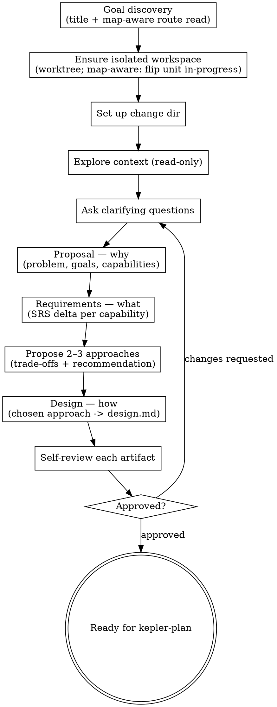

# Proposing a change

- Refine the change with the user before implementation: proposal (why), requirements (what), and design (how).
- This is step 1 of the seven-stage core pipeline: init → propose → plan → code → code-feedback → review → finish-work. Wayfinder and `kepler-critique` remain optional, outside the core sequence.
- Tactical changes may start at `kepler-plan` when they preserve domain, subdomain and bounded-context contracts. Changes to those contracts follow this skill's main flow.
- **Gate:** Every formal artifact needs explicit requester approval over its exact committed revision before handoff to `kepler-plan` or code. Draft/default decisions, lint, critique and unattended planning authorization cannot create approval.
- **Design quality:** Apply `references/code-quality.md`; an unresolved structural smell blocks a non-trivial design (step 11).

## What it produces

In `.kepler/changes/<YYYY-MM-DD-title>/`, using the templates at `${XDG_CONFIG_HOME:-$HOME/.config}/vialactea-works/kepler/templates/`:

- `proposal.md` — the PRD: why, what changes, and the capabilities affected.
- `requirements/<capability>.md` — the SRS (delta form) for each capability.
- `design.md` — the SDD: how it will be built.

## Inputs

- A change idea or request. If none is given, ask what to build.
- The project's canonical specs (`.kepler/specs/`) — the current requirement truth for each
  capability. Read them to tell new capabilities from modified ones, and to keep the proposal
  and requirements consistent with the conventions and decisions already committed.
- The canonical glossary (`.kepler/specs/glossary.md`) — the main source of context-scoped project language, created by `kepler-init`. Read it when present; for older projects without it, use established project documentation with explicit source references.
- Relevant domain and architecture documentation — supplementary definitions, responsibilities and context boundaries.
- Project standards (`AGENTS.md`).
- When returning from `kepler-plan`, its handoff naming the existing change directory, affected capabilities, requested behavior and any route/source-revision binding. Preserve that change identity, ownership and task history through the main flow.

## Domain language and capability scope

Use the canonical glossary for established meanings and project documentation for missing definitions. Cite each source. If the glossary is absent, disclose the gap and use documented language rather than inventing a replacement. Use these terms consistently in the problem, goals, proposed change, requirements and design. When a word has different meanings across bounded contexts, name each context and explain the translation.

Raise terminology conflicts with the requester; do not redefine canonical terms or edit the glossary while drafting the proposal. Record proposed additions or changes in meaning in Open Questions for explicit resolution through domain modeling. Unresolved material meanings or boundaries block approval. Keep unattended work draft.

A capability is a cohesive, durable area of responsibility with a clear boundary and an observable contract. It can represent a domain, subdomain or bounded context, including infrastructure responsibilities. A domain is the overall subject area, a subdomain is a problem area within it, and a bounded context defines where a particular model and language apply. A capability is Kepler's specification unit. Identify its scope and related subdomains and contexts without assuming a one-to-one mapping.

For example, a `rest-api` capability qualifies as an infrastructure bounded context when it owns a distinct external request/response model, vocabulary, translation boundary and compatibility obligations. If it only exposes an existing context's model over HTTP, it is an adapter within that context. The distinction depends on model and contract ownership, not the use of REST. State which domain contexts retain business rules and data ownership. A package, deployment unit or endpoint is not automatically a context or capability. Do not create overlapping parent and child capabilities that duplicate the same contracts.

Preserve existing capability slugs, frontmatter metadata and the file mapping from `requirements/<capability>.md` to `.kepler/specs/<capability>.md`. Record scope in prose, not new mandatory metadata. Historical proposals and specs remain valid under their existing lint contract; do not rewrite approved history to add sections or classifications. Apply the authoring contract below to new proposals. The glossary provides shared vocabulary; its presence alone does not require a capability delta.

## Design authoring contract

Describe the change in its project's domain and architectural language before explaining implementation choices. Use the installed design template as an outline, with coverage proportional to the change:

- **Language and goal:** Express goals in sourced, context-scoped terms from the canonical glossary and authoritative project documents. Cite their sources or the proposal's Domain Context; do not create a replacement glossary. Record undefined or conflicting meanings in Open Questions. A material unresolved meaning or owner blocks approval; obtain requester resolution through domain modeling, and keep unattended work draft.
- **Model:** Describe relevant domains, subdomains, bounded contexts, terms, relationships, commands, events, states and invariants, including who owns each rule and how meanings translate across contexts. Use core, supporting or generic classifications only when supported by project evidence or an explicit proposed decision. Separate current facts from the proposed model; a package or transport alone does not establish a context.
- **Packages and boundaries:** For each package created, modified or removed, name its responsibility, owning domain or context, architectural role (domain, application or infrastructure), and provided and required contracts. Explain data ownership, interactions, trust and compatibility across boundaries. For removals, trace responsibility transfers or retirements and affected consumers. Trace existing callers' success and failure outcomes into replacement contracts and requirements; retire or change an outcome only when the change explicitly authorizes it. A package can contain several contexts; attribute individual responsibilities rather than forcing one-to-one ownership.
- **Ports and adapters:** Name inbound use-case contracts and outbound capabilities, their owners, consumers/providers and relevant inputs, results, errors and invariant obligations. Identify each adapter and model translation. Reuse existing functions and injected collaborators as ports where suitable; dependencies point toward the application core. Distinguish dependency direction from runtime flow and describe unchanged seams when relevant.
- **Code attribution:** Map affected code to its domain/context or infrastructure responsibility, marking references as existing, proposed or removed. Verify existing references in the repository; proposed code needs an explicit owner and contract, not a claim that it already exists. Explain where removed responsibilities go and check surviving consumers. This mapping records responsibility, not author metadata or plan task steps.
- **Proportionate coverage:** Keep the seven lint-required headings from the design template, with concise explanations when no facts apply. Omit optional sections and tables when prose or upstream references provide the relevant coverage. Do not invent events, states, interfaces, layers or definitions to fill the outline; missing material evidence remains a question. Historical lint-valid designs remain valid without the new model or mapping sections. These expectations guide authoring and review; they do not add CLI schema requirements.

Describe the architecture before its supporting decisions and trade-offs. Tie tests to contracts, state transitions and invariant owners. Core tests substitute outbound capabilities; adapter checks exercise translation and failure boundaries.

## References

Use the Read tool to open references relative to this `SKILL.md`. They live in this skill's `references/` folder, not in the global Kepler data or templates directories.

- `references/code-quality.md` — the self-review rubric for design quality.

## Principles

- **Collaborate.** Confirm each section with the requester before moving on.
- **High-level first.** Start from the user's goal; draft, then elaborate together.
- **YAGNI.** Cut unnecessary scope from every artifact.
- **Explore alternatives.** Offer 2–3 approaches with trade-offs and a recommendation
  before settling on a design.
- **Design for quality.** Review decomposition, boundaries and dependencies before implementation, when structural defects cost less to fix. Apply `references/code-quality.md` from this skill's references directory, proportional to the change's size.
- **Right-size.** Scale each artifact to the change; a few sentences may suffice.
- **Write flowing prose.** In `proposal.md`, `requirements/` and `design.md`, keep each paragraph on one continuous line. Break lines only between paragraphs, list items or headings; let the reader's editor handle wrapping.

## Process

1. **Goal discovery.** For a `kepler-plan` handoff, resume its existing change and verified route/unit binding; do not select a new unit or derive a new change identity. Otherwise, derive a kebab-case title from the request — unless the request points
   at a `.kepler/maps/<effort>/` folder containing a `route.md`, in which case enter
   map-aware mode: resolve the canonical route under this project, require its file-scoped lint
   and compiled route/body identity checks to pass, and read its synthesized body as the semantic
   handoff. Do not treat map-level `open`, `cleared`, `shipping`, or `shipped` status as a
   substitute for that route. Select only the first `pending` unit in frontmatter order and derive
   the title from its `name`; if the first pending unit is blocked, report its exact prerequisite
   and stop rather than skipping to a later unit. A later-unit choice requires explicit owner
   authorization. Verify each selected unit dependency is `shipped` **and** its work is reachable
   from the actual delivery base; if a dependency is finished but unmerged, stop and ask the owner
   to merge it or deliberately branch from its work.
2. **Resolve visible claims and the source branch before any writes.** The designated
   user/controller serializes route-unit claims and delivery, with one owner per unit and one
   writer per change/worktree. Before creating or suffixing a workspace, scan known change
   proposals/plans, local and visible remote branches, and `git worktree list --porcelain` for
   the canonical route/unit reference. Prefer resuming the existing owner's change. A competing or ambiguous claim requires
   owner-directed resumption or transfer; otherwise stop. Do not evade the claim with a suffix.
   Transfer or release requires explicit owner authorization, inspection of partial work and
   Git/provider effects, preservation of history/work, and dependency revalidation. Retain shared,
   dirty, or ambiguously owned workspaces. A local scan is not distributed exclusivity; concurrent
   cross-clone claims/shipping are unsupported. Record the owning change, owner, source branch,
   base/input revision, canonical route/unit, and route-source revision in existing change intent.
   Do not add a claim database, distributed lock, or coordination service.

   Resolve the actual delivery target from route Shipping rules and the map's `branch:` (or the
   project's explicit target rules for a non-route change). `isolate --check` reports workspace
   shape only. Require a named source branch from `git symbolic-ref --quiet --short HEAD` and
   verify its normalized branch identity differs from that actual target; compare refs and their
   configured local/remote mapping, never tip SHAs. A detached linked worktree, non-default
   checkout, or `isolated: yes` is insufficient. If the source is the target or the identities
   cannot be resolved, stop for owner-directed creation/switching and verify again before any
   artifact, route-claim, or code write.
3. **Ensure an isolated workspace and verify your location.** Run
   `kepler workbench isolate --check`; its last line is only the workspace-shape result.
   Once claim and target-role checks pass, `isolated: yes` permits use of that workspace; it does
   not grant route or change ownership. `isolated: no` means create one:

   ```bash
   kepler workbench isolate <title>   # last line: the new worktree's path
   cd <that path>
   kepler workbench isolate --verify <title>
   ```

   If create mode reports that `.worktrees/<title>` or branch `<title>` already exists, inspect
   its owner and partial state. Resume only with that owner's authorization; do not select a
   suffixed name to bypass a visible claim. If the Kepler CLI is not installed (`kepler setup`
   has not run), create or verify a named source branch only after the same ownership and target
   checks; you are isolated by workspace shape if
   `git rev-parse --git-dir` differs from `--git-common-dir` (a linked worktree, and you are not
   in a submodule) or `git rev-parse --abbrev-ref HEAD` is not the default branch; otherwise
   `git worktree add .worktrees/<title> -b <title>` under the git-ignored `.worktrees/`
   directory, `cd` in, and confirm `git rev-parse --show-toplevel` ends in `.worktrees/<title>`.

   `git worktree add` creates the worktree but leaves the shell and file tools in the original checkout. Change into the new worktree and verify that the shell and file tools target it before creating files. **Do not proceed to step 4 until `--verify` succeeds.** Create the change directory and all artifacts inside `.worktrees/<title>/`, not the original checkout.

   In map-aware mode, reread the route source revision and selected unit after switching. If
   either changed, discard the stale selection and re-evaluate the route before writing any artifact.
4. **Set up the change.** Create `.kepler/changes/<YYYY-MM-DD-title>/`.
5. **Explore context (read-only).** Inspect the project structure, documentation, recent commits and canonical specs (`.kepler/specs/`). Read the canonical glossary and relevant domain and architecture documentation before drafting goals. Identify established subdomains, bounded contexts, their responsibilities and interactions; distinguish evidence from inferred boundaries and resolve material ambiguity with the requester. Inspect affected packages, public contracts, ports, adapters and significant code references so the design can attribute responsibilities without guessing. Read the specs before drafting: they hold the conventions and
   prior decisions the change inherits, so a MODIFIED capability builds on the behavior its
   canonical spec already documents (human-readable prose — Overview / Contract / Behavior /
   Invariants / Decisions) rather than contradicting it. When step 1 entered map-aware mode,
   read the route body as the primary current context: Point of departure, Destination,
   Path chosen, Shipping rules, and Units. Read the selected unit's destination contribution, goal, observable completion outcome and
   binding constraints before consulting tickets. Follow the selected unit's `backed_by` links only for evidence about reasoning or rejected
   alternatives; tickets do not replace the synthesized route body. If the selected unit has no `backed_by` entry, proceed from the
   route body alone.
   A coherent change may affect several related contexts and capability specs. If the request bundles independent goals or subsystems, stop and help decompose it rather than forcing them into one capability.
6. **Ask clarifying questions.** Draw out purpose, constraints, and success criteria from
   the requester (a person, or the calling agent). Attended, invoke `kepler-grilling`
   with those questions as content and "intent is clear" as the exit condition.
   Unattended, record only non-blocking assumptions; leave material language or boundary questions unresolved and keep formal inputs draft.
7. **Write the proposal (why).** Draft `proposal.md`: problem, goals/non-goals and proposed change in the sourced project language. Add Domain Context with Ubiquitous Language (term, scoped meaning, context and source) and Subdomains and Bounded Contexts (responsibility and involvement). List affected contexts even when they do not become separate capability files. In Capabilities, distinguish new, modified and removed names, retain existing slugs, and identify each capability's scope kind and name, responsibility and relation to Domain Context. This list is the contract into the requirements. Add Affected Boundaries under Impact: current and proposed responsibility, data ownership, interactions, contracts, trust boundaries, and compatibility or coordination obligations. If no boundary changes, explain which existing boundaries remain intact and why. Keep classes, ports and adapters in `design.md`. In
   map-aware mode, revalidate the selected unit, named source branch, actual delivery target,
   owner, and selected route-source revision before writing. Fill `route_unit` with the canonical
   route path and unit number. In the existing proposal Overview, record the owning change and
   owner, named source and normalized target identities, base/input revision, and exact route-source
   revision used for selection. For a new claim, flip only that unit from `pending` to `in-progress` in the
   source branch's route copy; preserve an existing verified claim for the same change. Treat map status as an aggregate summary; update it to `shipping`
   only when its rule holds, and stop on contradictory unit/map state. After each route/map
   mutation, run `kepler workbench lint --file <path>`; then run scoped change-directory lint before
   the next mutation. Commit the claim with the initial change scaffolding. The visible
   status records a reservation, not a distributed lock; `route_unit` links downstream steps to the map.

   Immediately before creating each author-bearing artifact (`proposal.md`, each `requirements/<capability>.md`, and `design.md`), read the repository's effective Git identity with `git config user.name` and `git config user.email`. Write `author: Name <email>` using both values, even if another artifact already exists. If either configured Git value is unavailable, ask the user or
   stop with a blocker before writing; never use an agent name, operating-system username, or
   unresolved template placeholder. When revising these artifacts, preserve every recorded author exactly unless explicitly directed otherwise.
   Populate the proposal frontmatter fields `change`, `status`, `author`, and `created`; do not
   recreate them as a Markdown metadata table. After every proposal artifact mutation, run
   `kepler workbench lint --change-dir <change-dir>` and resolve every warning or error before
   the next mutation or handoff.

   **Right-size capabilities by responsibility and contract.** Each named capability maps to one delta file when requirements are needed and one canonical spec downstream. Choose the fewest cohesive scopes without hiding distinct models or duplicating contract ownership. Infrastructure and integration responsibilities qualify when they have a durable boundary and contract. An endpoint, implementation file or wiring step alone does not justify a separate capability. Do not merge unrelated contexts merely because they use the same technology.

   | Fragments sharing one responsibility | Possible cohesive scope |
   | --- | --- |
   | `login-endpoint.md`, `password-reset-endpoint.md`, `jwt-refresh-handler.md` | `authentication.md`, when these share the authentication model and contract |
   | `api-error-mapping.md`, `api-version-routing.md`, `command-translation.md` | `rest-api.md`, when it owns the external model and translation boundary |
   | `structured-logging.md`, `trace-log-correlation.md` | `logging.md`, when correlation belongs to the same logging contract |

8. **Write the requirements (what).** For each capability named in the proposal, write
   `requirements/<capability>.md` in delta form (ADDED / MODIFIED / REMOVED / RENAMED), with
   normative SHALL statements and WHEN/THEN scenarios. Keep this structured delta form even when the canonical spec uses prose. For MODIFIED,
   read the relevant canonical section and name the changed behavior precisely enough for
   finish-work to locate it. State the *whole* new behavior, not just the difference. After every requirements artifact mutation, run
   `kepler workbench lint --change-dir <change-dir>` and resolve every warning or error before
   the next mutation or handoff.
9. **Propose 2–3 approaches.** Before designing, lay out two or three ways to build it
   with their trade-offs and a recommendation. Attended, invoke `kepler-grilling` with
   the approaches as content and "an approach is chosen" as the exit condition.
   Unattended, pick the recommended approach and record the reasoning.
10. **Write the design (how).** Follow **Design authoring contract**: establish sourced goals, the relevant model and architectural realization before supporting decisions. Cover affected packages, ports/adapters and code attribution, testing strategy, risks and change-specific operating boundaries. Reference upstream scope and requirements rather than duplicating them. Apply `references/code-quality.md` from this skill's references directory to cohesive units, narrow boundaries, inward dependencies and named testable seams, proportional to the change. Capture evidence in the design's **Quality Lens** subsection (one line for a trivial change). After the design artifact mutation, run `kepler workbench lint --change-dir <change-dir>` and resolve every warning or error before self-review or handoff.
11. **Self-review each artifact.** First confirm the workspace: `git rev-parse --show-toplevel`
    ends in `.worktrees/<title>` (or you were legitimately working in place per step 3) and every
    artifact was written under that root, not the default checkout. Then scan for placeholders,
    contradictions, scope creep, and ambiguity; fix in place. For a new proposal, verify every goal uses sourced, context-scoped terms, every capability has a supported scope and responsibility, and affected contexts and boundaries are covered without duplicate contracts. Missing material domain context is a failed semantic gate even when structural lint passes. For the design candidate, verify sourced language, model ownership, package roles, provided/required contracts, adapter translation and code attribution against the inputs and repository. Check relevant transitions and invariants, current versus proposed claims, and removed responsibilities. Missing material ownership or contracts and unsupported claims are a failed semantic gate even if lint passes; omitted irrelevant tables are not. Then run `design.md` against `references/code-quality.md`.
    **Blocking:** for a non-trivial change — one that adds or restructures units, not a
    mechanical or single-file edit — an unresolved structural smell (a unit with more than one
    reason to change, a leaked boundary, a hard-wired dependency with no testable seam) is a
    gate failure. Fix the structure, or, if you are deliberately accepting it, record it in
    the design's **Quality Lens** subsection (and cross-list under Risks / Trade-offs). Do not pass the gate with an unrecorded structural smell; the design must give the coder an explicit decision. After every in-place correction of a recognized artifact, rerun
    `kepler workbench lint --change-dir <change-dir>`; a nonzero lint result is a failed gate,
    not a bypass.
12. **Get revision-bound approval.** Keep the working artifacts draft until the proposal,
    design and every requirement delta are final. Prepare the exact final candidate bytes for each
    formal artifact, including `status: approved` and `decision: accepted`, and present that exact
    revision to the requester. Attended, use `kepler-grilling` to resolve feedback, then obtain an
    explicit requester decision approving those exact candidate bytes. Only afterward write the
    approved candidate bytes, run scoped lint, and commit all approved formal inputs. Record the
    exact full approval commit and requester-held decision reference for each path in the planning
    handoff; a single commit may be referenced by every included artifact. The metadata fields and
    commit prove which bytes are asserted approved, not the requester's identity. Any later change
    to approved content requires a new explicit approval and commit. Unattended, keep formal inputs
    draft and record open questions; do not pass the gate or create approval. Authorized unattended
    planning may self-review only the task breakdown, never these formal inputs.

## Output

Approved and committed `proposal.md`, `requirements/<capability>.md` files, and `design.md`,
with each full approval commit and requester-held reference, ready for `kepler-plan`.

## Handoff

- **Disclose the workspace.** If step 3 created a worktree, state its path (`.worktrees/<title>`) and branch. Make clear that the artifacts and subsequent work belong there. If you worked in place, name that branch.
- **Name the next step.** After the artifacts pass step 12, the next step is `kepler-plan`.
- **Hand back the decision.** Never invoke `kepler-plan` yourself. Ask whether to proceed after
  approval, and provide the artifact paths, approval commits and requester-held references.
  Running unattended, keep unapproved artifacts draft, report the missing approval, and stop.

## Process flow



## Dependency-mode compatibility

Approved intent remains owner-held. A dependency-mode execution amendment is scheduling-only and must not rewrite frozen Goal, Acceptance, task definitions, initialization, approvals or history. New dependencies, public contracts and security-policy changes return to approved planning rather than scope expansion.
