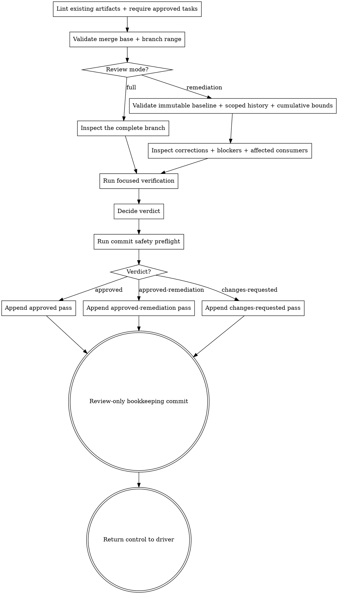

# Reviewing the whole branch

Review the complete branch as the final inspection gate before finish-work. This skill is pipeline
step 5. It judges how all implemented tasks compose across the repository; it is never a task-diff
review.

The **seven-stage core pipeline** is Kepler's fixed spec-driven sequence: init → propose → plan → code →
code-feedback → review → finish-work. Wayfinder and `kepler-critique` are optional and remain
outside the seven-step core count.

**Judge, do not fix.** Inspect and report. Never modify implementation, tests, proposal artifacts,
the plan, or task state while performing whole-branch review.

## Inputs

Every invocation supplies only the complete branch change from its merge base through current
`HEAD` and a whole-branch evidence package containing:

- The full merge base and head commit identifiers and an explicit full target branch reference.
- The requested review mode: `full`, or `remediation` with the named modern full-review baseline pass and its artifact-only commit.
- The change directory path.
- The change-level proposal, requirements, design, plan, and root task ledger that exist.
- Every active task's latest implementation attempt and feedback concerns. Older attempts or
  feedback passes may be opened only when the latest evidence identifies a concrete historical
  question.
- The complete branch diff from the supplied merge base through the supplied head.
- Project standards from `AGENTS.md` or its repository equivalent.

The supplied base, head, and target define one stable review range. Require full identifiers and
resolve only the explicitly supplied target; never infer a default branch. Compute the actual merge
base with `git merge-base` against that target and current `HEAD`; the supplied base must equal it
exactly. Merely being an ancestor of the head is insufficient. Also require the head to be an
ancestor of current `HEAD` before inspection. Stop if the target cannot be resolved or any range
check fails.

## References

This skill ships with its own `references/code-quality.md`. Read it from this skill directory and
apply its integration, omission, and affected-consumer rubric to the whole branch in `full` mode.
In `remediation` mode, apply that rubric to the cumulative correction delta and affected consumers
while verifying retained full-review coverage; do not perform a second full inspection.

## Generation preflight

Run this no-write gate before whole-branch scope inspection, range validation, or verdict mutation.
A change directory with no `plan.md` is `pre-plan`, not legacy; stop because no planned branch can
enter final review, but do not classify or scaffold it as an unsupported generation.

Once `plan.md` exists, run `kepler workbench lint --change-dir <change-dir>` before
interpreting the existing artifacts. Its exit status alone determines their format and schema
validity. Do not reject a lint-valid root `<change-dir>/progress.md` for frontmatter, extra
content, or failure to match a skill-specific task-only layout; only lint can classify an
artifact as `legacy-unsupported`. On nonzero lint, report its findings and do not write review.

Require the root task ledger and each active task's `tasks/task-N/progress.md` as review inputs.
If any is absent, stop and name the missing evidence; lint does not check absent files. Check
that task identities agree with the plan, without treating an alternative lint-accepted layout
as an invalid artifact. Then require every active task's `feedback.md` as review-ready evidence,
require every active task to have root status `done`, and require durable approved feedback. For
each exact `tasks/task-N/feedback.md` path, require all of the following from repository state:

- the feedback path is tracked at current `HEAD`, with
  `git ls-files --error-unmatch -- <feedback-path>` succeeding and the path present in the `HEAD`
  tree;
- the feedback path's index entry is unchanged from current `HEAD`, with
  `git diff --cached --quiet HEAD -- <feedback-path>` succeeding;
- the feedback path's worktree content is unchanged from the index, with
  `git diff --quiet -- <feedback-path>` succeeding;
- the latest commit that touched the feedback path is artifact-only, and the commit's path list
  contains only `tasks/task-N/feedback.md`;
- lint accepts the feedback artifact; the physical last pass belongs to this task, says
  `approved`, has no blocking findings, and its reviewed Git range is fresh for the latest
  commit that touched that task's progress file.

Missing feedback is a valid lifecycle state rather than a legacy format. A worktree-only approval
is interrupted-before-feedback-commit state. An untracked or modified feedback path fails this
preflight. Evaluate index and worktree divergence independently: a staged feedback blob that
differs while the worktree matches `HEAD` must fail the index condition. A mixed feedback commit
also fails. Stale feedback, feedback rejected by lint, and
`changes-requested` feedback also fail it. Stop without creating, appending, changing, or writing
`review.md`; direct the caller back to `kepler-code-feedback` for the affected task. Only durable
approved feedback for every active task may continue to branch inspection, range validation, or
review mutation.

An absent root `review.md` is also a valid creation-time state; the first successful whole-branch
pass creates it. Only after this preflight succeeds may the whole-branch scope and range checks
below run.

## Wrong scope

A task-scoped invocation, `Task N` identity, task-only diff range, arbitrary ancestor, task
checkpoint, missing whole-branch range, or mixed-scope package is wrong scope. An arbitrary
ancestor or task checkpoint remains wrong even when it is an ancestor of the supplied head. Stop
without recording a verdict or changing any artifact. For task-scoped review, direct the caller to
`kepler-code-feedback`.

## Review modes

`full` is the default and required for the first whole-branch pass. It inspects the complete branch
and repository as described below and records `Scope: full` plus the explicit `Target`.

`remediation` is available only after a valid full `changes-requested` pass with pass-local full
scope and target. Keep that original pass immutable. Name its pass number, reviewed Head, and the
artifact-only commit that contains it. Verify the commit and unchanged pass text before inspecting
the cumulative correction delta from that Head through the supplied current Head. Read all
outstanding findings from the full baseline and every scoped suffix pass, all appended remediation
task evidence, approved intent, and every changed correction path. Independently inspect each
correction and its affected consumers/invariants. Do not reopen unrelated preferences or claim a
second full inspection. Fall back to `full` if the baseline or target is invalid, reviewed commits
were amended, approved intent changed, a material correction path cannot be classified, or the
delta's integration impact cannot be bounded.

A scoped pass records `Scope: remediation`, the exact `Target`, `Parent pass`, `Parent commit`,
`Delta base` equal to the retained full pass Head, and `Resolutions` using the exact grammar below.
An approval covers the exact unique set of blocking finding IDs from the full baseline and scoped suffix,
including previously resolved blockers. A requested pass records only resolutions already checked and
keeps unresolved or new blockers in Blocking. Keep the same full baseline for later scoped passes and
inspect the cumulative correction delta each time. A new scoped pass cannot revive an older approval.
Resolve every historical scoped Head and require it to lie between the retained full Head and the
latest reviewed Head on the current branch. Compare every committed scoped pass body with retained
reachable history, including deletion/restoration and intermediate rewrites. Missing, damaged or
changed history requires full fallback or owner repair, never omission of a blocker.

## Whole-branch inspection

For a full pass, the complete branch diff is the starting evidence, not the inspection boundary.
Every full pass must inspect the broader repository for:

- affected consumers of changed interfaces and the assumptions those consumers still make;
- cross-task composition and integration, including invariants that isolated tasks could satisfy
  while their combined behavior violates the design;
- requirement and design completeness;
- missing material changes, including behavior, tests, specifications, maps, skills, templates,
  scripts, and documentation that should have changed but do not appear in the diff;
- scope and boundary violations, unrelated edits, stubs, dead code, debug output, weakened tests,
  and forbidden paths.

Search outward from each changed contract and stated assumption until all plausibly affected
repository consumers are accounted for. Inspect both positive changes and relevant absences. When
a finding's changed cause and affected location differ, identify both locations precisely.

## Focused verification

Evaluate every task's implementation evidence and the adequacy of changed tests. Run a command only
when inspection raises a concrete behavioral doubt, and then run the narrowest focused test or
check that resolves that doubt. Record the command and result in the pass.

Never run the full test suite as a routine review step. Never run the build as a routine review
step. If no concrete doubt remains, perform no execution. `kepler-finish-work` owns mandatory full
verification, including the full suite and build, after review approval.

## Process

1. Run the generation preflight and stop without inspection or writes unless it succeeds.
2. Validate that the input is a complete whole-branch package and reject wrong scope before any
   inspection or write.
3. Resolve only the explicitly supplied target branch, compute its actual merge base with current
   `HEAD`, require the supplied base to equal it exactly, and validate the full head identifier and
   ancestry.
4. Select the declared mode. For `full`, read the complete branch diff first and inspect broader
   repository impact. For `remediation`, verify the immutable full baseline, retained scoped history
   and cumulative correction delta before inspecting corrections; do not repeat a full inspection.
5. Read the supplied change artifacts, root ledger, applicable task evidence, project standards and
   local rubric. Trace changed contracts and assumptions through affected consumers/invariants.
   In full mode, inspect cross-task composition, requirements, design, tests, security, idioms,
   structural quality, omissions, scope, hygiene and boundaries across the complete branch.
6. In remediation mode, check every baseline/suffix blocker, located resolution evidence and any
   required numbered remediation tasks with current approved feedback. An evidence-gap-only case
   may use independently checked located evidence on the unchanged range without inventing tasks.
   Resolve a concrete doubt with focused verification only when warranted.
7. Check every binding requirement and design decision against the branch and broader repository
   for full mode, or verify retained coverage and correction boundaries for remediation mode.
   Classify findings before freshness routing: code-defect to numbered re-plan, evidence-gap to
   located-evidence adjudication, intent-defect to proposal revision. Unchanged inputs do not
   justify an identical automated retry.
8. Decide `approved`, `changes-requested`, or `approved-remediation` under the mode-specific rules.
   Inspect the index through the commit safety preflight before mutating root `review.md`.
9. Append one complete pass to root `review.md`.
10. Make the path-limited artifact-only bookkeeping commit. Verify the committed path list and
    preservation of the pre-existing staged state before handoff.

## Review dimensions

Apply these dimensions across the complete branch in full mode. In remediation mode, verify retained
coverage and inspect the cumulative corrections and affected consumers against these dimensions;
do not reopen unrelated full-review preferences.

- **Correctness:** The whole branch satisfies every binding requirement and scenario, including
  failure paths and edge cases.
- **Composition:** Independently implemented tasks preserve shared invariants and work together in
  the order and combinations the system permits.
- **Affected consumers and assumptions:** Every unchanged consumer of a changed interface remains
  correct, and repository assumptions agree with the new behavior.
- **Completeness and omissions:** All required application, test, specification, map, skill,
  template, script, and documentation changes exist, including material changes absent from the
  diff that the implementation makes necessary.
- **Tests:** Changed tests assert observable behavior, existing coverage remains meaningful, and
  the accumulated task evidence supports the branch without weakened or deleted tests.
- **Security:** The complete change introduces no secret, unsafe input handling, injection path,
  privilege error, or sensitive output.
- **Idioms and standards:** Naming, structure, error handling, and style follow project standards.
- **Structural quality:** The branch satisfies the local whole-branch rubric across both changed
  code and affected consumers.
- **Scope, hygiene, and boundaries:** The branch contains no unrelated edits, stubs, dead code,
  TODOs, debug output, commented-out blocks, generated accidents, or forbidden changes.

Every finding identifies the exact file and location, explains the defect and required correction,
cites the violated criterion or standard, and identifies the changed cause separately when the
affected location is unchanged. Suggestions are optional improvements and never conceal an
unresolved requirement.

## Verdicts

For a full pass, use `approved`, `changes-requested`, or `skipped`. A historical `skipped` pass
is not an approval. Use `approved` only when the complete range is valid and fresh, every binding
criterion is satisfied, broader repository impact is accounted for, and Blocking contains no
findings. Use `changes-requested` for any blocking correctness, composition, affected-consumer,
omission, test, security, standards, structural, scope, hygiene, or boundary defect.

For remediation mode, use `approved-remediation` only when every outstanding blocker is
independently resolved, every correction path is classified, any required numbered remediation tasks
have passed ordinary code and feedback gates, retained full-review coverage remains valid, and changed
consumer/invariant effects are bounded. Otherwise use `changes-requested` and record remaining or
new blockers. An approved verdict with blockers is contradictory. Metadata such as `decision:
applied` never clears a review.

Classify each Blocking finding as `code-defect`, `evidence-gap`, or `intent-defect`, and assign a
stable `pass-N-blocking-M` identity at first occurrence. Preserve both identity and kind when
carrying a finding forward. A kind guides routing; it does not change the verdict. If a legacy
finding is untyped or its identity is unclear, classify it before remediation and do not invent a
code defect.

## Commit safety preflight

Immediately before any create, append, change, write, or other mutation of root `review.md`, inspect
the repository index with `git diff --cached --name-only --` and preserve the exact staged diff as
reported by `git diff --cached --binary --` as read-only comparison evidence. A pre-staged production
path does not belong to this verdict commit. A pre-staged change-artifact path unrelated to this
review receives the same protection. If root `review.md` itself was already staged before this pass,
stop without mutating it because its staged content cannot be attributed safely to the current
verdict.

Never unstage, reset, restore, overwrite, or otherwise alter pre-existing staged work. Keep its
index state intact through artifact authoring and the path-limited commit below. If the initial
staged state cannot be identified exactly, stop before review mutation rather than risk absorbing
or destroying unrelated work.

## Review artifact

Write only `<change-dir>/review.md`. Load the exact installed
`${XDG_CONFIG_HOME:-$HOME/.config}/vialactea-works/kepler/templates/review.md` template on every pass. When the file does not exist, instantiate
a complete copy with the change title, current date, next pass number, full reviewed identifiers,
verdict, decision, and findings. Populate the artifact frontmatter fields `created`, `status`,
and `decision`; frontmatter contains only artifact identity and lifecycle fields. Remove the
opening instruction block and every inline hint while substituting placeholders; neither authoring
instructions nor hints may survive in the live artifact.

When the file exists, use the successful preflight lint result as its format validation, then
use the cleaned record portion of that same installed template to append the next-numbered pass
at the physical end. Preserve the heading and every prior pass. Each pass contains exactly one full
`Base:`, `Head:`, and `Verdict:` field, followed by `Scope:` and `Target:`. A remediation pass also
contains `Parent pass:`, `Parent commit:`, `Delta base:`, and `Resolutions:` in that order before
exactly the two child sections, `### Blocking` and `### Suggestions`. Retained template
authoring markup is not a reason to reject a lint-valid history; no recorded pass may be changed,
deleted, reordered, or split. Never rewrite a prior pass. No `### Reviewed range` heading or other
child heading is allowed; Base and Head are the only per-pass range fields. Populate every
template-defined value. An approval has no blocking findings
and may briefly record useful verified coverage as a suggestion; both findings groups remain
present. Record any focused command and result without changing the template-defined shape. Every
pass records full identifiers, never abbreviated commit ids. Append to the one `review.md` history
only; never create `review-<k>.md`.

`Resolutions:` must be a single-line JSON array, not prose, YAML or multiline JSON. Each entry has
exactly the keys `finding`, `evidence`, and `verification`: `finding` is a stable `pass-N-blocking-M`
string, `evidence` is a nonempty array of nonempty located-evidence strings, and `verification` is a
nonempty string describing the independent check and observed result. Preserve whole path strings,
including spaces. For `approved-remediation`, cover the exact unique ID union from the full baseline
and scoped suffix, including earlier resolved blockers; do not duplicate, omit or invent IDs.
Check each location and result independently. The example defines syntax, not authority or approval:

```text
Resolutions: [{"finding":"pass-1-blocking-1","evidence":["src/file name.ts","tests/report.test.ts:12"],"verification":"Focused consumer test passed; log: .kepler/notes/correction-check.md"}]
```

For `changes-requested`, retain unresolved/new blockers and list only checks already performed;
use `Resolutions: []` if none are discharged. An entry is not permission to erase historical text.

When creating a review file, use identity and lifecycle-only frontmatter with complete
pass-local Base, Head, Verdict, Scope, and Target fields; existing lint-valid extra metadata is not a blocker.
The first append to a legacy-global history has one deterministic transition:
validate the legacy-global history, preserve every existing pass body byte-for-byte, remove exactly
the global `base`, `head`, and `verdict` fields, and append the next complete pass-local record at the
physical end in the same mutation. Never copy global provenance into historical passes. Never retain
global provenance beside an explicit suffix. A fieldless prefix followed by an explicit suffix is
already transitioned, including the already-migrated root-review shape, so append normally to that
suffix; modern all-explicit history also appends normally. Fail closed for partial globals, mixed
global-plus-explicit evidence, missing legacy globals without an explicit suffix, or any fieldless
pass after the explicit suffix. Never create `review-<k>.md`.

For freshness, the latest material change commit is the latest current-branch commit touching any
tracked path except the change's root `progress.md`, `tasks/task-N/progress.md`,
`tasks/task-N/feedback.md`, root `review.md`, and root `finish.md`. Proposal, requirements, design,
plan, canonical specs, maps, application code, tests, skills, templates, scripts, and documentation
remain material even when their paths are under `.kepler/`.

The physically last pass governs whole-branch status. Use lint for its artifact format,
numbering, fields, and findings; a successful lint is not subject to a second shape check. Verify
that its base is an ancestor of its head, its head is an ancestor of current `HEAD`, and its head
contains the latest material change commit. Never scan backward or fall back to an earlier
approval. Do not rewrite, delete, reorder, or insert before an existing pass except for the
documented legacy-global transition.

## Record and commit

After appending the complete pass, run
`kepler workbench lint --file <change-dir>/review.md` before staging or committing. A nonzero
lint result is a failed gate: resolve the finding and rerun lint, or report its exact blocker
without staging, committing, or handing off. Then stage only root `review.md`. Create an
artifact-only bookkeeping commit with the exact path-limited invocation
`git commit --only -- <change-dir>/review.md`. Do not use an unrestricted commit. Commit no code or task artifact. After
the commit, verify that its path list contains only root `review.md`; if it includes any other path,
stop and report the invalid commit rather than advancing. Also compare the index with the
safety-preflight evidence and require every pre-existing staged path to remain staged and unchanged.
Never use destructive unstaging to make either check pass.

Never write root `<change-dir>/progress.md`. Never write task-local progress or feedback. Never
change a task implementation status. Whole-branch verdict history belongs only in root `review.md`.

## Output and handoff

Return the change identity, full reviewed Base and Head, verdict, blocking count, suggestion count,
and review commit identifier. Do not create a separate detailed report.

For `approved` or `approved-remediation`, return control to the driver so it can invoke
`kepler-finish-work`. For `changes-requested`, return the complete classified finding set before
freshness routing. Route each code-defect through `kepler-plan` re-plan into numbered remediation
tasks; each independently verifiable code correction receives its own code and code-feedback cycle.
Route an evidence-gap to independent adjudication of located evidence on the unchanged material range,
without inventing code or tasks. Preserve the finding until the evidence discharges it; unchanged
code, evidence, external conditions and protocol inputs do not justify an identical review retry.
Route an intent-defect that invalidates an approved requirement or design to `kepler-propose` for
revision and requester approval. Adjudicate ambiguous legacy kinds before choosing a route.
Never send whole-branch findings directly to `kepler-code`; never invoke another pipeline skill yourself.

## Process flow



Return the full reviewed Base and Head, verdict, blocking count, suggestion count, any focused
verification performed, and the review commit identifier.

On `approved` or `approved-remediation`, return control to the driver for `kepler-finish-work`.
On `changes-requested`, preserve the complete classified finding set and use the kind-specific
handoff above: numbered code remediation, located-evidence adjudication, or approved intent revision.
No identical retry follows unchanged inputs. Never send whole-branch findings directly to
`kepler-code`, and never invoke another pipeline skill yourself.
