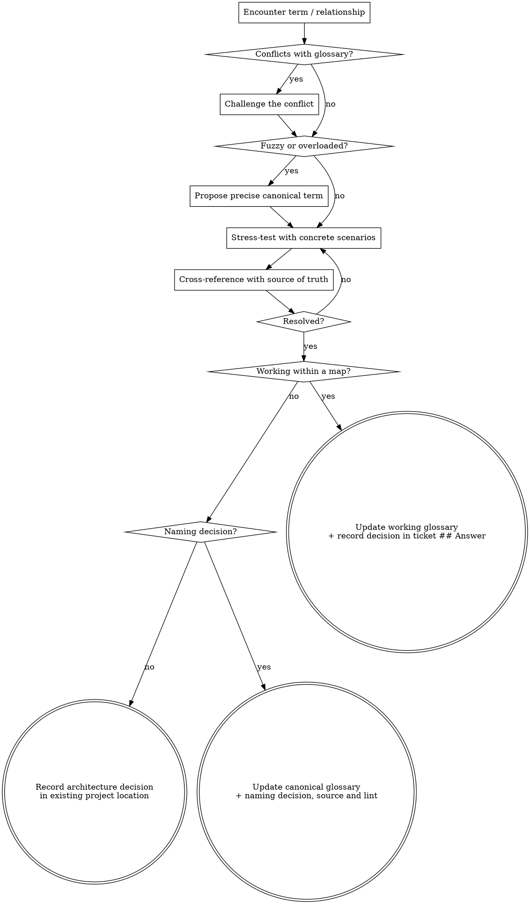

# Domain Modeling

Build and sharpen the project's domain model as you design: challenge terms, invent edge-case scenarios, and record glossary entries and decisions as they crystallise. Before writing or updating the glossary, read the canonical `.kepler/specs/glossary.md` for the project's committed language. When working within a map, also read that map's working `glossary.md` for the effort's in-progress terms. You cannot sharpen a model without reading its language. Use this skill to change the model, not just consume it.

## File structure

Most repos working a single map:

```
.kepler/
├── specs/
│   └── glossary.md
└── maps/
    └── <effort>/
        ├── map.md
        ├── glossary.md
        └── tickets/
            ├── 01-event-sourced-orders.md
            └── 02-postgres-for-write-model.md
```

When several efforts are worked against a single canonical glossary:

```
.kepler/
├── specs/
│   └── glossary.md                    ← canonical language
└── maps/
    ├── ordering/
    │   ├── glossary.md                ← working language
    │   └── tickets/                   ← decisions
    └── billing/
        ├── glossary.md
        └── tickets/
```

`kepler-init` creates or preserves the canonical glossary at `.kepler/specs/glossary.md`. Create working glossaries and tickets lazily, only when there is resolved language or a decision to record. The canonical glossary is the main source of context-scoped language; each map's working glossary holds only that effort's proposed meanings. Read only the current effort's working language, never another effort's glossary. Outside a map, update the canonical glossary only after explicit requester resolution; do not create a map merely to record a term. A map decision belongs in the resolving ticket's `## Answer`.

## Artifact validation

The canonical glossary is an author-bearing requirements-spec, and a resolving ticket is a recognized Kepler artifact. After each canonical glossary or ticket mutation, run the matching file-scoped command: `kepler workbench lint --file <spec-path>` for `.kepler/specs/glossary.md` or `kepler workbench lint --file <ticket-path>` for `.kepler/maps/<effort>/tickets/NN-slug.md`. A working map glossary is not a recognized artifact and is not linted. A nonzero lint result fails the gate: resolve the finding and rerun lint, or report the exact blocker without handing off or committing. The gate runs before handoff or commit.

When creating the canonical glossary, read `git config user.name` and `git config user.email` and record `author: Name <email>` in its frontmatter. If either identity value is missing, stop and report it instead of inventing attribution. Preserve the recorded author exactly when editing an existing canonical glossary.

## During the session

### Challenge against the glossary

Compare meanings within the named bounded context. The same word may legitimately have different meanings in different contexts; identify its scope and any translation first. If a meaning conflicts with canonical or current-effort language in that context, surface the conflict immediately and get explicit requester resolution rather than silently replacing the established definition.

### Sharpen fuzzy language

When the user uses vague or overloaded terms, propose a precise canonical term. "You're saying 'account' — do you mean the Customer or the User? Those are different things."

### Discuss concrete scenarios

When discussing domain relationships, stress-test them with specific scenarios. Invent edge-case scenarios that force the user to clarify boundaries between concepts.

### Cross-reference with the source of truth

When the user states how something works, check it against the artifact of record — the codebase, existing deck, prior published docs, or data. Surface contradictions: "Your code cancels entire Orders, but you just said partial cancellation is possible — which is right?"

### Update the glossary inline

When a term is resolved in a map, update that map's working glossary immediately with its context, source and relevant aliases. Use [GLOSSARY-FORMAT.md](references/GLOSSARY-FORMAT.md). The Wayfinder closing act promotes confirmed meanings into the canonical glossary; a newer working term cannot silently supersede committed language. Outside a map, record requester-confirmed meanings directly in the canonical glossary, preserve author attribution and run file-scoped lint. Leave unresolved or conflicting proposals outside canonical entries.

The glossary contains vocabulary only. Its requirements-spec metadata is a lint envelope, not an invitation to add application behavior, code or implementation decisions. Keep definitions and their sources distinct from unresolved working questions and architectural decisions.

### Record decisions

Within a map, record every decision in the resolving ticket's `## Answer`. Outside a map, record confirmed naming decisions in the canonical glossary's `## Decisions`, including context, requester resolution and source; link the affected term's Source field to that record. Keep architectural decisions in the existing project decision location, not in the glossary. If that location or its owner is unknown, ask before writing; do not manufacture a map or ticket merely to record terminology. Glossary and recognized ticket mutations follow the same scoped lint and attribution rules; other project decision records follow project standards.

Record the full reason, context and alternatives in the applicable decision record if any of these conditions holds:

1. **Hard to reverse** — changing the decision later carries a meaningful cost.
2. **Surprising without context** — a future reader will wonder "why did they do it this way?"
3. **The result of a real trade-off** — there were genuine alternatives and you picked one for specific reasons.

Even when none holds, record at least one line of alternatives — "chose X over Y because Z". A verdict alone is reserved for decisions with no real alternative.

## Process flow


