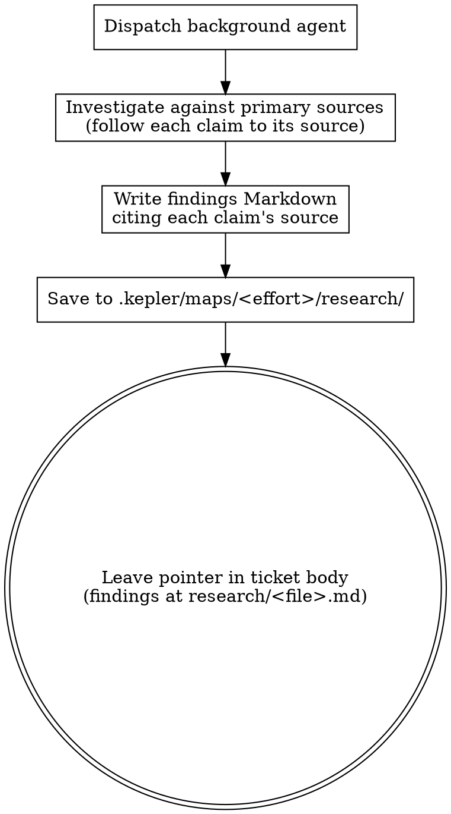

Dispatch a **background agent** to research while you keep working.

Its job:

1. Investigate the question against **primary sources** — official docs, source code, specs, first-party APIs — not secondary write-ups. Trace each claim to the source that owns it.
2. Write the findings in one Markdown file; cite the source for each claim.
3. Save it under `.kepler/maps/<effort>/research/`; `<effort>` names the current map. Research notes are unrelated outputs and remain outside lint scope; do not lint the research file.
4. If the resolving ticket is edited to leave a pointer in its body — `findings at research/<file>.md` — run `kepler workbench lint --file <ticket-path>` immediately after the mutation. A nonzero lint result is a failed gate: resolve the finding and rerun lint, or report the exact blocker. The latest successful lint is required before handoff or commit. If the ticket is not edited, no Kepler lint is needed.

## Process flow

